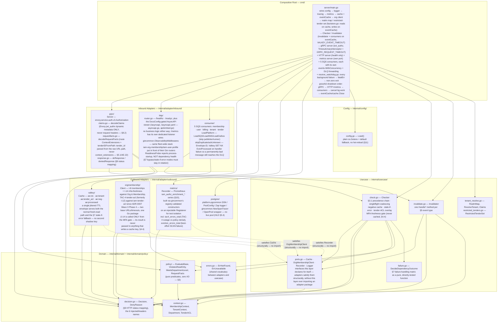
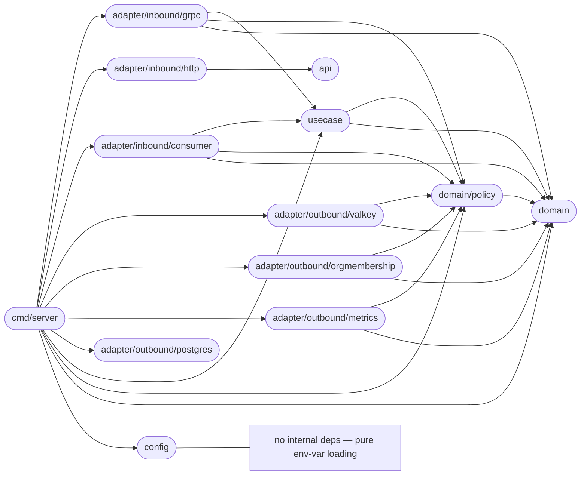
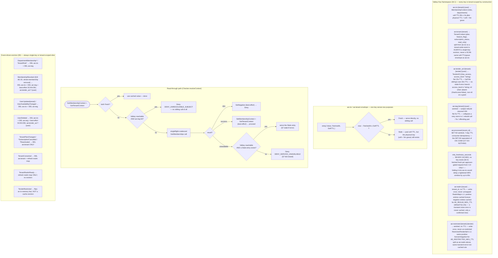
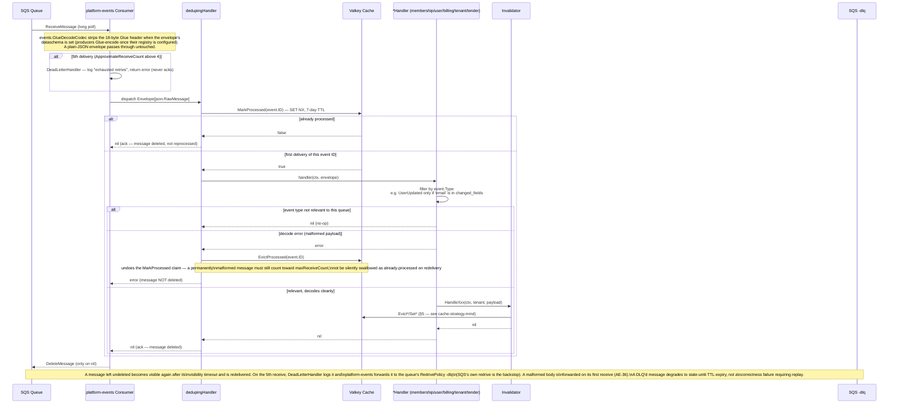
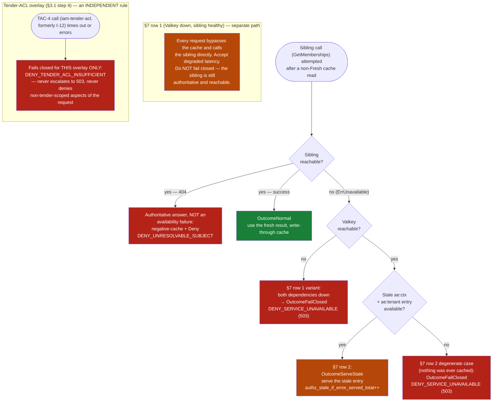
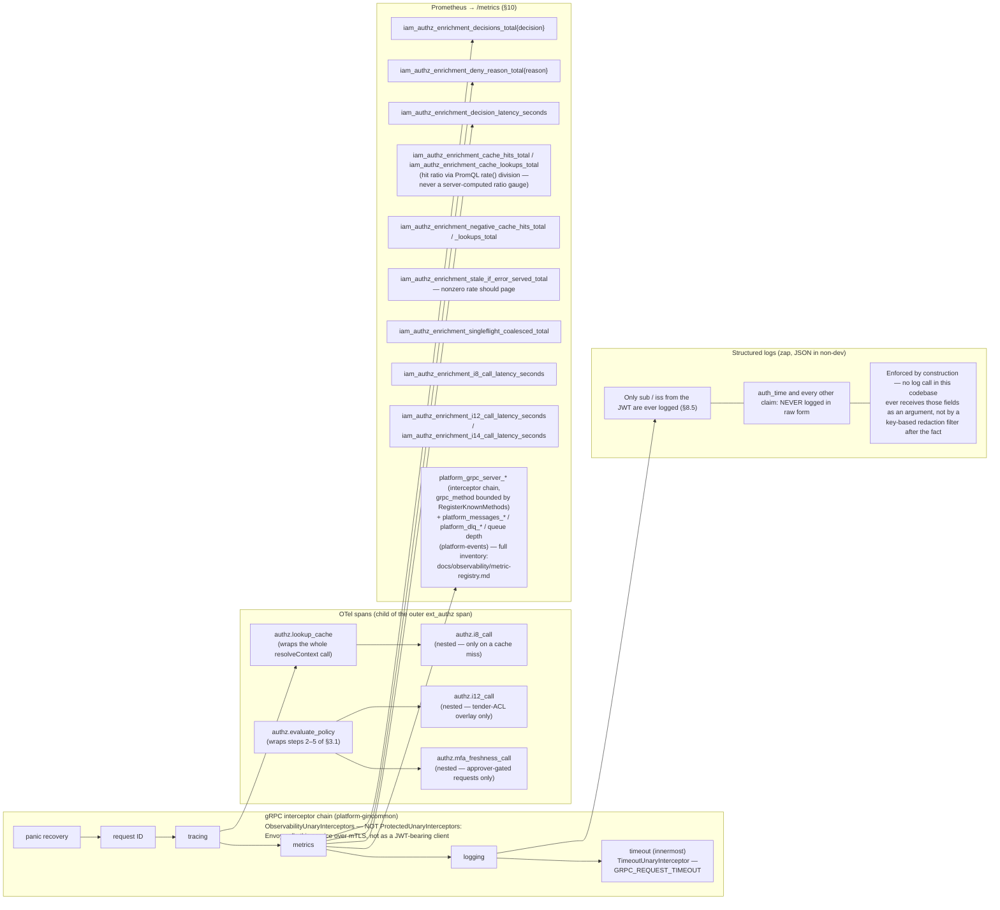

# Architecture

This document describes the internal structure, dependency rules, and runtime data flows of `iam-authz-enrichment`.

`iam-authz-enrichment` is a **private, stateless Go service** (`github.com/BCBP-SOLUTIONS-FZC-LLC/iam-authz-enrichment`, Go 1.26.9+) deployed as a containerised microservice (5–20 replicas, HPA on RPS). It implements Envoy's `ext_authz` v3 gRPC interface — the Policy Decision Point for every authenticated request on the platform. It owns no durable database: it is a Valkey-backed read-through cache in front of the Org & Membership service, plus policy logic expressed as plain Go predicate functions (no OPA/Rego, §3).

---

## Layer model

The service is organised in concentric Clean Architecture layers. Inner layers have **zero knowledge** of outer layers; dependencies always point inward.

> Source: [`docs/architecture/mermaid/layer-model.mmd`](docs/architecture/mermaid/layer-model.mmd)

**Rule:** `domain` ← `policy` ← `usecase` ← `adapter` ← `cmd`. Outbound adapters (`valkey`, `orgmembership`, `metrics`, `postgres`) depend only on `domain`/`policy` — they **never** import `usecase`, even though they implement interfaces `usecase/ports.go` declares. That inversion is the whole point: `usecase` owns the contract, adapters satisfy it structurally. Enforced in CI by three complementary gates:

1. **`go-arch-lint check --project-path .`** against `.go-arch-lint.yml` — enforces the inward-only import direction between layers.
2. **`make observability-lint`** (`.github/scripts/check-observability-routing.sh`) — enforces that all logs, metrics, and traces pass through `platform-gincommon` only: no direct `go.uber.org/zap`, no `prometheus.MustRegister` outside the gincommon registerer, no `otel.SetTracerProvider` in application code, no bare `http.DefaultTransport` without `otelhttp` wrapping.
3. **`make database-lint`** (`.github/scripts/check-database-routing.sh`) — enforces that all DB connections, config, and operations pass through `platform-pgcommon` only: no raw `pgxpool.New`/`pgx.Connect`, all DSN assembly via `pgcommon.ConfigFromEnv`, `OpenPool` is the only pool constructor, and `cmd/server` never calls `NewPool`/migrate/outbox (HLD §5.4 — no schema).

`postgres` is config-only (no usecase port): it wraps `platform-pgcommon` so a future schema cannot bypass it with a raw `pgxpool`.

---

## Package dependency graph

Arrows represent Go `import` relationships (module-internal only) — this is the literal shape `.go-arch-lint.yml` enforces.

> Source: [`docs/architecture/mermaid/package-dependencies.mmd`](docs/architecture/mermaid/package-dependencies.mmd)

`domain` is the dependency sink — it imports nothing from this module (`internal/domain/errors.go`, `decision.go`, `context.go`). `domain/policy` imports only `domain`. `config` imports nothing internal at all. `api` (the embedded `api/asyncapi.yaml`, via `api/embed.go`) is a second, unrelated leaf — a pure `//go:embed`'d `[]byte` with zero internal imports of its own; `http` is the only package that depends on it, to serve the spec at `/asyncapi`/`/asyncapi.yaml` (`internal/adapter/inbound/http/asyncapi.go`).

---

## Request flow

Every `Check()` call evaluates the §3.1 precedence chain in a fixed order — **the first failing check wins**, never whichever branch a given code path happens to reach first.

> Source: [`docs/architecture/mermaid/request-flow.mmd`](docs/architecture/mermaid/request-flow.mmd)

```mermaid
sequenceDiagram
    participant Envoy
    participant Server as grpc.Server
    participant Checker
    participant Cache as Valkey Cache
    participant Org as Org & Membership
    participant TenderACL as iam-tender-acl
    participant Policy as domain/policy

    Envoy ->> Server: Check(CheckRequest)
    Note over Envoy,Server: jwt_authn already validated the JWT — Server never<br/>re-validates it, and never reads request headers for identity (§8.2)

    Server ->> Server: decodeClaims(MetadataContext)<br/>decodeRequestFacts(ContextExtensions + tender_id from URL path)

    Server ->> Checker: Check(CheckInput)
    Note over Server,Checker: always handed to Checker — even with no subject — so every<br/>decision is timed and counted in decisions_total / deny_reason_total

    alt claims.Subject is empty
        Checker -->> Server: Denied — DENY_MALFORMED_IDENTITY (401)
        Note over Checker: §8.1 — first check in Checker.check, before tenant resolution
    else subject present
        Checker ->> Checker: ResolveTenant(claims, realmMap, sharedRealmIssuer)

        alt iss matches neither a dedicated realm nor the shared realm
            Checker -->> Server: Denied — DENY_MALFORMED_IDENTITY (401)
        else tenant resolved
            Checker ->> Cache: GetMembershipContext + GetTenantContext

            alt both Fresh
                Cache -->> Checker: cached MembershipContext + TenantContext
            else miss, stale, or Valkey unreachable
                Cache -->> Checker: Miss / Stale / connection error

                alt Valkey reachable and ae:neg hit
                    Checker -->> Server: Denied — DENY_UNRESOLVABLE_SUBJECT
                    Note over Checker,Cache: §4.3 — collapses the repeat rebuild call<br/>without ever calling Org & Membership
                else no negative-cache short-circuit
                    Checker ->> Org: GetMemberships(tenant, user)
                    Note over Checker,Org: singleflight-coalesced — concurrent callers<br/>for the same (tenant,user) share one call (§4.5),<br/>run on context.WithoutCancel so one cancelled caller<br/>can't fail the rest (bounded by ORG_MEMBERSHIP_TIMEOUT)

                    alt 404 (ErrNotFound)
                        Org -->> Checker: not found
                        Checker ->> Cache: SetNegative (best-effort)
                        Checker -->> Server: Denied — DENY_UNRESOLVABLE_SUBJECT
                    else success
                        Org -->> Checker: MembershipContext + TenantContext
                        Checker ->> Cache: SetMembershipContext + SetTenantContext (best-effort)
                    else unreachable (ErrUnavailable)
                        Org -->> Checker: unavailable
                        Checker ->> Checker: DecideDependencyOutcome (§7)
                        alt Valkey reachable and a Stale entry exists
                            Checker ->> Checker: serve the Stale entry
                            Note over Checker: iam_authz_enrichment_stale_if_error_served_total++ —<br/>nonzero rate should page (§10)
                        else nothing to fall back on
                            Checker -->> Server: Denied — DENY_SERVICE_UNAVAILABLE (503)
                            Note over Checker,Server: 5xx, not 403 — distinguishes a degraded<br/>authz system from a genuine not-authorized answer (§9)
                        end
                    end
                end
            end

            Note over Checker,Policy: §3.1 precedence — first failing check wins
            Checker ->> Policy: ViolatesReadOnly(tenant.ReadOnly, mutation)
            alt read-only tenant + mutation method
                Checker -->> Server: Denied — DENY_TENANT_READ_ONLY
            else
                Checker ->> Policy: EvaluateBase(subject, membership, request)
                alt base policy fails
                    Checker -->> Server: Denied — DENY_ROLE_INSUFFICIENT
                else base policy allows
                    opt tender-scoped and flagged restricted
                        Checker ->> Cache: GetTenderACL
                        alt cache miss
                            Checker ->> TenderACL: GetTenderACL(tenant, tender, user)
                            TenderACL -->> Checker: grant or ErrUnavailable
                            alt call fails
                                Checker -->> Server: Denied — DENY_TENDER_ACL_INSUFFICIENT
                                Note over Checker: §7 row 4 — fails closed for THIS<br/>overlay only, never 503
                            end
                            Checker ->> Cache: SetTenderACL (best-effort, 15s TTL)
                        end
                        alt grant insufficient for the required level
                            Checker -->> Server: Denied — DENY_TENDER_ACL_INSUFFICIENT
                        end
                    end
                    opt action requires approver level
                        Checker ->> Org: GetMFAFreshness(tenant)
                        Note over Checker,Org: I-14 — the ONLY caller of this endpoint —<br/>result is never written to any cache key (§4.4)
                        Org -->> Checker: freshness window (or an error)
                        alt call failed, or now − auth_time > window
                            Checker -->> Server: Denied — DENY_MFA_STALE
                        end
                    end
                    Checker -->> Server: Allowed + 6 trust-boundary headers
                end
            end
        end
        Server -->> Envoy: CheckResponse
    end
```

**Precedence order (§3.1) and status mapping (§9):**

| Step | Check | DenyReason | Status |
|------|-------|-----------|--------|
| 1 | Subject resolution (membership rebuild 404) | `DENY_UNRESOLVABLE_SUBJECT` | 403 |
| 2 | Subscription read-only enforcement | `DENY_TENANT_READ_ONLY` | 403 |
| 3 | Base role/department policy | `DENY_ROLE_INSUFFICIENT` | 403 |
| 4 | Tender-ACL overlay (only if step 3 allows, tender flagged restricted) | `DENY_TENDER_ACL_INSUFFICIENT` | 403 |
| 5 | MFA freshness gate (only if steps 1–4 allow, approver-gated) | `DENY_MFA_STALE` | 403 |
| — | Malformed identity (`iss` resolves to neither realm) | `DENY_MALFORMED_IDENTITY` | 401 |
| — | Both Valkey and Org & Membership unreachable | `DENY_SERVICE_UNAVAILABLE` | 503 |

The 401/503 rows are not numbered steps in §3.1 — they can short-circuit at any point identity or dependency resolution is evaluated, ahead of the five numbered policy steps.

---

## Cache strategy

All decisions read Valkey first. A single jittered-TTL envelope backs both the normal fresh-read path and the stale-if-error fallback — there is no second shadow key.

> Source: [`docs/architecture/mermaid/cache-strategy.mmd`](docs/architecture/mermaid/cache-strategy.mmd)

**Key invariants:**
- Every cache key and every outbound call is tenant-scoped by construction (§8.4) — there is no shared, unscoped namespace anywhere in this codebase.
- `mfa_freshness_seconds` is never written to any cache key this service owns — see the dedicated regression tests in `internal/domain/mfa_never_cached_test.go` and `internal/usecase/check_test.go`.
- A tenant-wide event (`TenantPlanChanged`, …) is always a single-key `DEL ae:tenant:{tenant}` — never a `SCAN`, because tenant-scoped facts are split into their own key from per-user membership facts.
- Jitter (±6s on the 60s `ae:ctx` TTL) desynchronizes expiry across replicas; `singleflight` desynchronizes concurrent callers against the same key at the moment it does expire. There is deliberately no cross-replica distributed lock (§4.5) — the sibling's own capacity headroom makes a worst-case simultaneous-expiry stampede a non-issue.
- `RealmMap`/`RestrictedTenderSet`'s L1 caches split positive and negative results asymmetrically: a positive result (realm mapped, tender restricted) is trusted forever, since neither fact is ever reversed by an event; a negative result is trusted only for `AE_REALM_NEG_TTL`/`AE_RESTRICTED_NEG_TTL` (default 5s each), so a replica eventually notices another replica's write to the shared L2 key without paying a Valkey round-trip on every request for an issuer/tender that has never resolved.
- A concurrent write landing in `RealmMap`/`RestrictedTenderSet`'s L1 map while a stale-negative L2 read is still in flight can never be clobbered back to negative — both `lookupStore` (tenant_resolve.go) and `IsRestricted` (restricted_tenders.go) re-check L1 for an existing positive entry immediately before writing their own result. See `TestRealmMap_ConcurrentSetDuringStaleLookup_DoesNotClobber` / `TestRestrictedTenderSet_ConcurrentMarkDuringStaleLookup_DoesNotClobber`.
- A transient L2 (Valkey) error is never cached as a confirmed negative on either of those two L1 caches — only a genuine "confirmed absent" result (no error) gets a negative TTL entry, so a single Valkey blip cannot extend itself into a multi-second window of wrongly-denied requests. See `TestRealmMap_StoreErrorOnGet_NotCached_RetriesNextCall` / `TestRestrictedTenderSet_StoreErrorOnGet_NotCached_RetriesNextCall`.

---

## Event flow

This service **consumes only** — it publishes nothing. Five SQS queues keep the cache honest; each queue's DLQ is its own RedrivePolicy target, and platform-events forwards poison messages there (LLD §16 AE-36). This section covers the dedup/handler mechanics — for the full per-queue event-type/effect tables, see [`README.md` § Event architecture](README.md#event-architecture) or [the LLD's §7.1–§7.9](docs/lld/iam-lld-authz-enrichment.md), including §7.8's AsyncAPI-contract reference and §7.9's `EVT-#` invariants.

> Source: [`docs/architecture/mermaid/event-flow.mmd`](docs/architecture/mermaid/event-flow.mmd)

**Consumed event types:**

| Queue | Event types | Effect |
|-------|-------------|--------|
| `membership-authz-q` | `DepartmentMembershipGranted/Revoked/LevelChanged`, `TenantRoleGranted/Revoked` | Evict `ae:ctx:{tenant}:{user}` + `ae:neg` |
| `membership-authz-q` | `MembershipRevoked` (§16 AE-20 — Org & Membership's per-user removal cascade signal) | Evict `ae:ctx` + `ae:neg` + best-effort `ae:tender_acl:*:{user}` — the only whole-membership-removal trigger; per-grant rows are left inert rather than individually revoked |
| `user-authz-q` | `UserUpdated` (email changes only), `UserAvailabilityChanged`, `UserDeleted` | Evict `ae:ctx` + `ae:neg`; `UserDeleted` also best-effort-evicts `ae:tender_acl:*:{user}` |
| `billing-authz-q` | `TenantPlanChanged`, `TenantSubscriptionCancelled`, `TenantReactivated` | Evict `ae:tenant:{tenant}` (single key) |
| `tenant-authz-q` | `TenantConverted`, `TenantRealmReady` | Refresh the in-process realm map; `TenantConverted` also evicts `ae:tenant` |
| `tender-authz-q` | `TenderRestricted` | Flip the in-memory restricted-tender fact — not a cache eviction |

`TenantSuspended` is deliberately not consumed anywhere — a suspended tenant's realm is disabled, so no new token is issued and the request never reaches this service.

**Why both `TenantConverted` and `TenantRealmReady` matter:** a tenant converting from shared-trial to dedicated fires `TenantConverted`. A tenant that signs up directly for a paid plan and gets a dedicated realm from day one fires *only* `TenantRealmReady`. Subscribing to just one leaves a real gap in the realm→tenant map.

---

## Failure handling

The §7 failure-handling matrix is implemented as one pure function — `usecase.DecideDependencyOutcome` — not scattered `if err != nil` handling through the request path. The tender-ACL overlay's fail-closed rule is deliberately independent of it.

> Source: [`docs/architecture/mermaid/failure-handling.mmd`](docs/architecture/mermaid/failure-handling.mmd)

**Failure domains:**

| Component | Failure mode | Impact | Fallback |
|-----------|--------------|--------|----------|
| **Valkey** | Unreachable, sibling healthy | Latency increases (every request calls the sibling) | Bypass cache, call sibling directly — never fail closed (§7 row 1) |
| **Org & Membership** | Unreachable, Valkey healthy | Serves stale data for up to the 5-minute grace window | `ae:ctx`/`ae:tenant` entries stay usable past their soft TTL (§7 row 2) |
| **Both Valkey and Org & Membership** | Unreachable | All requests denied | `DENY_SERVICE_UNAVAILABLE` (503) — distinct from a 403 so operators can tell "degraded" from "not authorized" |
| **iam-tender-acl — TAC-4 (tender-ACL, formerly Org & Membership's I-12) only** | Times out / errors | Only the tender-scoped aspect of the request is denied | `DENY_TENDER_ACL_INSUFFICIENT` — scoped to the overlay, never escalates |
| **Org & Membership — I-14 (MFA-freshness) only** | Times out / errors | Only approver-gated requests affected | `DENY_MFA_STALE` — fails closed; the client's remedy (re-auth) is the same as for a genuinely stale assertion |
| **One SQS queue / its DLQ** | Consumer or handler failure | That queue's cache facts go stale until the message is redelivered or DLQ'd | Forwarded to the queue's DLQ on the 5th delivery (platform-events, SQS redrive as backstop); degrades to "stale until TTL expiry", never a correctness failure requiring replay |
| **Org & Membership / iam-tender-acl — slow, not down** | Responds, but slower than the client timeout | A timed-out call is a deny or a stale answer, not a slow one | Timeouts sized above each sibling's own p99 target — `ORG_MEMBERSHIP_TIMEOUT` 40ms, `TENDER_ACL_TIMEOUT` 30ms — never below it; `GRPC_REQUEST_TIMEOUT` (250ms) caps a whole `Check` server-side when Envoy sends no shorter `grpc-timeout` (LLD §16 AE-37) |
| **Envoy cancels one request while others wait on the same cache miss** | The first singleflight caller's deadline fires | Previously every coalesced request for that `(tenant, user)` failed with it → `DENY_SERVICE_UNAVAILABLE` | The shared I-8 call runs on `context.WithoutCancel`, bounded by `ORG_MEMBERSHIP_TIMEOUT`; each caller keeps its own deadline afterwards (LLD rev 1.32) |
| **Valkey slow for a moment during event processing** | One round trip exceeds the request path's 10ms timeout | An eviction or `TenderRestricted` write fails and waits a full 30s visibility timeout — indefinitely wrong for `ae:restricted` (no TTL) | Consumers write through a second Valkey client (`Cache.WithTimeouts`, `VALKEY_EVENT_TIMEOUT` 500ms); `cmd/server/factstore.go` routes `SetRealm`/`SetRestricted` there while reads stay on the request client (LLD §3.4) |
| **OTel Collector** | Unreachable | Spans not exported | Metrics and logs unaffected; trace IDs still valid but not persisted |
| **Panic in `Check()`** | Any panic | The gRPC panic-recovery interceptor returns an error response | Recorded in metrics and logs; other in-flight requests unaffected |
| **A wedged Envoy connection / in-flight `Check()` during shutdown (SIGTERM)** | Deliberate shutdown, not a runtime dependency failure | Previously unbounded — `grpcServer.GracefulStop()` blocked until every connection drained, stalling every later shutdown step (HTTP shutdown, consumer drain, `cache.Close()`) | Bounded to 10s (`grpcGracefulStopTimeout`), falling back to a hard `Stop()` — the rebalanced shutdown budget (grpc 10s + HTTP/metrics 10s + consumer drain ~35s = 55s) fits `terminationGracePeriodSeconds` (60s) with a 5s margin (LLD §16 AE-33) |
| **Handler panic in a SQS consumer's `processedHandler`** | Any panic during event handling, after `MarkProcessed` already claimed the ID | Without recovery here, the idempotency marker stays permanently set — `ae:restricted` (no TTL, §8.5.1's overlay fact) is the highest-blast-radius case, since it never self-heals via TTL the way every other cache key does | `processedHandler` recovers, runs the same `EvictProcessed` cleanup the error path uses, then re-panics so `platform-events`' own top-level recovery still runs unchanged (LLD §16 AE-34) |

---

## Observability stack

Three signals per request: Prometheus metrics (synchronous), OpenTelemetry spans (async, OTLP export), and structured logs. All are keyed off the same gRPC interceptor chain.

> Source: [`docs/architecture/mermaid/observability-stack.mmd`](docs/architecture/mermaid/observability-stack.mmd)

**SLOs (§10):** decision latency p99 > 50ms for 5 min → SEV-2. Availability < 99.5% over 10 min → SEV-1. `iam_authz_enrichment_stale_if_error_served_total` at a nonzero rate means a live dependency outage is in progress — page on it directly rather than waiting for the SLO windows above to trip. These thresholds are validated against a single-machine, loopback-network `test/load` run only (README § Testing) — not yet measured against a real cluster/network path.

**Full metric inventory:** [`docs/observability/`](docs/observability/) — `metric-registry.md` (generated by `make metrics-inventory`, drift-checked by `make metrics-check` in CI) lists every `platform_*` series platform-gincommon/platform-events emit alongside the `iam_authz_enrichment_*` business series above; `runbooks.md` has per-alert triage. Alert rules live only in `deploy/monitoring/app-alerts.yml` (the Helm `PrometheusRule` is rendered from it by `make prometheusrule`, and both are promtool-tested in `deploy/monitoring/tests/`). Every observability entry point goes through `pkg/gincommon` — `InitTracingWithConfig` (same identity as the metrics config), `MetricsHandler`, `NewTracer`, `NewSpanTracer`, `InjectTraceContext` — no local tracer/propagator/`promhttp` copies.

**A gap Prometheus can't cover:** DLQ depth is a CloudWatch-native metric, and no application code ever reads a `-dlq` queue (see the "DLQ target is infra-owned" invariant above); `platform_dlq_messages_total` counts forwards, but nothing on `/metrics` says a message is still sitting there. `deploy/monitoring/dlq-alarms.tf.example` is the only alerting on a message actually landing in one; without it, a permanently-undeliverable message sits there unmonitored indefinitely. See `docs/runbook.md` for what to do when it fires.

---

## Key invariants

| Invariant | Where enforced |
|-----------|----------------|
| No JWT validation in this service — trust only Envoy-`jwt_authn`-validated claims (`sub`, `iss`, `tenant_id`, `auth_time`) | `internal/adapter/inbound/grpc/claims.go` reads only `Attributes.MetadataContext`, never `Attributes.Request.Http.Headers` |
| Client-supplied headers that shadow the six output headers are structurally impossible to leak through | `okResponse` builds headers exclusively from `Decision.Headers`, itself built only from cached/fetched domain data — see the header-spoofing regression test in `internal/adapter/inbound/grpc/server_test.go` |
| `mfa_freshness_seconds` is never cached | No field for it exists on `MembershipContext`/`TenantContext` (compile-time proof) + `internal/domain/mfa_never_cached_test.go` + `internal/usecase/check_test.go` |
| Every Valkey key and outbound call is tenant-scoped by construction | Key-builder functions in `internal/adapter/outbound/valkey/keys.go` take `tenant` as a mandatory parameter; there is no unscoped key constructor |
| Only `sub`/`iss` are ever logged, never `auth_time` or other claims | No log call anywhere in this codebase receives those fields as an argument |
| The first failing check in the §3.1 precedence order wins | `usecase.Checker.check` evaluates steps 1–5 in a fixed, linear order with no reordering based on cost or code-path convenience |
| A tender-ACL failure fails closed for that overlay only | `usecase/check.go` returns `DENY_TENDER_ACL_INSUFFICIENT` directly at the TAC-4 (formerly I-12) call site, independent of `DecideDependencyOutcome` |
| Consumer idempotency never double-applies an eviction, and never permanently swallows a bad message | `MarkProcessed` (SET NX) before dispatch; `EvictProcessed` on handler failure so a redelivery is a real retry, not a false-positive dedup skip |
| DLQ target is infra-owned, poison messages are never deleted | Each queue's DLQ is its own RedrivePolicy target (`scripts/init-localstack.sh`, Terraform); nothing in this repo names or creates one, and a consumer refuses to start on a queue without one. platform-events' `WithDLQForwarding` sends a malformed body, a failed Glue decode, or a 5th delivery (after `WithMaxReceiveCount(4)` failures, logged first by `DeadLetterHandler`) to that DLQ before deleting it, preserving body and attributes. SQS's own redrive after the 5th receive is the backstop when a forward fails. No replay mechanism (§5) — LLD §16 AE-36 |
| Glue-encoded events are decoded, never dead-lettered for their wire format | platform-events' `GlueDecodeCodec` (`WithConsumerCodec`) strips the 18-byte Glue header whenever `dataschema` is set — every sibling producer Glue-encodes once its registry is configured |
| Stale-if-error never exceeds its hard cap regardless of configuration | `internal/config/config.go` clamps `AE_STALE_IF_ERROR_MAX_AGE` to 5 minutes even if a higher value is configured |
| Realm-map freshness survives the direct-paid-signup edge case | Both `TenantConverted` and `TenantRealmReady` update the realm map; only the latter fires for a tenant that never went through conversion |
| A deployment left pointed at the local-dev Org & Membership URL fails at startup, not silently on every request | `internal/config/config.go`'s `Load()` returns an error when `OrgMembershipBaseURL` is still `http://localhost:8081` and `APP_ENV != "dev"` |
| The five SQS consumers stop concurrently, not sequentially, on shutdown | `cmd/server/main.go`'s shutdown path uses a `sync.WaitGroup`, bounding worst-case shutdown to one drain window instead of five |
| A consumer whose `ReceiveMessage` calls fail forever is still detected and restarts the pod | `platform-events`' consumer loop never returns an error for this case — it retries internally, forever, logging only. `cmd/server/receive_watchdog.go` wraps each consumer's SQS client to count that queue's own `ReceiveMessage` errors and successes, and pushes to `fatalErr` after several minutes of errors with no successful receive (no dependency on a metric name), closing a gap `fatalErr` alone could not detect |
| Two `*_AUTHZ_QUEUE_URL` env vars can never silently point at the same queue | `internal/config/config.go`'s `Load()` fails fast on a duplicate — undetected, it would also corrupt the receive-error watchdog's per-URL streak tracking (two aliases racing to update/reset the same counter every poll) |
| A fatal background failure exits non-zero; SIGTERM exits 0 | `run()` returns the `fatalErr` cause after the graceful shutdown, so a restart caused by a dead server or consumer shows up as `Error`/`CrashLoopBackOff`, not `Completed` — pinned by `test/e2e/startup_test.go` |
| A request with no verified subject is still counted | `Server.Check` always calls `Checker.Check`, which denies `DENY_MALFORMED_IDENTITY` as its first step — so it lands in `decisions_total`/`deny_reason_total` like every other decision |
| One environment name everywhere | `config.ResolveAppEnv` (`APP_ENV`, then `ENVIRONMENT`, trimmed, lowercased, default `dev`) — the precedence the platform libraries apply, so metric/trace `environment` labels can't disagree with this service's dev/prod checks |
| A malformed `VALKEY_URL` fails at startup | `Load()` runs `redis.ParseURL` on any value containing `://` — otherwise a typo'd `rediss://` URL silently fell back to a plain address with TLS off, and failed every request closed behind a green `/readyz` |
| An unexpected death of the gRPC/HTTP/metrics server itself — not just a consumer — still restarts the pod | `values.yaml`'s liveness/readiness probes are `httpGet` against the HTTP server only, with no `grpc:` probe against the gRPC port's health service; `cmd/server/main.go`'s three server goroutines report any non-graceful `Serve`/`ListenAndServe` exit to the same `fatalErr` channel a stuck consumer feeds, so a dead gRPC server (the entire ext_authz decision path) can't run indefinitely behind a healthy-looking `/healthz` (LLD §16 AE-28) |

---

## Threat model

STRIDE analysis of `iam-authz-enrichment`. Threats marked **External** are dependencies on platform-level controls outside this service.

| STRIDE | Threat | Component | Mitigation |
|--------|--------|-----------|------------|
| **Spoofing** | Caller impersonates another tenant/user via a crafted request header | gRPC inbound | Identity is read exclusively from Envoy-`jwt_authn`-validated dynamic metadata; `Attributes.Request.Http.Headers` is never consulted for identity or policy facts (§8.1, §8.2) |
| **Tampering / Information Disclosure** | Decisions and JWT-derived claims sniffed or altered in transit between Envoy and this service | gRPC inbound (network) | The server listens in plaintext unless `GRPC_TLS_CERT_FILE`/`GRPC_TLS_KEY_FILE` are set — "Envoy calls over mTLS" describes the *intended* deployment (a service mesh sidecar or the CNI layer), which this repo cannot verify or enforce on its own. **This is an unverified assumption, not a confirmed control** — see `docs/runbook.md` and README § Security. `GRPC_TLS_*`/`deploy/helm/values.yaml`'s `grpcTLS.enabled` is the app-level fallback for clusters without one |
| **Spoofing** | Forged SQS message evicts or corrupts another tenant's cache entry | SQS consumers | `aws:SourceArn` condition on SQS resource policy (**External** — platform infra); event payloads only ever affect the `(tenant, user)` pair named in the envelope/payload |
| **Tampering** | Corrupt or type-confused Valkey entry causes a wrong decision | Valkey cache | Defensive decode: a JSON-unmarshal failure returns an error, not a zero-value success — callers fall back to §7's failure-handling path, never silently serve a corrupt struct |
| **Tampering** | Direct Valkey write bypasses tenant scoping | Valkey | Every key-builder function requires `tenant` as a parameter; there is no unscoped key path in this codebase to target |
| **Repudiation** | A cache eviction or deny decision has no auditable trail | All decision paths | `iam_authz_enrichment_deny_reason_total{reason}` + structured logs on every deny; **audit-log persistence itself is External** — owned by the platform Audit service |
| **Information Disclosure** | PII or claim values leaked through logs | All log call sites | Only `sub`/`iss` are ever logged, and only those two — enforced by construction (§8.5), not by a post-hoc redaction filter |
| **Information Disclosure** | Cross-tenant data served from cache | Valkey cache | Tenant is part of every cache key; no shared/unscoped namespace exists (§8.4) |
| **Denial of Service** | Cache-miss stampede on simultaneous key expiry | Valkey read path | Per-key jitter (±6s) desyncs expiry across replicas; `singleflight` desyncs concurrent callers within one replica against the same key (§4.5). Deliberately no cross-replica lock — the sibling's headroom makes this a non-issue |
| **Denial of Service** | A single misbehaving consumer message loops forever | SQS consumers | SQS's native `maxReceiveCount=5` redrive policy routes it to the `-dlq`; no application-level retry loop exists to spin |
| **Elevation of Privilege** | A request satisfies the base role/department policy but lacks a required tender-scoped grant | Tender-ACL overlay | §3.1 step 4 is evaluated unconditionally for restricted tenders — default department membership alone is explicitly insufficient |
| **Elevation of Privilege** | An approver action proceeds on a stale MFA assertion | MFA-freshness gate | §3.1 step 5 is a live, uncached call to I-14 for every approver-gated request — never served from `ae:ctx`, so a tenant tightening its window takes effect immediately |

**Out of scope (platform controls):**
- JWT issuance, signature/`iss`/`aud`/`exp` validation, MFA enrollment — owned by Envoy's `jwt_authn` filter and Keycloak.
- Realm/tenant provisioning, Keycloak Admin API — this service never talks to Keycloak directly.
- mTLS certificate issuance/rotation for the service mesh — owned by platform infrastructure.
- Active session/token revocation — best-effort, owned by a different service; this service only bounds the *passive* cutoff via its own cache TTL.

---

## Documentation assets

Architecture diagrams live as standalone Mermaid source files under `docs/architecture/mermaid/` and are embedded into this document as fenced code blocks. Each section above carries a `> Source:` link back to its `.mmd` file.

> Source: [`docs/architecture/README.md`](docs/architecture/README.md)

| File | Diagram |
|------|---------|
| `layer-model.mmd` | Clean Architecture layer graph |
| `package-dependencies.mmd` | Go import graph (mirrors `.go-arch-lint.yml`) |
| `request-flow.mmd` | Full `Check()` precedence chain |
| `cache-strategy.mmd` | Cache keys, TTLs, read-through path, eviction rules |
| `event-flow.mmd` | SQS consumer → dedup → Invalidator → cache |
| `failure-handling.mmd` | §7 failure-handling matrix as a decision flow |
| `observability-stack.mmd` | Interceptors, OTel spans, Prometheus, log redaction |

See also [`docs/runbook.md`](docs/runbook.md) for what to do when each alert above actually fires.

To render locally, open any `.mmd` file in a Mermaid-aware IDE (VS Code + Mermaid Preview, IntelliJ + Mermaid plugin) or paste into [mermaid.live](https://mermaid.live). GitHub renders the fenced blocks above natively.
