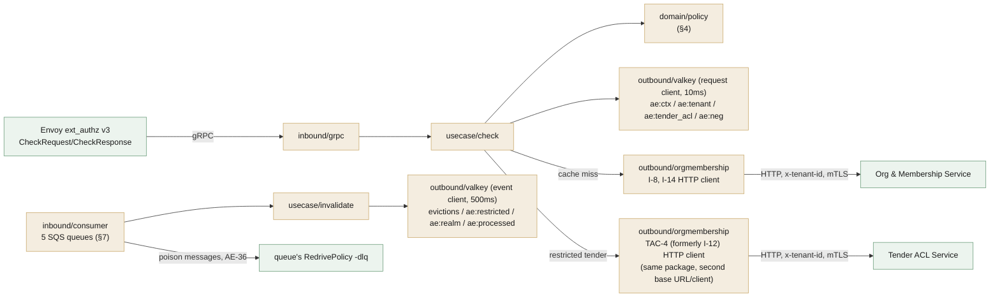
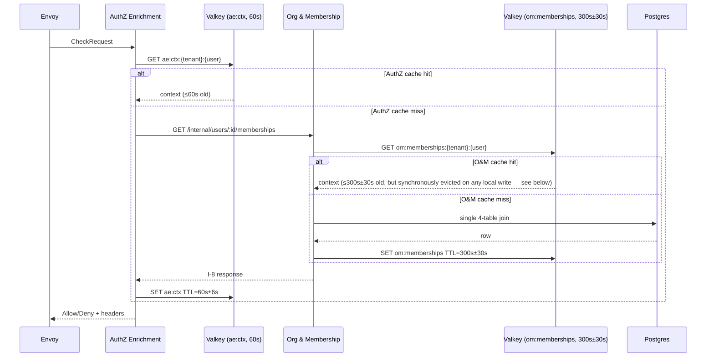
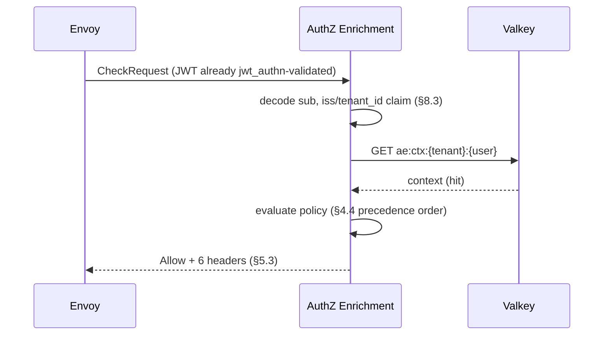
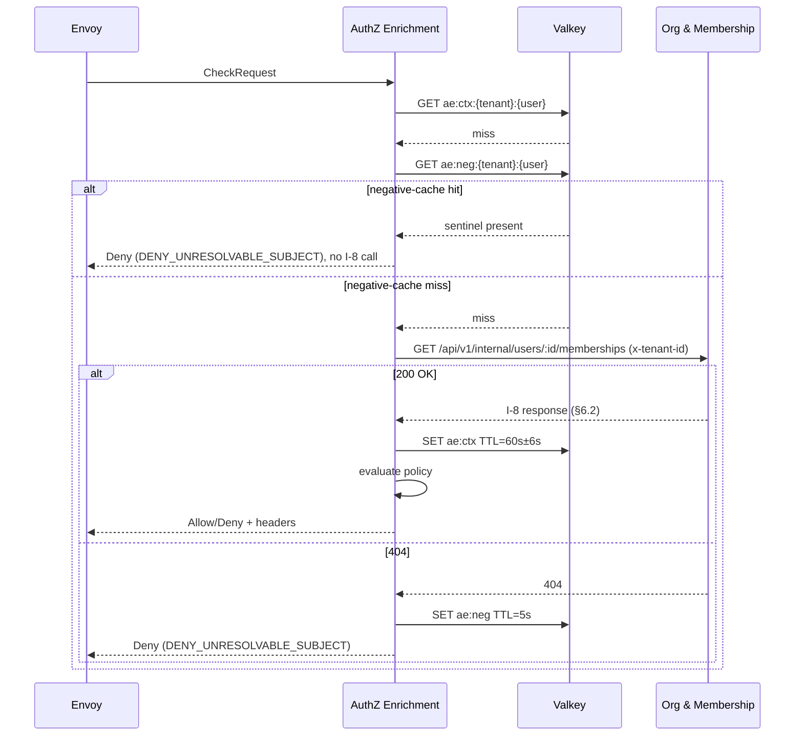
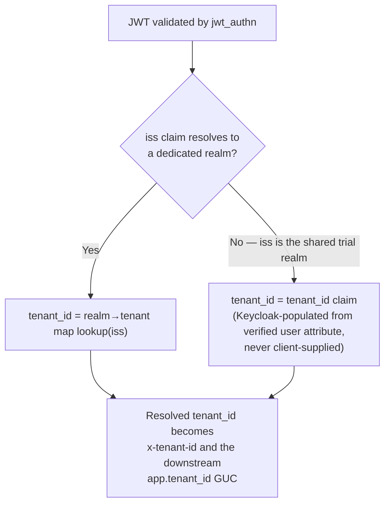
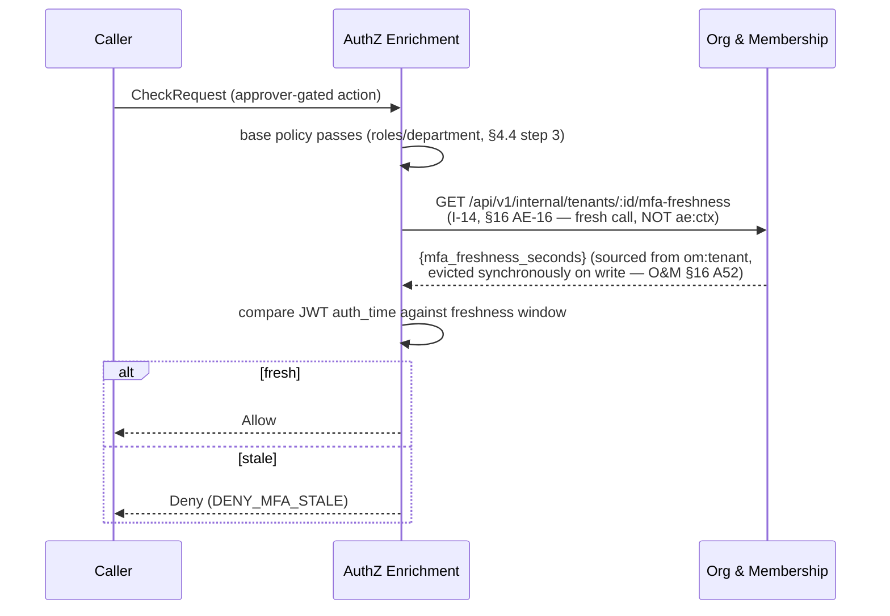
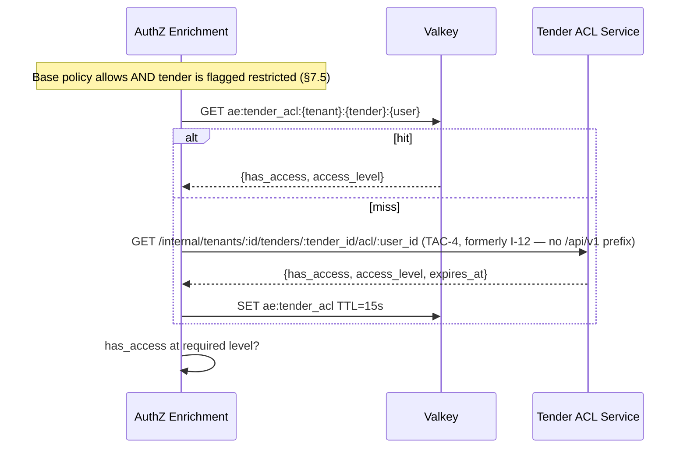
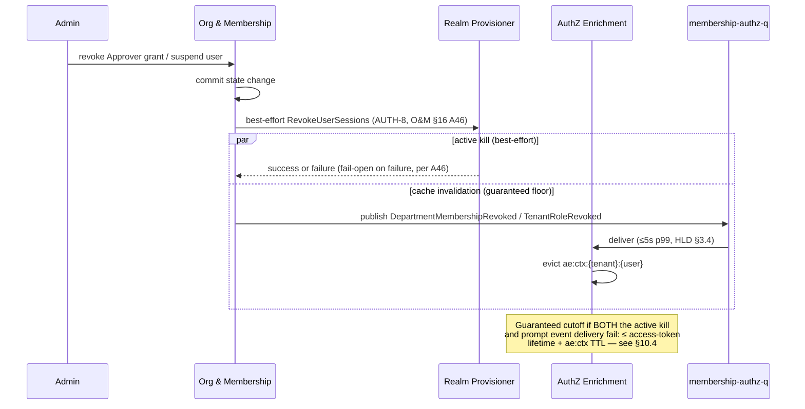

# AuthZ Enrichment Service — Low-Level Design

## Tender Management SaaS Platform — IAM Subsystem

| Field | Value |
|---|---|
| Document Type | Low-Level Design (LLD) |
| Service | AuthZ Enrichment Service (`iam-authz-enrichment`) |
| Parent design | IAM High-Level Design v1.41 (Approved for LLD), §5.4 |
| Subsystem | Identity & Access Management |
| Version | 1.35 |
| Date | 2026-10-14 |
| Status | Approved (AE-20's O&M asyncapi-reconciliation sub-item confirmed resolved at v1.16 — the deployed SNS→SQS filter policy itself remains outside this document's authority to verify; AE-19 confirmed against the Tender ACL Service's own LLD; AE-26 at v1.17 fixed the most severe integration defect this document has recorded; AE-27 at v1.18 upgraded Realm Provisioner's event schemas from unknown to confirmed; AE-28 at v1.19 closed a total-outage detection gap for the gRPC/HTTP/metrics servers themselves; AE-29 at v1.20 restated policy 1 at Node granularity; AE-30 at v1.21 records this service's side of CF-2 action item #13's dashboard-read contract, leaving a batch tender-ACL lookup open as a Tender ACL Service/Tender Service dependency; AE-31 at v1.22 confirms CF-5 action item #5 — the assign-to-workflow check is not owned by this service, Tender enforces it in its own handler; AE-32 at v1.23 confirms CF-4 action item #17 — Tender's published `tender.events` set against IAM HLD v1.41 §9.4/§10.3's three catalogued types; v1.24 wires `platform-pgcommon` for DSN/config/logger/tracer parity with siblings without opening a pool; v1.25 wires `platform-events` LoadSNS/LoadOutbox/RunnerConfigFromEnv + skipDuplicate/ackUnknown for events/outbox/dedup parity without starting a publisher or runner; AE-33/AE-34 at v1.26 close a production-readiness audit's two remaining reliability gaps (unbounded `GracefulStop`, a handler-panic idempotency-marker leak); v1.27 adds the `test/e2e` real-binary-over-real-gRPC test tier and migrates local-dev SQS emulation from LocalStack to floci (CI's own `scripts/init-localstack.sh`/LocalStack service containers are unchanged); AE-35 at v1.28 resolves Glue-encoded event decoding; AE-36 at v1.31 forwards poison messages to each queue's own DLQ; AE-37 at v1.32 re-baselines the sibling timeouts; v1.34–v1.35 merge the compatibility-check pass — five config fail-fasts, platform-events/v2 v2.1.0 and platform-pgcommon/v2 v2.0.1, security fixes AE-38 (future `auth_time`) and AE-39 (empty-TenderID guard), TAC-4/eviction error metrics and alert, BatchTenderACLClient — see revision history) |
| Audience | Platform engineering, security, SRE |
| Owner database | None — Valkey cache only (stateless service, HLD §5.4) |

### Revision history

| Version | Date | Notes |
|---|---|---|
| 1.35 | 2026-10-14 | **Compatibility-check gap closure pass (AE-38/AE-39), platform library v2 migrations, security fixes, new observability.** Nine changes confirmed against the running codebase: **(1) `platform-events/v2 v2.1.0`** — all import paths migrated from `platform-events/pkg/...` to `platform-events/v2/pkg/...`; the hand-rolled `consumer.GlueDecoder` (AE-35) retired in favour of the built-in `events.GlueDecodeCodec{}` now shipped with v2; wire format and Envelope JSON shape are unchanged. **(2) `platform-pgcommon/v2 v2.0.1`** — all import paths migrated; `pgmetrics.InitWithIdentity` signature change (opts variadic removed in v2, no opts were passed so no call-site change); pool/DSN/logger/tracer API unchanged. **(3) `go-redis/v9 v9.23.0`** patch bump. **(4) Security: future `auth_time` guard (AE-38)** — `checkMFAFreshness()` now denies any token whose `auth_time` claim is in the future; without this guard, a future timestamp produced a negative duration that was never `>` the positive MFA window, silently bypassing the approver gate. **(5) Security: empty `TenderID` guard (AE-39)** — `check()` now denies `DenyMalformedIdentity` when `RequiredAccessLevel != ""` but `TenderID == ""`; previously, a trailing-slash path (`/tenders/`) or a misconfigured route would produce `TenderID=""`, and `RequiresTenderACL()` would return `false`, silently skipping the overlay on a route that required it. **(6) New metrics** — `iam_authz_enrichment_tac4_errors_total` (incremented exclusively on `resolveTenderACL` error, making iam-tender-acl outages distinguishable from legitimate policy denials in Prometheus) and `iam_authz_enrichment_eviction_errors_total{event}` (incremented on best-effort SCAN failures in `HandleMembershipRevoked`/`HandleUserDeleted`, making systematic eviction failures alertable without a log review). **(7) New alert** — `AuthzEnrichmentTAC4ErrorSpike` added to `deploy/monitoring/app-alerts.yml`; fires when `iam_authz_enrichment_tac4_errors_total` is increasing. Fixes the gap where a TAC-4 outage was invisible to automated alerting (both `AuthzEnrichmentStaleIfErrorServing` and `AuthzEnrichmentServiceUnavailableSpike` only fire for Org & Membership / Valkey failures, not TAC-4). **(8) `BatchTenderACLClient` interface split** — `GetBatchTenderACL` (TAC-5 batch check, AE-30/§18.4) removed from `OrgMembershipClient` and placed on a separate narrower `BatchTenderACLClient` interface, so test fakes for the §3.1 Check() chain don't need to implement a method no Check() path calls. **(9) `TenderACL.AccessLevel *string`** — field changed from `string` to `*string` (TAC-GAP-001); absent JSON field (iam-tender-acl omits it via `omitempty` when `HasAccess=false`) now decodes as `nil`, not empty string. `Satisfies()` short-circuits on nil. **Merge note (2026-10-14):** drafted on the compatibility-check branch as rev 1.30 concurrently with revs 1.30–1.33 above and renumbered on merge — its two register entries were AE-36/AE-37 and are now **AE-38/AE-39** (main's AE-36/AE-37 keep their numbers). Superseded on merge: the `consumer.GlueDecoder` retirement and the gincommon-based metrics/tracing were already done by rev 1.30; this branch's metric renames (`dependency_request_seconds`, `deny_reasons_total`, `stale_served_total`) were dropped in favour of §11.2's registry-validated names, so the two new counters are registered through gincommon's Tier 3 constructors and `AuthzEnrichmentTAC4ErrorSpike` follows `app-alerts.yml`'s identity-label conventions (runbook in `docs/observability/runbooks.md`). Version bumped 1.34 → **1.35**. |
| 1.34 | 2026-10-14 | **Production-readiness hardening pass — five config fail-fasts, two new CI enforcement scripts, monitoring alerts, and spec corrections.** Seven changes, all confirmed against the running codebase: **(1) Valkey TLS enforcement** — `config.Load()` now rejects any `VALKEY_URL` that does not start with `rediss://` outside `APP_ENV=dev` (startup failure, not a warning), ensuring the authorization-context cache is always encrypted in transit in staging/production. **(2) `AE_PROCESSED_EVENT_TTL` default corrected** from 168h (exactly 7 days, at-boundary with the SQS message lifetime) to 192h (8 days, strictly greater per PE-1), preventing a redelivered 6-day-old message from being re-processed after the old TTL expired. **(3) `SHARED_REALM_ISSUER` + `REALM_TENANT_MAP_SEED` both-empty** is now a startup failure outside dev (was a `main.go` warning-only). Both empty = no tenant-resolution path = every request silently returns `DENY_MALFORMED_IDENTITY` with no observable error. The check was moved into `config.Load()` to be unit-testable (four new tests cover all branches). **(4) `DOCS_AUTH_TOKEN` startup warning** — `cmd/server/main.go` now logs a warning at startup when `DOCS_ENABLED=true` in production without `DOCS_AUTH_TOKEN`, making the unauthenticated `/asyncapi` exposure immediately visible at deploy time. **(5) `make observability-lint` + `make database-lint` CI scripts** added and wired into `validate-quality.yml` alongside `go mod tidy` drift check — machine-enforced invariants that all logs/metrics/traces pass through `platform-gincommon` only and all DB operations pass through `platform-pgcommon` only; both are documented in `ARCHITECTURE.md`'s dependency-rules section. **(6) Two new Prometheus alert rules** (`AuthzEnrichmentSQSReceiveErrors` and `AuthzEnrichmentDLQMessageArrived`) added to `deploy/monitoring/app-alerts.yml` — the former fires on sustained SQS `ReceiveMessage` errors before the receive-error watchdog triggers a pod restart; the latter fires critically on any DLQ arrival, with a specific note that a missed `TenderRestricted` event permanently disables the tender-ACL overlay for that tender. **(7) `api/asyncapi.yaml` spec correction** — three locations incorrectly stated that RP-2 (direct-paid signup) fires "only TenantRealmReady, never TenantConverted." RP-2 always co-emits both events. Corrected in the TenantRealmReady `note`, `summary`, and `tenant-authz-q` channel `description`; matching corrections in `internal/usecase/invalidate.go` and `README.md`. Also: `.github/workflows/changelog-check.yml` now includes `api/**` in its path trigger so asyncapi.yaml changes no longer escape the CHANGELOG gate; `github.com/jackc/puddle/v2` direct import removed from `wrap.go` (now uses string sentinel, puddle moves to indirect in go.mod); `gocritic` + `nolintlint` added to `.golangci.yml`. **Merge note (2026-10-14):** drafted on the compatibility-check branch as rev 1.29 (2026-10-01), concurrently with revs 1.29–1.33 above, and renumbered on merge. Superseded on merge: item (6)'s two alerts — `sqs_receive_errors_total` no longer exists in platform-events, and rev 1.31's `AuthzEnrichmentDLQForwards` replaces `AuthzEnrichmentDLQMessageArrived` — and item (5)'s `metrics-lint` naming script, replaced by rev 1.30's `make metrics-check`. `observability-lint`/`database-lint`/`events-lint` stay in `make ci`. The `DOCS_AUTH_TOKEN` warning applies at `APP_ENV=prod`. Version bumped 1.33 → **1.34**. |
| 1.33 | 2026-10-04 | **Documentation alignment with revs 1.30–1.32; no code or contract change.** §12's configuration table carried pre-AE-37 values ("single-digit ms" for the Org & Membership timeout, 20ms for TAC-4) and lacked `GRPC_REQUEST_TIMEOUT`, the request/event-path Valkey timeouts, and the `ResolveAppEnv` / `VALKEY_URL` / positive-value fail-fast checks — now listed. §11.2 credited gRPC server metrics to `go-control-plane` (they come from platform-gincommon's interceptors) and now points at the generated `docs/observability/` inventory; §11.3 names the MFA-freshness span and the gincommon tracing entry points; §9.1 records the singleflight `WithoutCancel` rule. |
| 1.32 | 2026-10-04 | **Production-readiness review fixes — new §16 AE-37.** **(Bug)** the coalesced I-8 call (singleflight) ran under the *first* caller's context, so when Envoy's deadline cancelled that request every other request waiting on the same `(tenant, user)` failed with it and was denied `DENY_SERVICE_UNAVAILABLE`; the shared call now uses `context.WithoutCancel` (bounded by `ORG_MEMBERSHIP_TIMEOUT`) — reproduced by a regression test that fails without the fix. **(AE-37)** sibling timeouts re-baselined against the siblings' own targets and a server-side deadline added. **Also:** a fatal shutdown (dead server or consumer) now exits non-zero instead of 0, so restarts surface as failures; SQS event processing uses its own Valkey client with `VALKEY_EVENT_TIMEOUT` (500ms) — evictions, `ae:restricted`/`ae:realm` writes and the `ae:processed` ledger — instead of the request path's 10ms timeouts, under which one slow round trip failed a `TenderRestricted` write and delayed it a full 30s visibility timeout (`factStore` routes the shared sets' writes to it; reads stay on the request client); `VALKEY_URL` that looks like a URL must parse (fail-fast instead of silently falling back to a plain address); `make vuln-check` scans the whole module (it scanned `./internal/...` only and missed a reachable grpc server vulnerability, GO-2026-6443, accepted with an expiry in `.github/govulncheck-allow.txt` until grpc v1.85.0 ships); Helm: no CPU limit + `GOMEMLIMIT`, topology spread across zones/nodes instead of hard one-pod-per-node anti-affinity (`maxSurge: 1`, `maxUnavailable: 0`), `LOG_SAMPLING=true`, and a render-time guard refusing prod with plaintext gRPC until `grpcTLS.enabled` or `grpcTLS.meshProvidesMTLS` is set; the README Envoy sketch sets `failure_mode_allow: false` explicitly. Version bumped 1.31 → **1.32**. |
| 1.31 | 2026-10-04 | **Observability-standard gaps closed — new §16 AE-36.** **(AE-36)** Consumers now forward poison messages to each queue's own RedrivePolicy DLQ through platform-events' `WithDLQForwarding`, replacing EVT-4's "SQS-native only" rule: a body that is not an envelope (or a Glue frame that fails to decode) used to be **deleted** by platform-events with no DLQ copy, losing its eviction silently. `DeadLetterHandler` now logs the 5th delivery and lets the library forward it; SQS's redrive stays the backstop; a consumer refuses to start on a queue without a RedrivePolicy; the IRSA policy gains `sqs:GetQueueUrl`/`SendMessage` on the five DLQs. **Also:** a request with no verified subject is denied inside `Checker.Check` rather than in the gRPC adapter, so `DENY_MALFORMED_IDENTITY` from undecodable claims is now timed and counted in `iam_authz_enrichment_decisions_total` / `deny_reason_total` (§11.2); the environment resolves `APP_ENV`, then `ENVIRONMENT`, trimmed and lowercased, like the platform libraries; the alert rules aggregate `by (domain, service, environment)`, carry a `runbook` annotation and gain `AuthzEnrichmentDLQForwards` and `AuthzEnrichmentEventFailureRateHigh`; the Helm PrometheusRule is generated from `deploy/monitoring/app-alerts.yml`; and iam-org-membership's observability CI (`metricslint` on a real scrape, `refs`, a generated and drift-checked metric inventory, collector-naming and proposed-metric lints) is ported, plus promtool alert unit tests. Version bumped 1.30 → **1.31**. |
| 1.30 | 2026-10-03 | **Shared-library parity with iam-org-membership; one metric-label value change.** `platform-gincommon` v1.4.0 → **v1.6.0** (latest). Local copies of shared-library functionality are replaced by the library APIs iam-org-membership uses: `consumer.GlueDecoder` → platform-events' `events.GlueDecodeCodec` (same header checks, plus a clear error for a non-JSON payload — AE-35's behaviour otherwise unchanged); `postgres.NewOTelTracer` → `gincommon.NewSpanTracer`; the usecase tracer → `gincommon.NewTracer`; the outbound clients' `propagateTraceparent` → `gincommon.InjectTraceContext`; `cmd/server`'s `metricsScrapeHandler` → `gincommon.MetricsHandler` (a failing collector no longer blanks the scrape); `InitTracingFromEnv` → `InitTracingWithConfig` with the same identity as the metrics config, so trace resources and metric labels cannot disagree. `grpccommon.RegisterKnownMethods` now bounds the `grpc_method` label to the registered services. The §11.2 business metrics are built through gincommon's registry-validated Tier 3 constructors instead of `promauto`, which surfaced a real violation: `iam_authz_enrichment_deny_reason_total{reason}` carried the upper-case `DenyReason` (e.g. `DENY_SERVICE_UNAVAILABLE`), outside the registry's snake_case `reason` vocabulary. **The label value is now lowercased** (`deny_service_unavailable`); the `DenyReason` wire values themselves (§9) are unchanged, and the alert rules that filter on the label are updated. No `§16 AE-#` entry — library adoption, not a design tradeoff. Version bumped 1.29 → **1.30**. |
| 1.29 | 2026-10-03 | **Deployment wiring for the two synchronous siblings; no code or contract change.** Helm now defaults `ORG_MEMBERSHIP_BASE_URL` to `http://iam-org-membership.iam.svc.cluster.local:8080` and `TENDER_ACL_BASE_URL` to `http://iam-tender-acl.iam.svc.cluster.local:8080` (IAM convention: namespace `iam`, Service named after the repo, port 8080); both were empty, which fell back to the dev defaults that §12's fail-fast validation rejects outside dev. New `networkPolicy.upstreamEgress` adds one egress rule per sibling, restricted to its pods (`app.kubernetes.io/name: iam-org-membership` / `tender-acl`) in namespace `iam` on 8080 — previously the default-deny policy had no rule for either, so every non-cached I-8/I-14/TAC-4 call would have been dropped. The reverse direction is iam-tender-acl's: its `networkPolicy.internalCallerPodSelectors` must list `app.kubernetes.io/name: iam-authz-enrichment` (iam-tender-acl LLD §21.5). |
| 1.28 | 2026-09-24 | **Glue-encoded inbound events are decoded — new §16 AE-35; a dead-letter observer added.** Every sibling producer (Org & Membership, User Profile, Realm Provisioner, Tender ACL, …) Glue-encodes `data` once its own registry is configured and sets `dataschema`; `platform-events` then runs the consumer codec. This service passed `events.NoopCodec`, whose `Decode` returns the bytes unchanged, so the 18-byte Glue header reached every handler and `json.Unmarshal` failed on **every** Glue-encoded event: each retried 5 times and dead-lettered with its cache eviction never applied — a revoked role/membership staying authorized until its TTL, and a `TenderRestricted` fact (`ae:restricted`, no TTL, §8.5.1) wrong indefinitely. The previous rationale ("inbound IAM events are plain JSON") only held while no producer had a registry configured. **Resolved**: `consumer.GlueDecoder`, a decode-only `events.Codec` that strips the self-describing header (validating version `0x03` and compression `0x00`) with no Glue client, registry or IAM grant. **Also**: `WithMaxReceiveCount(4)` + `DeadLetterHandler` log each message's 5th and last delivery before SQS's own redrive moves it — observability only, it always returns an error so it never acks, keeping EVT-4's "SQS-native DLQ" intact; and it is what makes the max-receive count safe to set at all (platform-events deletes a message past its count when no dead-letter handler is set). Verified against a real SQS emulator (floci): a Glue-framed `DepartmentMembershipGranted` evicts `ae:ctx` (and fails to with `NoopCodec` — mutation-checked), and a persistently failing message is handled on deliveries 1-4, observed on the 5th, then redriven by SQS. Consumed-payload schema validation, applied to the IAM services that act on events, is deliberately **not** added here (AE-35). Version bumped 1.27 → **1.28**. |
| 1.27 | 2026-09-20 | **Adds the `test/e2e` real-binary-over-real-gRPC test tier; migrates local-dev SQS emulation from LocalStack to floci.** Neither unit tests nor `test/integration` (build tag `integration`) start `cmd/server` itself — they exercise individual adapters against fakes or real infra directly, so neither can catch a wiring/config regression (an env var renamed in `config.go` but not propagated to the Helm chart, a `context_extensions` key that stops round-tripping through the real wire format, a startup-ordering bug that only manifests when every real dependency is reachable at once). **New `test/e2e` package** (build tag `e2e`) starts the actual compiled binary as a subprocess against real Valkey + a real SQS emulator + a fake Org & Membership/Tender ACL HTTP server, then drives it over a real gRPC connection through all five §3.1 precedence steps: subject resolution, the read-only gate, base role/department policy (plus a real `DepartmentMembershipGranted` event round-trip proving cache eviction actually happens over the wire, not just via a direct `Invalidator` call), the tender-ACL overlay (a real `TenderRestricted` event, then both an insufficient and a sufficient TAC-4 grant), and the MFA-freshness gate. Each test scopes its tenant IDs to a per-run UUID suffix — `ae:restricted` has no TTL by design (§8.5.1), and this suite runs against a real, persistent Valkey rather than a fresh one per run, so an unscoped tenant/tender name would let one run's residual state corrupt the next run's "not yet restricted" assertion (caught by this suite's own first draft before the fix). Wired into CI as a new parallel `e2e` job in `.github/workflows/validate-test.yml` (own Valkey/LocalStack services, builds the binary, runs `make test-e2e`) — picked up automatically by `ci.yml`'s `needs: [validate-test, ...]` gates since those reference the whole reusable workflow, not an individual job within it. **Separately**, `docker-compose.yml`'s local-dev SQS emulator is migrated from `localstack/localstack` to `floci/floci` (plus a new `floci-ui` service, a web console at `http://localhost:4502`) — the same open-source, always-free LocalStack-compatible emulator `iam-org-membership`/`iam-delegation` already use, via a new `scripts/init-floci.sh` mirroring `scripts/init-localstack.sh`'s five-queue/DLQ shape. This is local-dev-only: CI's own `test`/`e2e` jobs continue to run a bare `localstack` service container and `scripts/init-localstack.sh` directly, unchanged — the two provisioning scripts now coexist deliberately, one per environment. No `§16 AE-#` entry — a new test tier and a local-tooling substitution, not a design decision with a tradeoff to record. Version bumped 1.26 → **1.27**. |
| 1.26 | 2026-09-20 | **Production-readiness audit: two reliability gaps closed, new §16 AE-33/AE-34.** A fresh code-level audit (not a doc-consistency pass) of `cmd/server/main.go`, the hot-path `usecase`/`config`/`consumer` packages, the Dockerfile, and the Helm chart found the surrounding infrastructure (Docker hardening, resource limits, CI gates) already solid, but two real gaps and two smaller hardening fixes: **(AE-33, new)** `grpcServer.GracefulStop()` had no timeout — a wedged Envoy connection or a `Check()` call stuck on a hanging downstream call would stall every shutdown step after it (HTTP shutdown, consumer drain, `cache.Close()`) until Kubernetes' `terminationGracePeriodSeconds` (60s) expired and SIGKILLed the pod, skipping the graceful consumer drain entirely. **Resolved**: `GracefulStop()` now runs in a goroutine with a 10s cap (`grpcGracefulStopTimeout`), falling back to a hard `Stop()`. Fixing this exposed a second, adjacent problem: the *sum* of the shutdown-phase timeouts (grpc + the shared HTTP/metrics `Shutdown()` context, previously 30s + the SQS consumers' own ~35s drain window, run sequentially) could exceed `terminationGracePeriodSeconds` even before this fix — rebalanced the HTTP/metrics shutdown timeout down to 10s (`httpShutdownTimeout`, neither server holds long-lived connections, so the prior 30s was unused headroom) so the worst case (10+10+35=55s) now fits with a 5s margin; `deploy/helm/values.yaml`'s `terminationGracePeriodSeconds` comment updated to the corrected budget math. **(AE-34, new)** `internal/adapter/inbound/consumer/idempotency.go`'s `processedHandler` marked a message processed *before* running its handler; a handler panic would be recovered by `platform-events`' own top-level recovery, outside this app's `EvictProcessed`-on-error path, leaving the message permanently (or until the 7-day TTL) marked "processed" with no retry. For most queues this only masks a stale cache entry for its own TTL — low impact — but `tender-authz-q`'s `ae:restricted` fact has **no TTL** (§8.5.1), so a panic there would silently and permanently disable the tender-ACL overlay for that tender with zero automatic recovery. No live trigger exists today (every event-handler JSON decode is already error-checked, no unsafe type assertions), so this was a defense-in-depth gap, not an active bug. **Resolved**: added a `recover()` inside `processedHandler` itself that evicts the marker before re-panicking, so `platform-events`' own recovery still runs exactly as before. **Two smaller hardening fixes bundled in, no separate AE-# (no open design tradeoff to record):** `internal/usecase/check.go`'s `resolveContext` now runs its two Valkey reads (`GetMembershipContext`/`GetTenantContext`) concurrently rather than sequentially — at the 10ms default `VALKEY_READ_TIMEOUT`, two sequential reads could alone approach the 15ms p99 decision budget (§11.1) on a slow-but-not-erroring Valkey; and `internal/config/config.go` gained `envPositiveInt`, applied to `GRPC_MAX_CONCURRENT_STREAMS` (plus an explicit `uint32`-overflow check before its narrowing conversion), both gRPC message-size limits, and all five queue-concurrency vars, so a zero/negative value now fails fast at startup instead of silently misbehaving at runtime (a gRPC server accepting zero concurrent streams, negative consumer concurrency) — consistent with this file's existing fail-fast philosophy for every other class of operator typo. All four changes verified with new/updated unit tests, `-race` (including 5x repeated runs on `internal/usecase`), `golangci-lint` (0 issues), `go-arch-lint`, and a full local run against the real docker-compose stack; 100% coverage maintained on `internal/...` (the existing coverage-gate scope — `cmd/server` itself remains outside `-coverpkg`, a pre-existing, documented scope choice, not something this pass changed). §9.4 gains a new failure-mode row for the bounded-shutdown case. Version bumped 1.25 → **1.26**. |
| 1.25 | 2026-09-20 | **`platform-events` v1.4.0 wired for events/outbox/dedup parity with iam-user-profile / iam-org-membership, without a publisher or runner.** `consumer.LoadPlatform` calls `LoadSQS` / `LoadSNS` / `LoadOutbox` + `SNSConfigFromEnv` / `RunnerConfigFromEnv` (nil pool/publisher). `cmd/server` skips `NewSNSPublisher`, `outbox.ApplySchema`, and `NewRunner` (HLD §5.4 / EVT-2); a set `SNS_TOPIC_ARN` or outbox `DATABASE_URL` is a warning. Inbound consumers use `SQSConfigFromEnv` / `SQSConsumerOptions` / `WithConsumerCodec(NoopCodec)`. Dedup is the sibling `skipDuplicate` / `ackUnknown` pair on `Envelope.ID`; the store stays Valkey `SET NX` (`ae:processed:{event_id}`, AE-6) because platform-events has no processed-events API and this process has no Postgres table. Version bumped 1.24 → **1.25**. |
| 1.24 | 2026-09-20 | **`platform-pgcommon` v1.3.0 wired for DSN/config/logger/tracer parity with iam-user-profile / iam-org-membership, without a live pool.** Added `internal/adapter/outbound/postgres` (`DSNFromEnv`, `ApplyStatementTimeout`, Zap `LoggerAdapter`, `NewOTelTracer`, `PoolConfig`, `OpenPool`). `cmd/server` calls `pgmetrics.InitWithIdentity` (identity from `gincommon.MetricsConstLabels()`) + `PoolConfig` after `events.InitMetrics` (identity from `gincommon.MetricsConstLabels()`), logs ConfigFromEnv warnings, and **skips** `NewPool` / migrate / outbox (HLD §5.4: no schema). A set DSN is a warning, not a pool. Version bumped 1.23 → **1.24**. |
| 1.23 | 2026-09-18 | **CF-4 action item #17 ("Tender event set," AuthZ Enrichment + Audit): Tender's published `tender.events` set confirmed against IAM HLD v1.41's catalog, new §16 AE-32.** CF-4 asks AuthZ Enrichment and Audit to confirm Tender Service's actual published event set against "the three catalogued." Unlike AE-29/AE-30/AE-31, the parent HLD is actually available in this workspace (`docs/HLD/iam-hld-tender-saas-v1.41.md`) and was read directly rather than reasoned about from absence. **Confirmed:** HLD §9.4's event catalog lists exactly three `tender.events` types — `TenderRestricted` (→ AuthZ Enrichment + Audit Log), `TenderAccessGranted` (→ Audit Log only), `TenderSectionApproved` (→ Audit Log only) — and §10.3's Tender Service description independently states "Emits `TenderRestricted`, `TenderAccessGranted`, `TenderSectionApproved` to the shared event bus," verbatim matching §9.4's catalog with no discrepancy between the two HLD sections. This service's own §7.5/`api/asyncapi.yaml` already correctly consume only `TenderRestricted` — the one of the three the HLD's own consumer-routing column assigns here — and correctly do not attempt to consume `TenderAccessGranted`/`TenderSectionApproved`, which the HLD routes to Audit Log exclusively; no correction was needed to this service's own contract. **Left explicitly unverifiable from this workspace:** Tender Service's own code/asyncapi.yaml and the Audit Log Service's own code/LLD are both absent here (no `iam-audit-log`/Tender Service repo present) — so while the HLD's *documented* catalog is internally consistent and this service's own consumption matches it exactly, whether Tender Service's actual deployed implementation emits precisely these three event types (and only these), and whether Audit Log's actual subscription matches `tender-audit-q`'s documented three-event fan-out, remain confirmable only from those two services' own code/LLDs — the same disclosure posture `api/asyncapi.yaml`'s existing `TenderRestricted` message block already carries (`producer-lifecycle-status: unknown`, since no Tender Service asyncapi.yaml is available to verify the payload wire-shape against). §7.5 gains a one-line cross-reference to the confirmed HLD catalog. Version bumped 1.22 → **1.23**. |
| 1.22 | 2026-09-18 | **CF-5 action item #5 ("Assign-to-workflow check," AuthZ Enrichment): confirmed this service does not own it, new §16 AE-31.** CF-5 asks AuthZ Enrichment to confirm it does not own the assign-to-workflow check and that Tender enforces it in its own handler. **Confirmed:** §4.2's policy list has exactly two policies touching workflow-node assignment — policy 1 (Node-granularity department/role edit gate, restated AE-29) and policy 2 (`tender_admin`-gated *override* of an existing workflow-node assignee) — neither is the initial assign-to-workflow routing/assignment act itself; §4.3's fact table carries no per-workflow-instance assignment fact (no `workflow_instance_id`, candidate pool, or queue-membership signal) to decide such a gate from, and this service has no Workflow-Service client (same absence AE-29 already established); §2.2 already excludes workflow node assignment/ownership from this service's scope entirely. This formalizes, as its own verified decision, what AE-29 had only cited in passing as an analogy ("the same in-handler pattern Tender uses for assign-to-workflow") when placing the per-Section assignee check with Tender Service. **Left explicitly unverifiable from this repo:** Tender Service's own handler code/LLD is not present in this workspace (same disclosure posture as AE-19/AE-27's "no spec available" flags for Billing Service/Realm Provisioner/Tender Service) — this entry confirms IAM's own contract has no assign-to-workflow ownership and no fact source to build one from, but cannot independently verify Tender Service's own handler actually implements the enforcement. §2.2 gains a cross-referencing row. Version bumped 1.21 → **1.22**. |
| 1.21 | 2026-09-18 | **CF-2 action item #13 ("Dashboard-read contract," AuthZ Enrichment + Tender): AuthZ Enrichment's side of the cross-team agreement recorded, new §16 AE-30.** CF-2 asks the two teams to agree schema, batch bound, freshness, and per-user filtering for a Tender dashboard view. **Resolved for this service's contribution:** no new endpoint, no new synchronous-call obligation — this service's only interface remains Envoy's `ext_authz` `Check` (§2.1, §5), and §2.2 already excludes a business HTTP API from scope; a bulk dashboard listing is Tender Service's own read endpoint, not a call into this one. Per-user filtering is already available to Tender Service via the injected `x-departments`/`x-feature-flags`/etc. headers on every proxied request (§5.3); freshness for any such contract should reuse this service's existing bounds (≤60s±6s `ae:ctx`, ≤15s `ae:tender_acl`, ≤5s restricted-flag L1-negative window — §6.1, §8.5.1) rather than invent a new one; no new schema is introduced beyond the existing header shapes and TAC-4's `{has_access, access_level, expires_at}` response (§18.7). **Left open, explicitly not this service's to resolve:** TAC-4 (§18.7) is single-resource per call with no batch variant, so a dashboard needing restricted/grant status for many tenders at once cannot be served by N synchronous TAC-4 calls at this service's own `ext_authz` latency budget (§11.1) — a bulk lookup endpoint, if CF-2 needs one, is a Tender ACL Service capability (durable tender-ACL data ownership, §2.2) for that team and Tender Service to design, not resolvable within this LLD. §18.4 updated with a cross-reference. Version bumped 1.20 → **1.21**. |
| 0.1 | 2026-08-10 | Initial draft. Written against IAM HLD v1.39 §5.4 (service definition), §4 (architecture/two request paths), §6 (role/permission model), §8.3 (authenticated request flow), §9 (event architecture), §11.3–§11.4 (token strategy, credential protection); and against the frozen contracts in Org & Membership LLD (I-8, I-12, `membership-authz-q` fan-out, §16 A46/A51/A52/A53, §18.2, §21.1) and User Profile LLD (§6.3, `user-authz-q`, §8.8.0). Several design points the HLD and sibling LLDs leave silent are resolved here as new decisions and recorded in §16 under the `AE-#` prefix (distinct from the sibling LLDs' `A#`/`B#`/`C#`/`D#` register prefixes, to avoid cross-document ID collision). Two discrepancies between the drafting brief and the verified sibling-LLD text are also recorded in §16 (AE-2, AE-8) rather than silently resolved in the brief's favor. |
| 0.2 | 2026-08-11 | **Closes AE-11.** The HLD authorization-header contract owner confirmed the AE-11 proposal; IAM HLD v1.41 §5.4/§8.3 now specify `x-departments` as UUID-based (`<department_id>:<role_level>` pairs) and `x-feature-flags` as a plain comma-separated present-flag-names list, matching this LLD's §5.3 recommendation verbatim. §5.3's two header rows updated from "Proposed... pending confirmation" to confirmed/adopted, citing HLD v1.41. §16 AE-11 status changed from **Proposed — pending confirmation** to **Closed — Adopted**. Parent-design reference bumped to HLD v1.41 accordingly. Propagating the corresponding example into the Workflow Service's own document remains a follow-up for that document's owner, unchanged from AE-11's original resolution note — not something this LLD or the HLD update can complete on that document's behalf. |
| 0.3 | 2026-08-11 | **Addresses the §18.1 loose end on the `mfa_freshness_seconds` read path, new §16 AE-16.** Checked directly against the Org & Membership LLD (full-text): its internal-endpoint catalogue (I-1–I-13) has no endpoint exposing the `om:tenant`-cache-backed, P-2-evicted value its own T-10/§16 A52 name as the authoritative source for the approver step-up — I-8's `mfa_freshness_seconds` field is explicitly informational only (frozen in the 300s `om:memberships` snapshot, not evicted by P-2), and the public `GET /api/v1/tenants/:id` (P-1) is member-scoped, not a service-to-service path. This is a genuine gap in Org & Membership's published contract, not a misunderstanding on this LLD's part. **New decision AE-16** proposes closing it the same way Org & Membership already solved the identical shape of problem for a different field: a new internal endpoint, `GET /api/v1/internal/tenants/:id/mfa-freshness` (proposed **I-14**), modeled directly on the existing **I-9** (`GET /api/v1/internal/tenants/:id/locale`) precedent — a lightweight, cached, tenant-scoped internal GET already consumed the same way by LLM Service. §4.3, §8.4 (sequence diagram + new prose paragraph), and §18.1 updated to reference the proposed endpoint by name. **This is a proposal for the Org & Membership team to confirm and build — not resolvable within this LLD**, the same posture AE-11 held before HLD adoption closed it; AE-16 is recorded as Proposed, not Closed. |
| 0.4 | 2026-08-11 | **Closes AE-16.** The Org & Membership team confirmed and built AE-16's proposal verbatim: their LLD rev 1.72 (§16 A72) adds `GET /api/v1/internal/tenants/:id/mfa-freshness` as **I-14** — same path, same shape as this LLD's proposal, reading the same `om:tenant` cache, with no new cache key or invalidation logic needed on their side. Verified directly against the updated Org & Membership LLD text (§5.3 I-14 catalogue row, §6.1 `om:tenant` cache-key table, §16 A72) before closing rather than taking the changelog summary alone. §4.3, §8.4 (diagram + prose), §16 AE-16, and §18.1 updated to cite I-14 as the confirmed integration point rather than a proposal. AE-16 status changed from **Proposed** to **Closed — Adopted**. With this, the §16 register is fully Accepted/Closed and the last outstanding loose end noted in §18.1 is resolved. |
| 1.0 | 2026-08-11 | **Signed off.** All 16 §16 register items (AE-1–AE-16) are Accepted or Closed; a full-document sweep found no other outstanding TODO/pending/unresolved markers. Header `Status` changed from "Draft for review" to **Approved**; version bumped from 0.4 to **1.0**, matching the parent HLD's own Draft→"Approved for LLD" convention. Two items remain openly disclosed in prose but do not block this sign-off: (1) §15 notes `TenantOffboarded` is not in this service's event subscriptions — a documented "still-open completeness question," argued as a defensive nicety rather than a compliance requirement given the short TTLs already in force; (2) AE-11's closure note flags that Workflow Service's own document has not yet been confirmed as aligned to the UUID-based header encoding this LLD and HLD v1.41 adopted — explicitly outside this LLD's authority, a follow-up for that document's owner. Neither required resolution within this service's own design. |
| 1.1 | 2026-08-11 | **Closes AE-17 (post-sign-off amendment).** Formalizes the risk-acceptance resolution for the §15 `TenantOffboarded` completeness question left unresolved-but-non-blocking at v1.0: this service will **not** subscribe to `TenantOffboarded`. Every cache key is already TTL-bound to 5–60s (§6.1), so a tenant's entries expire on their own regardless of subscription; adding one would only make an already-compliant cleanup marginally faster, with no material effect on compliance, correctness, or customer experience. New **§16 AE-17**, `Closed (Accepted Risk)` — the same posture as AE-5, not a design change. §15's tenant-offboarding bullet reworded from "still-open" to reflect the closed decision. This is the only remaining prose loose end from v1.0 that has now been formally resolved; the Workflow-Service-alignment note under AE-11 remains, unchanged, as a follow-up outside this LLD's authority. |
| 1.2 | 2026-08-26 | **Re-baselined against the post-decomposition Org & Membership LLD (rev 2.0, 2026-08-22).** v1.1 and earlier were written against the pre-split Org & Membership **monolith** (`org_membership_lld_5.md`, rev ~1.71); the current baseline is the **Core** LLD after four service extractions — Catalog/Admin Config, Group Mapping/JIT Config, **Tender ACL** (`iam-tender-acl`), and **Delegation** (`iam-delegation`) — under ADR-0007/ADR-0008. Four alignment findings resolved: **(AE-18)** O&M's I-8 no longer projects `active_delegations[]` (delegations extracted → four-table join; O&M I8-4, §18.2, OQ-2) — removed from the `ae:ctx` projection (§4.3, §6.1) and the `UserAvailabilityChanged`-as-delegation-refresh handling dropped (§6.3, §7.2, §14), closing this service's side of O&M's OQ-2; **(AE-19)** the tender-ACL check (**I-12**), its second-layer `om:tender_acl` cache baseline, and O&M's former §16 A51 were **extracted to the Tender ACL Service** — reattributed throughout (§2.1, §2.3, §3.4, §4.2, §4.3, §6.1, §8.5, §9.2, §10.3, §11.2, §17, §18), with the exact I-12 wire contract flagged for cross-team confirmation (owner: Tender ACL team); **(AE-20)** subscribed `membership-authz-q` to **`MembershipRevoked`** — O&M's new per-user removal cascade signal (O&M LLD §7.3.2) — so a full member removal promptly evicts `ae:ctx` (§7.1, §6.3), with a cross-team flag that O&M's own `api/asyncapi.yaml` omits `MembershipRevoked` from the AuthZ filter, contradicting O&M LLD §7.3.2 (owner: O&M team); **(AE-21)** citation/framing refresh — O&M now cited as **rev 2.0** (not rev 1.72; I-14/§16 A72 confirmed present in rev 2.0's §5.3, §6.1, and swagger), the "seven services" stack framing updated for the decomposition, and the stale-ToC editorial note (former AE-12) retired since rev 2.0's ToC is complete (§1–§21). Version bumped 1.1 → **1.2**; Status remains **Approved** for everything within this service's authority, with two items openly tracked as **Proposed/Open** (AE-19 I-12-contract confirmation by the Tender ACL team; AE-20 asyncapi reconciliation by the O&M team) — both cross-team, neither resolvable within this LLD. |
| 1.3 | 2026-08-26 | **Closes AE-19 (I-12/TAC-4 wire-contract confirmation); implements AE-20 in code.** **(AE-19)** Verified directly against the Tender ACL Service's own LLD (`iam-tender-acl/docs/lld/iam-lld-tender-acl-service.md`, §8.3 endpoint catalogue, §8.4 TAC-4 spec, §9.1 cache-TTL table) rather than continuing to assume the monolith-era contract: the path is confirmed **`GET /internal/tenants/:id/tenders/:tender_id/acl/:user_id`, no `/api/v1` prefix** (that LLD's own §8.4 notes an earlier revision of *that* document briefly showed the prefixed form too, and resolves it the same way — prefix-less is correct, TAC-4 is a mesh-only route outside the versioned `/api/v1` surface TAC-1/2/3 sit behind); the response shape `{has_access, access_level, expires_at}` with never-404 semantics is confirmed verbatim (§8.4); and the assumed 30s upstream `tac:acl:{tenant}:{tender}:{user}` cache TTL this LLD's own 15s `ae:tender_acl` TTL was derived from (§16 AE-9) is confirmed exactly (§9.1). This service's actual implementation already matched all three independently (`internal/adapter/outbound/orgmembership/client.go`), so no code change was needed — only this document's citations, which previously read "the monolith-era contract... pending confirmation," are updated to cite the confirmed source. Separately, corrected one genuine documentation-only inaccuracy this cross-check surfaced: earlier revisions of *this* LLD described a dedicated `outbound/tenderacl` Go package (§3.2, §3.3); the actual implementation folds the TAC-4 client into the existing `outbound/orgmembership` package instead (two base URLs/timeouts/`http.Client`s, one package — the package predates the split and a pure rename was judged not worth the file-history churn). This was never something the Tender ACL team's contract could confirm or deny — it's this service's own internal package layout — so it's fixed here as a plain correction, not a "resolution." §16 AE-19 status changed from **Proposed/Open** to **Resolved/Accepted**; all thirteen citing sections (§1, §2.1, §2.3, §3.2, §3.3, §3.4, §4.2, §4.3, §6.1, §8.5, §9.2, §10.3, §10.6, §11.2, §14, §17, §18.1, §18.4, §18.7) updated to drop "flagged for cross-team confirmation"/"Proposed/Open" language and cite the confirmed source instead. **(AE-20)** The `MembershipRevoked` subscription this LLD specified is now implemented: `internal/usecase/invalidate.go`'s `Invalidator.HandleMembershipRevoked` (evicts `ae:ctx` + `ae:neg` + best-effort `ae:tender_acl:*:{user}`) and `internal/adapter/inbound/consumer/handlers.go`'s `membershipHandler` (routes `MembershipRevoked` to it, the other five membership-authz-q event types to the existing narrower eviction), both with full unit-test coverage. AE-20's subscription sub-item remains **Accepted**, now additionally **Implemented**; the O&M asyncapi-reconciliation sub-item is unchanged and remains **Proposed/Open** (owner: O&M team) — this service controls only its own subscription filter, not O&M's published spec or the live SNS→SQS filter policy. Version bumped 1.2 → **1.3**; header `Status` updated to reflect one remaining open cross-team item instead of two. |
| 1.4 | 2026-08-26 | **Full code-vs-LLD alignment audit.** Systematically checked every §3–§13 claim against the actual codebase (not just the AE-18/19/20 topics already re-baselined at v1.2/1.3). Found and corrected six genuine LLD inaccuracies — code was already correct in every case except one, which is now implemented to match: (1) **§3.1/§3.2** still described `/metrics` as served by the internal Gin HTTP server and the package tree undercounted the SQS queues and omitted `outbound/metrics/` — corrected to reflect the dedicated metrics listener (already noted at v1.3 for other sections, now also fixed here) and the actual five-queue/six-package layout; a stray "four queues" also appeared uncorrected at six other locations (§3.4, §7 intro, §7.7, §14, §9.4-adjacent test-plan prose) — all now read "five." (2) **§5.1** materially misdescribed the CheckRequest contract: it claimed the JWT is read from `attributes.request.http.headers["authorization"]`, when the actual (and correct, security-load-bearing) mechanism is Envoy's `jwt_authn` writing already-validated claims to `attributes.metadata_context`, never a header (`internal/adapter/inbound/grpc/claims.go`) — describing it as a header read would have documented a weaker trust boundary than what's built. §5.1 also omitted the `attributes.context_extensions` route-level mechanism entirely (six keys: `policy_action`, `tender_id`, `department_id`, `required_department_level`, `assignee_user_id`, `required_access_level`) — now documented. (3) **§5.3** claimed `read_only` gets folded into the `x-feature-flags` header; it doesn't — `read_only` is enforced as an independent server-side base-policy gate (`policy.ViolatesReadOnly`) that denies outright, never reaching an `Allow` response — corrected. (4) **§6.1**'s key table omitted `ae:tenant:{tenant}` entirely and mis-attributed its contents (`plan`/`feature_flags`/`subscription_status`/`read_only`) to `ae:ctx` instead — the two are split by construction (`internal/domain/context.go`'s `MembershipContext` vs. `TenantContext`) specifically so a tenant-wide event is always a single-key eviction — added the missing row and corrected `ae:ctx`'s contents to just `roles[]`/`departments[]`. (5) **§11.2** named `authz_cache_hit_ratio`/`authz_negative_cache_hit_ratio` as metrics; the actual implementation deliberately exposes lookups/hits counter pairs instead (`internal/adapter/outbound/metrics/recorder.go`'s own doc comment: a ratio gauge is a well-known Prometheus anti-pattern) — corrected, with a note on the PromQL-side ratio query. (6) **§11.2** also named `iam_authz_enrichment_i14_call_latency_seconds` (MFA-freshness/I-14 call latency) as an existing metric, but no such metric existed — `usecase.Recorder` had no `ObserveI14Latency` method at all, unlike its I-8/I-12 siblings. **Implemented** rather than documented away, since it's this service's own metric (no cross-team dependency) and directly mirrors the existing I-8/I-12 pattern: added `ObserveI14Latency` to `usecase.Recorder`/`NoopRecorder`, a new `iam_authz_enrichment_i14_call_latency_seconds` histogram in `metrics.Recorder`, and wired it into `checkMFAFreshness` (`internal/usecase/check.go`) exactly like the I-8/I-12 call sites — full unit-test coverage added, 100% maintained. Separately, **§13**'s `5–20 replicas, HPA on RPS` claim didn't match `deploy/helm/values.yaml`'s actual `replicaCount: 3`/`minReplicas: 3`/`maxReplicas: 10` — since this service is still pre-deployment (no production capacity commitment yet to protect), the Helm chart was updated to `replicaCount: 5`/`minReplicas: 5`/`maxReplicas: 20` to match the LLD's HLD-§5.4-derived design, rather than downgrading the documented commitment to match an unreconciled default; `deploy/helm/templates/pdb.yaml`'s comment updated to match. No other §3–§13 claim (policy engine, precedence chain, the full §9.2 fail-open/fail-closed matrix, security invariants, event architecture, tenant resolution, MFA step-up) had any discrepancy — independently verified clean. Version bumped 1.3 → **1.4**; `Status` unchanged (still the one AE-20 O&M-side cross-team item). |
| 1.5 | 2026-08-26 | **Added `api/asyncapi.yaml`** — the machine-readable counterpart to §7, following the same convention `iam-org-membership`/`iam-user-profile`/`iam-tender-acl` already established for their own event contracts. Documents all 15 event types across the five §7 channels as `receive`-only operations (zero `send` operations, matching this service's "publishes nothing" invariant), with per-event consumer behavior (`x-consumer-behavior`) and payload schemas. Schemas for `membership-authz-q`'s six events and `user-authz-q`'s three were verified field-for-field against the producing services' own published asyncapi.yaml (Org & Membership, User Profile — available in this workspace); schemas for `billing-authz-q`, `tenant-authz-q`, and `tender-authz-q`'s events reflect only what this service's own code actually decodes, explicitly flagged `producer-lifecycle-status: unknown` per message, since no asyncapi.yaml was available for those producers (Billing Service, Realm Provisioner, Tender Service) to verify against — the same honest-disclosure pattern `iam-tender-acl`'s spec uses for its own unverifiable upstream dependencies. Unlike every sibling service, this document is **not** served over HTTP (no `/asyncapi` route) — this service's Gin server remains health-probe-only by design (§3.1); the file is design-time documentation only. §7's intro updated with a one-line pointer to the new file. Version bumped 1.4 → **1.5**; no other section changed. |
| 1.6 | 2026-08-26 | **Added the AsyncAPI HTTP viewer** (`GET /asyncapi`, `GET /asyncapi.yaml`), reversing v1.5's "not served over HTTP" framing — that was accurate when written but is no longer the design. Ported `internal/adapter/inbound/http/asyncapi.go` verbatim from `iam-tender-acl`'s identical renderer (itself ported from `iam-user-profile`'s — entirely YAML-driven, no service-specific logic needed), plus `api/embed.go` (`//go:embed asyncapi.yaml`) matching that service's pattern. New `DocsConfig` (`Environment`/`Enabled`/`AuthToken`) gates the routes exactly as `iam-org-membership`/`iam-tender-acl` gate theirs — always mounted outside `APP_ENV=prod`, opt-in via `DOCS_ENABLED` in production, optionally bearer-token-gated via `DOCS_AUTH_TOKEN` — but with no Swagger half, since this service has no business HTTP API to document one for. §3.1 and §12 updated to describe the Gin server's two purposes and the new config knobs; verified end-to-end against a running binary (`/healthz` 200, `/asyncapi.yaml` returns the real spec, `/asyncapi` renders the HTML catalog with the correct title and all 15 messages). Version bumped 1.5 → **1.6**. |
| 1.7 | 2026-08-27 | **§5.1 correction: `tender_id` moved off `context_extensions`, parsed from the request path instead.** Design review surfaced that `context_extensions` (`ExtAuthzPerRoute.check_settings.context_extensions`) is a static `map<string,string>` authored once per route in Envoy's config at deploy time — it has no templating/substitution mechanism, so it cannot carry a genuine per-request, per-resource value like a specific tender's ID the way it can a route-invariant fact like `policy_action` or `required_access_level`. `tender_id` is now parsed directly from `CheckRequest.Attributes.Request.Http.Path` (`internal/adapter/inbound/grpc/requestfacts.go`'s new `tenderIDFromPath`, matching the `/tenders/{id}` path segment regardless of HTTP method — GET/POST/PATCH/DELETE alike, since the ID is never read from a request body ext_authz doesn't buffer by default and this service's tight `ext_authz` timeout budget, §11.2, can't absorb the added latency `with_request_body` buffering would cost). §5.1's context_extensions key count corrected from six to five (`policy_action`, `department_id`, `required_department_level`, `assignee_user_id`, `required_access_level`); `tender_id` is documented separately as path-derived. No change to §3.1 step 4's tender-ACL overlay logic or §4.2 policy 8 — only where `TenderID` is sourced from before it reaches `policy.RequestFacts`. Full unit-test coverage added (`requestfacts_test.go`), 100% maintained. Version bumped 1.6 → **1.7**; `Status` unchanged. |
| 1.8 | 2026-08-27 | **Explicit route-design requirement added for AE-22.** v1.7 fixed where this service reads `tender_id` from but didn't spell out the corresponding obligation on route authors. Added: §4.2 policy 8 now carries a callout that every tender-scoped route — `GET`/`POST`/`PUT`/`PATCH`/`DELETE` alike — **must** expose the tender ID as a `/tenders/{id}` URL path segment, since `tenderIDFromPath` never reads a request body or `context_extensions`; a route that only places the ID in a POST/PATCH body silently disables the tender-ACL overlay for that route (fails open on that one check) rather than erroring. §5.1's `.path` fact row and §16 AE-22 both cross-reference the same requirement. This is a documentation-only clarification — no code or behavior change, since `tenderIDFromPath` (v1.7) already only ever looked at the path; this closes the gap where that constraint was implicit in the implementation but not stated as a requirement for whoever owns the Envoy/gateway route config. Version bumped 1.7 → **1.8**; `Status` unchanged. |
| 1.9 | 2026-08-27 | **Full alignment pass against the branch's uncommitted production-readiness fixes.** A broader audit (spanning this LLD, README.md, ARCHITECTURE.md, and `.claude/CLAUDE.md`) found this document — unlike README/ARCHITECTURE/CLAUDE.md, which were already largely current — had not been updated for a prior commit's worth of production-readiness work (app-level gRPC TLS, native gRPC health checking, DLQ CloudWatch alarms, and a completed load test), plus §3.2's package-tree comment for `http/` was still pre-AsyncAPI-viewer. Six corrections, all documentation-only (no code change; each item was already implemented, just undocumented here): (1) §3.1 gained a paragraph on the native `grpc.health.v1.Health` service (`cmd/server/main.go`, tied to the same `MarkReady()` signal as HTTP `/healthz`); (2) §3.2's `http/` tree comment corrected to mention the AsyncAPI viewer, not just "health/readiness only"; (3) §10.3 gained a bullet on the opt-in app-level gRPC TLS/mTLS fallback (`GRPC_TLS_CERT_FILE`/`_KEY_FILE`/`_CLIENT_CA_FILE`, `loadServerTLS`) for deployments with no mesh sidecar; (4) new §11.6 documents DLQ CloudWatch alerting (`deploy/monitoring/dlq-alarms.tf.example`, `docs/runbook.md`'s corresponding on-call procedure) — a coverage gap Prometheus/§11.2 cannot fill since SQS queue depth is CloudWatch-native; (5) §12 gained a row for gRPC transport TLS defaults plus a new paragraph documenting the fail-fast startup validation (`ORG_MEMBERSHIP_BASE_URL`/`TENDER_ACL_BASE_URL` left at their dev defaults outside `APP_ENV=dev`); (6) §14's load-test bullet rewritten from a still-to-do test plan to report the actual completed run and its real numbers (hit p50=0.82ms/p95=1.29ms/p99=1.68ms; miss p50=0.83ms/p95=1.65ms/p99=3.18ms), with its loopback-network/mock-dependency caveat preserved verbatim from README.md. No `§16 AE-#` register entries added — these are corrections bringing already-implemented, already-decided behavior into the document, not new decisions, the same posture v1.4's "Full code-vs-LLD alignment audit" took. Version bumped 1.8 → **1.9**; `Status` unchanged. |
| 1.10 | 2026-08-27 | **§3.2 Package layout rewritten to match the actual current file tree.** The tree omitted the `api/` package entirely (added at v1.5/v1.6, never folded into §3.2) and had drifted from `internal/domain/`/`internal/usecase/` as those grew: `errors.go` (domain), and `failure.go`/`ports.go`/`restricted_tenders.go` (usecase) were all missing from the file-level breakdown, even though `check.go`/`invalidate.go`/`tenant_resolve.go` were already listed at that granularity — an inconsistent, partial view rather than a deliberately abstracted one. Added `api/asyncapi.yaml`+`api/embed.go` as a top-level entry (mirroring README.md's Architecture tree, which already had it), the four missing domain/usecase files with one-line descriptions, split `valkey/`'s and `grpc/`'s folder comments to name their actual files, and added a closing sentence on `api` being the one package outside the domain→usecase→adapter→cmd layer set (a pure embed leaf, depended on only by `adapter/inbound/http`, per `.go-arch-lint.yml`'s explicit exception). Also fixed the equivalent gap in `README.md`'s own Architecture section: its dependency-rules table listed `adapter/inbound/*` as importing only `usecase`+`domain`+`domain/policy`, omitting `http`'s `api` import. No `§16 AE-#` entry — a tree/table accuracy correction, not a design decision, same posture as v1.9. Version bumped 1.9 → **1.10**; `Status` unchanged. |
| 1.11 | 2026-08-27 | **§6.3 correction: the invalidation-triggers table contradicted the actual implementation for every tenant-scoped event.** Adding a `README.md` events section cross-referenced against `api/asyncapi.yaml` and the real handlers surfaced that §6.3 still described `TenantPlanChanged`/`TenantSubscriptionCancelled`/`TenantReactivated`/`TenantConverted` as evicting `ae:ctx:{tenant}:*` via a pattern scan — the *pre*-split-key design the "Pattern eviction note" right below it framed as a forward-looking recommendation. The actual code (`Invalidator.HandleBillingEvent`/`HandleTenantConverted`, `internal/usecase/invalidate.go`) evicts the single `ae:tenant:{tenant}` key via `EvictTenantContext` — the split-key design (`ae:ctx` vs `ae:tenant`, `internal/domain/context.go`'s `MembershipContext`/`TenantContext`) was already implemented, and §6.1's key table already documented `ae:tenant` correctly (since the v1.4 alignment audit) — §6.3 was simply never updated to match when that split landed. **Resolved**: all four table rows corrected to `ae:tenant:{tenant}`, single-key; the pattern-eviction note rewritten from "recommended implementation" to "historical — superseded," now describing what's actually built and citing the real handler/key-builder files. No `§16 AE-#` entry — a correctness correction bringing already-implemented behavior into the document, not a new decision, same posture as v1.9/v1.10. Version bumped 1.10 → **1.11**; `Status` unchanged. |
| 1.12 | 2026-08-27 | **Added §7.8 "AsyncAPI contract" and §7.9 "Event invariants,"** bringing this document's §7 up to the same convention Org & Membership's LLD uses for its own event architecture (§7.4 "AsyncAPI contract" blockquote-link pattern; §7.5 "Event invariants" `EVT-#` table) — adapted throughout for this service being a pure consumer with no outbox, no schema-governance tooling, and no durable projection to protect with a recency guard, none of which apply here (`platform-schemagov` is explicitly not a dependency, §2). **§7.8** adds the canonical "referenced here, not reproduced" blockquote linking `api/asyncapi.yaml` (previously only mentioned in one sentence in the §7 intro), plus the first explicit documentation anywhere in this LLD of the inbound event **envelope shape** (`platform-events` `events.Envelope[json.RawMessage]` — `id`/`type`/`source`/`specversion`/`tenant_id`/`trace_id`/`correlation_id`/`subject`/`actor`/`ip_address`/`user_agent`/`dataschema`/`time`, body under `data`), naming exactly which fields this service actually decodes (`id`/`type`/`tenant_id`/`time` unconditionally, plus each handler's specific `data` subset) versus which arrive on the wire but are never read. **§7.9** introduces six `EVT-#` invariants consolidating facts previously only stated in scattered §7.1–§7.7 prose (inbound scope, idempotency, DLQ) plus one genuinely new invariant, **EVT-6**: an explicit statement that no Org-&-Membership-style EVT-14 recency/reordering guard is needed here, because every handler's effect (Valkey `DEL`, `RestrictedTenderSet.MarkRestricted`, `RealmMap.Set`) is independently commutative under reordering — verified against `internal/usecase/restricted_tenders.go` (set-only, no reversal event exists) and `tenant_resolve.go` (`RealmMap.Set` always writes the same `tenant_id` for a given realm regardless of delivery order). Both `README.md`'s new "Event architecture" section and `api/asyncapi.yaml` were cross-referenced while writing these subsections; no discrepancy found beyond the §6.3 correction already made at v1.11. No `§16 AE-#` register entry — EVT-6 documents an already-true structural property of the existing implementation, not a new design decision. Version bumped 1.11 → **1.12**; `Status` unchanged. |
| 1.13 | 2026-08-27 | **§3.2 Package layout expanded to the whole repository tree — `test/`, `docs/`, `deploy/`, `scripts/` were entirely absent.** Prior revisions (v1.10) fixed §3.2's Go-package detail (`api/`, missing `internal/domain`/`internal/usecase` files) but kept the tree scoped to the Go module's own dependency graph plus a single `docker-compose.yml` line — every non-Go top-level directory was left out, even though `README.md`'s own "Architecture" tree already covers all of them. **Added**: `test/` (`fixtures/`/`integration/`/`load/`, matching CLAUDE.md/README's descriptions), `docs/` (`lld/` — this document — plus `architecture/README.md` and its 7 `.mmd` sources, plus `runbook.md`), `deploy/` (`helm/`, `iam/`, `monitoring/` — each described at the same one-paragraph granularity `README.md` uses), and `scripts/init-localstack.sh`. Added a closing sentence noting `test`/`docs`/`deploy`/`scripts` sit outside `.go-arch-lint.yml`'s scan entirely (`exclude: [test, scripts]`; `docs`/`deploy` contain no Go code). No `§16 AE-#` entry — a tree-completeness correction, not a design decision, same posture as v1.10. Version bumped 1.12 → **1.13**; `Status` unchanged. |
| 1.20 | 2026-09-11 | **Policy 1 restated at Node granularity (§16 AE-29, action item #18).** HLD §5.4's seed policy 1 and HLD §8.3 step 6 assumed this service resolves the per-Section ticket assignee via a Workflow `GET /tenders/:id/sections/:section_id/assignee` call — an endpoint that does not exist, backed by a per-request/per-resource fact `context_extensions` cannot carry (AE-22), for a Section concept IAM does not model (Tender owns sections, HLD §11). §4.2 policy 1 is restated to the Node-granularity department/role gate this service can decide from cached `departments[]`/`roles[]` + the route's `department_id`; the precise per-Section assignee check moves to the Tender Service's own handler (which holds the Section → Node → workflow-instance → assignee chain). New §16 AE-29 (`Accepted`); §4.2 intro updated; HLD §5.4/§8.3/§6 updated to match (HLD v1.46). No code/behavior change to the precedence chain or any other policy — policy 1 never had a working per-Section fact source to begin with. Version bumped 1.19 → **1.20**. |
| 1.19 | 2026-09-07 | **Production-readiness pass, same day: closes AE-28 (fatal server-death detection gap).** Auditing `cmd/server/main.go`'s shutdown/failure-detection wiring against `deploy/helm/values.yaml`'s actual probe configuration surfaced a real availability gap none of AE-23/AE-24's SQS-focused reliability work had covered: liveness/readiness probes are `httpGet` against the HTTP server only, so an unexpected post-startup exit of `grpcServer.Serve` — the entire ext_authz decision path — would leave `/healthz`/`/readyz` reporting healthy indefinitely with no pod restart, since nothing fed that exit back to the existing `consumerFatal` restart channel; the HTTP and metrics servers had the identical blind spot for their own unexpected exits. **Resolved**: all three server goroutines now report a non-graceful exit to the same shared fatal-error channel (renamed `fatalErr`, no longer SQS-consumer-scoped) via a small non-blocking `reportFatal` helper, reusing the identical pod-restart path AE-24's watchdog and a consumer death already trigger — no new probe type needed, since source-side detection is faster and strictly more precise than inferring the failure from an unrelated port. New §16 **AE-28**, plus a new §9.4 failure-mode-table row. Version bumped 1.18 → **1.19**. |
| 1.18 | 2026-09-07 | **Third compatibility pass, same day: closes AE-27 (Realm Provisioner event-schema verification).** This pass extended the cross-service audit from Org & Membership to this service's other two event producers, User Profile and Realm Provisioner. User Profile's actual `api/asyncapi.yaml` (`UserUpdatedPayload`/`UserAvailabilityChangedPayload`/`UserDeletedPayload`) was checked field-for-field against what `internal/usecase/invalidate.go` decodes — already correct, no discrepancy. Realm Provisioner's actual `api/asyncapi.yaml` was checked the same way for `TenantConverted`/`TenantRealmReady` (`realm: {type: string}` in both, matching `usecase.TenantRealmEventPayload`) — also already correct in code, but this service's own `api/asyncapi.yaml`, README, and this document's §7.8 all stated no Realm Provisioner spec was available to verify against and flagged `producer-lifecycle-status: unknown` — stale: the spec exists in this workspace and was never actually checked against it. **Resolved** as a documentation-only correction, no code change: `api/asyncapi.yaml`'s `TenantConverted`/`TenantRealmReady` message blocks now read `producer-lifecycle-status: stable` with comments citing this confirmation; README's event-architecture paragraph moves Realm Provisioner into the verified-producer group; §7.8 updated to match. New §16 **AE-27**, `Resolved`. Version bumped 1.17 → **1.18**. |
| 1.17 | 2026-09-07 | **Second Org & Membership compatibility pass, same day: the most severe integration defect this document has recorded (§16 AE-26), fixed.** v1.16's audit checked wire *shapes*; this pass checked *authentication* — whether Org & Membership's `/internal/*` routes require anything beyond mesh/mTLS trust. They do: `RequireSystemRole()` (that service's own router/middleware, verified directly) gates I-8 and I-14 behind an application-level check requiring `x-user-id`/`x-tenant-id`/`x-tenant-roles` headers identifying the caller as the reserved `iam-system` principal — the same convention Org & Membership's own five outbound sibling-clients (`catalogadmin`, `groupmappingclient`, `delegationcheck`, `workflow`, `realmprovisioner`) all use identically. `internal/adapter/outbound/orgmembership/client.go` set **none** of these on any call. Unmitigated impact was total, not partial: every real `GetMemberships`/`GetMFAFreshness` call would 403 before reaching Org & Membership's handler logic, so the core cache-miss-rebuild path could never succeed against a real instance — only against a mock, which is exactly why every mock used so far (this service's own tests, README's walkthrough, this author's own earlier live-verification pass) never caught it: a plain mock doesn't reimplement the callee's auth middleware. Fails **closed** (denies/degrades via §9.2's existing fail-open/closed matrix, never a bypass). **Resolved**: `getJSON` now sets all three headers (real tenant ID for `x-tenant-id`, matching the majority sibling-client convention over `catalogadmin`'s tenant-agnostic `uuid.Nil` outlier); `GetTenderACL`/`getJSONWith` deliberately continues to send none, with a dedicated regression test guarding the distinction (TAC-4 is mesh-only/no-RBAC — confirmed against `iam-tender-acl`'s own router comment). Verified against a running binary and a hand-built mock that reimplements `RequireSystemRole`'s exact logic — 403 without the fix, 200 with it — the first verification method used in this LLD's history that actually exercises this specific failure mode. New §18.1 paragraph documents the header requirement going forward. Version bumped 1.16 → **1.17**. |
| 1.16 | 2026-09-07 | **Org & Membership compatibility audit: one real I-8 wire-format bug found and fixed (§16 AE-25); AE-20's O&M-side documentation gap confirmed resolved.** Prompted by a request to verify this service's actual compatibility against Org & Membership's *current code*, not just its LLD prose (the two can and did drift — see AE-25's own history of catching exactly this kind of thing for TAC-4 at v1.3). **AE-25 (new):** `departmentDTO.Level` (`internal/adapter/outbound/orgmembership/client.go`) was tagged `json:"level"`, but I-8's real response uses `"role_level"` for the identical field — verified against O&M's actual `GetMemberships` handler and independently against that service's own LLD example. Silently decoded every department's level as `""` on every real request, corrupting the `x-departments` header and permanently failing every `required_department_level` policy gate (fail-closed, not a bypass, but a live functional defect). This service's own contract test and README's mock-Org-&-Membership walkthrough had independently encoded the same wrong field name, which is why neither caught it — both corrected alongside the fix. Verified end-to-end against a running binary with a corrected mock. No other I-8/I-14/event-payload field showed an equivalent mismatch (all re-verified field-for-field in the same pass). **AE-20 (updated):** the O&M-side `api/asyncapi.yaml` omission this item flagged as cross-team/open no longer exists — re-verified directly against O&M's current spec, whose `membershipAuthZQueue` channel and fan-out registry table now both include `MembershipRevoked`. Marked **Resolved** (documentation only; the live deployed SNS→SQS filter policy remains outside this document's authority to verify — noted explicitly rather than claimed). Header `Status` updated to reflect zero remaining tracked cross-team documentation gaps. Version bumped 1.15 → **1.16**. |
| 1.15 | 2026-09-07 | **Reliability/correctness hardening session: two new design decisions (§16 AE-23, AE-24) plus corrections to two long-standing but previously undocumented cache-architecture facts.** **(New decisions)** AE-23 adds an L1 negative-cache TTL to `RealmMap`/`RestrictedTenderSet` (`AE_REALM_NEG_TTL`/`AE_RESTRICTED_NEG_TTL`, default 5s each, §12) — previously a negative L1 result was never remembered, so every request with a never-resolving issuer or tender paid a mandatory Valkey round-trip; two concurrency-safety rules ride along (never clobber a positive with a stale negative; never cache a transient store error as a confirmed negative), documented as `AE-REALM-2`/`AE-RESTRICT-2` (§8.3.1, §8.5.1, new §8.5.1 section). AE-24 adds a receive-error watchdog (`cmd/server/receive_watchdog.go`, new §11.7) closing a gap where a persistently failing SQS `ReceiveMessage` loop (revoked IAM permissions, a deleted queue) was undetectable — the underlying library retries such a failure forever without ever returning an error, so the existing `consumerFatal` restart path never fired for it; new §9.2/§9.4 rows and a §7.7 scope-limit note document the gap this closes. A related fix (aliased queue names corrupting the watchdog's own streak tracking) and its double defense (URL dedup in the watchdog itself, plus a new duplicate-queue-URL fail-fast check in `internal/config/config.go`, §12) are folded into AE-24 rather than given a separate entry, matching this document's convention of bundling closely related fixes (cf. AE-19 at v1.3). **(Corrections — documentation-only, no code change, same posture as v1.9–v1.14)** §6.1's key table, §4.3's fact table, and §6.3's invalidation table never listed `ae:realm`/`ae:restricted` as real Valkey keys at all; and §8.3.1's `AE-REALM-1` stated the realm map "has no Valkey-backed or otherwise durable representation of its own," which was never accurate — both `RealmMap` and `RestrictedTenderSet` have always been two-layer (in-process L1 + write-once Valkey L2) caches, predating this session's changes; only the new L1 negative-cache behavior (AE-23) is actually new. All now corrected, with `AE-REALM-1` rewritten and a new parallel `AE-RESTRICT-1` added for `RestrictedTenderSet` (§8.5.1) which had no invariant statement of its own before this revision. §14 gained three new test-coverage bullets (negative-cache concurrency safety for both caches, the receive-error watchdog's streak logic) and the fail-fast-startup-validation paragraph in §12 updated from "two fields are the exception" to three, incorporating the new duplicate-queue-URL check. Version bumped 1.14 → **1.15**; `Status` unchanged (still the one AE-20 O&M-side cross-team item). |
| 1.14 | 2026-08-27 | **Two bug fixes from this session, folded in for the LLD's own change-tracking completeness — both already in `CHANGELOG.md`'s `[Unreleased]` → Fixed section, neither is a design change.** (1) `internal/adapter/inbound/http/asyncapi.go`'s description/summary truncation used byte-level string slicing (`s[:800]`/`s[:200]`); `api/asyncapi.yaml`'s `info.description` uses multi-byte box-drawing characters (`─`, U+2500) to draw its producer table, and the real description's byte 800 lands mid-character, so the `/asyncapi` HTML viewer rendered `�` (U+FFFD) instead of the description text. Fixed with a new `truncateRunes` helper (rune-boundary-safe), applied at all three truncation sites; regression test `TestAsyncAPIHandler_RealSpec_NeverEmitsReplacementCharacter` renders the real embedded spec and asserts no `�` appears. (2) `api/asyncapi.yaml`'s producer-summary table listed the identical "Billing Service / Realm Provisioner" for both `billing-authz-q` and `tenant-authz-q`, when each queue has one distinct producer (Billing Service and Realm Provisioner respectively) — a copy-paste duplication, corrected; `README.md`'s "Event architecture" section had inherited the same wrong label and is corrected too. Neither fix changes this LLD's own §7.1–§7.9 content, which already attributed each queue's producer correctly. No `§16 AE-#` entry. Version bumped 1.13 → **1.14**; `Status` unchanged. |

---

## Table of Contents

1. [Document Overview](#1-document-overview)
2. [Service Responsibilities and Boundaries](#2-service-responsibilities-and-boundaries)
3. [Architecture and Package Layout](#3-architecture-and-package-layout)
4. [Decision Model / Policy Engine](#4-decision-model--policy-engine)
5. [gRPC ext_authz Contract](#5-grpc-ext_authz-contract)
6. [Caching Design](#6-caching-design)
7. [Event Architecture (Inbound)](#7-event-architecture-inbound)
8. [Key Request Flows](#8-key-request-flows)
9. [Concurrency, Consistency, and Failure Handling](#9-concurrency-consistency-and-failure-handling)
10. [Security](#10-security)
11. [Observability](#11-observability)
12. [Configuration](#12-configuration)
13. [Deployment and Scaling](#13-deployment-and-scaling)
14. [Testing Strategy](#14-testing-strategy)
15. [GDPR, Data Lifecycle, and Compliance](#15-gdpr-data-lifecycle-and-compliance)
16. [Open Questions and Sign-off Register](#16-open-questions-and-sign-off-register)
17. [Appendix — Error Taxonomy](#17-appendix--error-taxonomy)
18. [Integration Details](#18-integration-details)

*(This table of contents lists every section present in the body, including §18 — see the editorial note at the end of §1.1. The Org & Membership LLD's own ToC is likewise complete in its current rev 2.0; the note this parenthetical formerly made about that document's ToC applied to the pre-decomposition monolith and no longer holds, see §16 AE-21.)*

---

## 1. Document Overview

This is the Low-Level Design for the AuthZ Enrichment service (`iam-authz-enrichment`), one of the IAM subsystem's services, produced after the Org & Membership and User Profile LLDs. (The IAM subsystem began as seven services in HLD v1.41 §5.6; the Org & Membership decomposition programme has since carved four further services out of the O&M monolith — Catalog/Admin Config, Group Mapping/JIT Config, Tender ACL, and Delegation — under ADR-0007/ADR-0008, so the stack is larger than seven today; see §16 AE-21.) AuthZ Enrichment is the stateless gRPC `ext_authz` Policy Decision Point (PDP) that sits in Envoy's request path for every authenticated request against the platform (HLD §4.3, §5.4, §18.1 glossary). It is the consumer, not the definer, of most of the contracts it depends on: the membership/entitlement projection it rebuilds on cache miss (Org & Membership's I-8), the tender-ACL check it performs for restricted tenders (the **Tender ACL Service**'s TAC-4, formerly I-12 — extracted from Org & Membership under ADR-0007 and confirmed against that service's own LLD; see §16 AE-19), and the event topics that keep its cache honest (`membership-authz-q`, `user-authz-q`, and the direct `billing-authz-q`/`tenant-authz-q`/`tender-authz-q` subscriptions catalogued in HLD §9.1/§9.4).

### 1.1 Relationship to the HLD and sibling LLDs

This document does not redesign anything the HLD or a sibling LLD has already fixed. Per the drafting brief's rules of engagement: where the HLD or a sibling LLD is explicit (response shape, header names, cache TTLs, invariant IDs), this LLD reuses it verbatim and cites the section; where it is silent, this LLD proposes a design and marks it as a new decision in §16 under the `AE-#` prefix.

Two things follow structurally from AuthZ Enrichment owning no durable data (HLD §5.4: "Valkey cache only, stateless service"):

- There is no §4 "Data Model" section the way the sibling LLDs have one. Its content is replaced by §4 **Decision Model / Policy Engine** — the actual thing that dominates this service's design space.
- There is no migration strategy, ERD, or RLS section. §2.2 states explicitly why each is absent, mirroring the pattern the Org & Membership LLD used in its own §2.2 for quota/pricing exclusions.

**Editorial note on the Table of Contents.** This document's ToC above lists all 18 sections that exist in the body, including §18 Integration Details. (Earlier revisions of this note observed that the Org & Membership LLD's printed ToC omitted §18–21; that applied to the pre-decomposition monolith. The current baseline — Org & Membership LLD rev 2.0 — carries a complete ToC listing §1–§21, so the observation no longer holds and is retired; see §16 AE-21.)

---

## 2. Service Responsibilities and Boundaries

### 2.1 In scope

Per HLD §5.4 and §4.3, on every authenticated request AuthZ Enrichment:

1. Implements Envoy's `ext_authz` v3 interface as a gRPC server (HLD §5.4, §18.1: this service is the Policy Decision Point; Envoy is the Policy Enforcement Point).
2. Extracts `sub` (and, for shared-realm tenants, the `tenant_id` claim) from the JWT **already validated** by Envoy's `jwt_authn` filter (signature, `iss`, `aud`, `exp` — HLD §8.3 steps 1–4). AuthZ Enrichment performs no JWT validation of its own (§10.2).
3. Resolves `tenant_id`: from the JWT `iss` claim for dedicated-realm tenants, or from the Keycloak-populated `tenant_id` claim for shared trial-realm tenants (HLD §5.4 — binding input, reused verbatim; see §8.3 of this document for the resolution flow).
4. Looks up the user's tenant/department/role/plan/entitlement context from its own Valkey cache (`ae:ctx:{tenant}:{user}`, established in Org & Membership LLD §8.3's sequence diagram), falling back to Org & Membership's I-8 (`GET /api/v1/internal/users/:id/memberships`) on a cache miss (Org & Membership LLD I8-1, §5.4).
5. Performs the tender-ACL check via the **Tender ACL Service**'s TAC-4 (formerly I-12; `GET /internal/tenants/:id/tenders/:tender_id/acl/:user_id`, no `/api/v1` prefix) when a policy requires it for a restricted tender. (I-12, its `tender_acl_entries` data, and the former O&M §16 A51 were **extracted from Org & Membership to the Tender ACL Service (`iam-tender-acl`)** under ADR-0007 — Org & Membership no longer serves this endpoint (O&M LLD §5.3 "Removed from Internal (extracted): I-12 → `iam-tender-acl`", endpoint-count reconciliation). The overlay logic here is unchanged; only the owning service is. The exact TAC-4 path/response shape is confirmed against the Tender ACL Service's own LLD §8.3/§8.4 — see §16 AE-19.)
6. Evaluates the tenant's Approver MFA-freshness requirement, passing `mfa_freshness_seconds` as Keycloak's `max_age` for Approver-gated actions (HLD §6.5, §11.3; Org & Membership LLD §16 A52 — sourced from the tenant-scoped cache, not the per-user I-8 snapshot; see §4.2, §8.4, §16 AE-10).
7. Applies policy rules (HLD §5.4's four example policies plus this LLD's own additions, §4) and returns either `Allow` with the injected header set, or `Deny`.
8. Reflects `tenants.subscription_status`: injects a `read-only` flag into `x-feature-flags` during the `cancelled` grace period (writes denied, reads allowed — HLD §5.4, §8.10.7); a `suspended` tenant never reaches this service at all because its dedicated realm is disabled and no token is issued (HLD §5.4 — see §16 AE-8 for the edge case this raises).
9. Subscribes to the inbound event queues that keep its cache honest (§7).

### 2.2 Out of scope (owned elsewhere)

| Concern | Owner | Why not here |
|---|---|---|
| Durable membership, role, and department data | Org & Membership | AuthZ Enrichment owns no database; it is a read-through cache in front of Org & Membership's I-8 (HLD §5.4: "Valkey cache only, stateless service") |
| Durable tender-ACL grant data | **Tender ACL Service** (`iam-tender-acl`) | Extracted from Org & Membership under ADR-0007; AuthZ Enrichment is a read-through cache in front of this service's TAC-4 (formerly I-12) tender-ACL check (§16 AE-19) |
| Durable delegation data | **Delegation Service** (`iam-delegation`) | Extracted from Org & Membership under ADR-0008; delegation state left I-8's projection entirely (`active_delegations[]` dropped) and is not consulted for any authz decision here (§16 AE-18) |
| User profile data (display name, signature, LLM/notification preferences) | User Profile | Confirmed not on the authorization hot path — User Profile exposes no authz-rebuild endpoint and is never consulted synchronously for an authz decision (User Profile LLD §6.3) |
| JWT issuance, signing, realm/session lifecycle, MFA enrollment | Keycloak | AuthZ Enrichment trusts the `jwt_authn`-validated claims Envoy hands it; it never talks to Keycloak directly (HLD §4.3) |
| Realm and tenant provisioning, IdP configuration, `requires-mfa` realm-role assignment | Realm Provisioner | Sole caller of the Keycloak Admin API (HLD §4.2); AuthZ Enrichment has no Admin API access |
| Policy-authoring UI | — | Explicit MVP non-goal (HLD §3.2): "policies live as Go code in the AuthZ Enrichment service" |
| Active session/token revocation | Realm Provisioner (`RevokeUserSessions`, best-effort) | AuthZ Enrichment can only honor cached/event-driven state; the active-kill path is Org & Membership's AUTH-8 call into Realm Provisioner (Org & Membership LLD §16 A46). This service's contribution is bounding the *passive* cutoff via its own cache TTL (§10.4). |
| Workflow node assignment — including the assign-to-workflow act itself | **Tender Service**, in its own handler | Confirmed, CF-5 action item #5 (§16 AE-31): no policy here decides an assignment, only the narrower department/role edit gate (policy 1, AE-29) and the `tender_admin`-gated *override* of an already-existing assignee (policy 2); §4.3 carries no per-workflow-instance assignment fact, and this service has no Workflow-Service client |
| Rate limiting and metered-resource quota enforcement | Envoy `rate_limit` filter, Usage & Metering Service | HLD §10.6 — AuthZ Enrichment injects `x-plan`/`x-feature-flags` so those components know what to enforce, but does not count tokens or requests itself |
| Full data model, migrations, Row-Level Security | — | No durable schema exists to model, migrate, or protect with RLS. Multi-tenant isolation for this service is enforced structurally (every cache key and every I-8/I-12 call is tenant-scoped) rather than via a database access-control layer — see §10.1. |

The service never writes to another service's database and never calls the Keycloak Admin API. Cross-service data is obtained exclusively via the two internal HTTP endpoints it consumes — I-8 (Org & Membership) and TAC-4, formerly I-12 (Tender ACL Service, §16 AE-19) — and the SQS queues it subscribes to (§7).

### 2.3 Relationship to adjacent components

**Envoy.** AuthZ Enrichment is invoked exactly once per request, after `jwt_authn` and before the request is forwarded to its destination (HLD §4.3). It is the only service in the synchronous request path besides Keycloak and the destination service itself.

**Keycloak.** No direct relationship — AuthZ Enrichment never calls Keycloak. It trusts Envoy's `jwt_authn` output. It does, indirectly, drive Keycloak behavior: the `mfa_freshness_seconds` value it looks up is passed by the caller (typically the frontend, per the approval flow) as Keycloak's `max_age` parameter (HLD §11.3).

**Org & Membership.** The primary synchronous dependency. I-8 is the sole authoritative rebuild source on a cache miss (Org & Membership LLD I8-1). AuthZ Enrichment also subscribes to `iam.membership.events` (via `membership-authz-q`) for cache invalidation (§7.1).

**Tender ACL Service (`iam-tender-acl`).** The synchronous source for the restricted-tender check: TAC-4 (formerly I-12; `GET /internal/tenants/:id/tenders/:tender_id/acl/:user_id`, no `/api/v1` prefix — confirmed against that service's own LLD §8.3/§8.4) is this service's tender-ACL grant check, consulted only when a policy requires it for a tender flagged `restricted` (§4.2 policy 8, §8.5). I-12 and its backing `tender_acl_entries` data were extracted from Org & Membership under ADR-0007 (§16 AE-19).

**User Profile.** No synchronous relationship at all. The only linkage is the `UserUpdated` event (email-change filtered) and `UserDeleted`/`UserAvailabilityChanged` events User Profile publishes, consumed via `user-authz-q` (§7.2; User Profile LLD §6.3, §7.3–§7.4).

**Tender Service.** A peer consumer of the Tender ACL Service's TAC-4 (formerly I-12), not a caller of AuthZ Enrichment's internal state. Tender Service reads the `x-*` headers AuthZ Enrichment injects (HLD §10.3) and independently calls TAC-4 for its own restricted-tender authorization checks — the two services do not call each other (§18.4). (Both AuthZ Enrichment and Tender Service are peer consumers of the same TAC-4 endpoint on the Tender ACL Service.)

**Billing / Realm Provisioner.** Indirect, event-only relationships: `billing-authz-q` (from `billing.events`) and `tenant-authz-q` (from `iam.tenant.events`) keep the plan/subscription-status slice of the cache current (§7.3–§7.4).

---

## 3. Architecture and Package Layout

### 3.1 Protocol adapter

Unlike the Gin-HTTP sibling services, AuthZ Enrichment's primary inbound adapter is a **gRPC server implementing Envoy's `ext_authz` v3 `CheckRequest`/`CheckResponse` interface**, built on `go-control-plane` (HLD §5.4). This is the one service in the IAM stack where `grpccommon` (the shared library User Profile's LLD notes it explicitly does *not* use, User Profile LLD §3.3.1) is the primary adapter package, not `gincommon`.

A minimal internal Gin HTTP server is retained for two purposes: the `/healthz`/`/readyz` probes the Kubernetes deployment requires, and (opt-in outside dev, `DocsConfig`-gated — mirrors `iam-org-membership`'s/`iam-tender-acl`'s identical convention) the AsyncAPI event-contract viewer at `GET /asyncapi`/`GET /asyncapi.yaml`, rendering `api/asyncapi.yaml` (§7's machine-readable counterpart). No *business* logic is exposed over HTTP either way — the AsyncAPI routes are read-only documentation, not part of the authz decision path. `/metrics` (§11) is served separately, from its own dedicated `http.Server`/port (`METRICS_PORT`) — not part of the Gin server — mirroring the identical split every sibling service uses (fleet-wide `ServiceMonitor`/`NetworkPolicy` consistency, not a gap this service otherwise had, since its `APP_PORT` never carried business API traffic in the first place).

The gRPC server additionally registers a native `grpc.health.v1.Health` service (`healthgrpc.RegisterHealthServer`, `cmd/server/main.go`), tied to the same `MarkReady()` signal as the HTTP `/healthz` probe — not dependency health, process-startup readiness only (§7's stale-if-error/fail-open modes must stay in rotation regardless of dependency state). This lets Kubernetes' native `grpc:` probe type be used as an alternative to the HTTP probe where an operator prefers probing the same port/protocol the service actually serves traffic on.

### 3.2 Package layout

Follows the same Clean Architecture / ports-and-adapters layout convention as the sibling services (HLD §15.3), with the adapter set specific to this service's actual dependencies:

```
iam-authz-enrichment/
├── api/
│   ├── asyncapi.yaml                # AsyncAPI 3.0 spec — 5 consumed channels, 15 event types, 0 published;
│   │                                # the machine-readable counterpart to §7 (§16 AE-#/v1.5), served raw at
│   │                                # GET /asyncapi.yaml and rendered as an HTML catalog at GET /asyncapi
│   └── embed.go                     # //go:embed asyncapi.yaml — the only thing adapter/inbound/http imports
│                                     # from outside usecase/domain/policy (v1.6)
├── cmd/
│   └── server/
│       ├── main.go                  # run() — wires config, the gRPC server (observability interceptors +
│       │                            # TimeoutUnaryInterceptor, RegisterKnownMethods), the health/readiness +
│       │                            # AsyncAPI-viewer HTTP server, the separately-listening /metrics server,
│       │                            # the five consumers, graceful shutdown; a fatal cause exits non-zero (§9.4)
│       ├── factstore.go             # factStore — RealmMap/RestrictedTenderSet store: reads via the request
│       │                            # Valkey client, SetRealm/SetRestricted via the event client (§3.4)
│       └── receive_watchdog.go      # per-consumer ReceiveMessage tracker + watchdog (§11.7, AE-24)
├── internal/
│   ├── domain/                      # policy predicates, header-encoding rules, decision types
│   │   ├── policy/                  # the concrete policy list (§4.2)
│   │   ├── context.go               # MembershipContext, TenantContext, Department, TenderACL value objects
│   │   ├── decision.go              # Allow/Deny + DenyReason enum (§17), the 6 InjectedHeaders names
│   │   └── errors.go                # ErrNotFound, ErrUnavailable — shared vocabulary between adapters and usecase
│   ├── usecase/
│   │   ├── check.go                 # Checker — the CheckRequest handler orchestration, §3.1 chain (§5, §8);
│   │   │                            # the coalesced I-8 call runs on context.WithoutCancel (§9.1)
│   │   ├── failure.go               # DecideDependencyOutcome — the §7 failure matrix as a pure function
│   │   ├── invalidate.go            # Invalidator — event-driven cache eviction, one Handle* per §5 event type (§7)
│   │   ├── ports.go                 # Cache / OrgMembershipClient / Recorder / Logger port interfaces this
│   │   │                            # layer declares for itself — adapters satisfy them structurally
│   │   ├── restricted_tenders.go    # RestrictedTenderSet — the in-process restricted-tender fact (§4.2 policy 8)
│   │   └── tenant_resolve.go        # RealmMap, ResolveTenant — iss-vs-claim tenant resolution (§8.3)
│   ├── adapter/
│   │   ├── inbound/
│   │   │   ├── grpc/                # ext_authz v3 server (go-control-plane) — claims.go/requestfacts.go decode,
│   │   │   │                        # response.go encode
│   │   │   ├── http/                # health/readiness + DocsConfig-gated AsyncAPI viewer (router.go,
│   │   │   │                        # asyncapi.go, §3.1) — /metrics has its own separate listener
│   │   │   └── consumer/            # SQS consumers for the five inbound queues (§7) — LoadPlatform
│   │   │                            # (LoadSQS/LoadSNS/LoadOutbox), skipDuplicate/ackUnknown (v1.25),
│   │   │                            # events.GlueDecodeCodec (AE-35), WithDLQForwarding + DeadLetterHandler
│   │   │                            # (AE-36)
│   │   └── outbound/
│   │       ├── valkey/              # cache client (go-redis/v9) — cache.go (the entry[T] envelope, §6;
│   │       │                        # WithTimeouts builds the event-path client) + keys.go (ae:ctx/ae:tenant/
│   │       │                        # ae:tender_acl/ae:neg/ae:processed/ae:realm/ae:restricted builders)
│   │       ├── orgmembership/       # HTTP clients for I-8 + I-14 (Org & Membership) and TAC-4/formerly-I-12
│   │       │                        # (Tender ACL Service, extracted from O&M — §16 AE-19). One package, two
│   │       │                        # base URLs/timeouts/http.Clients — the package predates the ADR-0007
│   │       │                        # split and a pure rename was judged not worth the file-history churn;
│   │       │                        # this LLD previously (incorrectly) described a separate outbound/tenderacl
│   │       │                        # package here — corrected in v1.3
│   │       ├── postgres/            # platform-pgcommon DSN/pool config, Zap logger adapter, OpenPool wrapper
│   │       │                        # (Tracer = gincommon.NewSpanTracer, v1.24/v1.30). No live pool — HLD §5.4;
│   │       │                        # cmd/server loads PoolConfig then skips NewPool / migrate / outbox
│   │       └── metrics/             # iam_authz_enrichment_* series (§11.2) — built with gincommon's
│   │                                # registry-validated NewCounterVec/NewCounter/NewHistogramVec (v1.30)
│   └── config/                      # Load() — env vars + fail-fast dev-default validation (§12)
├── test/
│   ├── fixtures/                    # hand-written fakes — FakeCache, FakeOrgMembershipClient, a test logger
│   │                                # (cache.go, org.go, logger.go) — no gomock/mockery
│   ├── integration/                 # build tag `integration` — real Valkey + real SQS emulator (floci locally,
│   │                                # LocalStack in CI): sqs_test.go, sqs_glue_test.go (Glue decode, DLQ
│   │                                # forwarding), valkey_test.go
│   ├── e2e/                         # build tag `e2e` — the real compiled binary over real gRPC (§14):
│   │                                # main_test.go, e2e_test.go (decision flows), startup_test.go (fail-fast
│   │                                # exits, SIGTERM → 0), fakeorg.go, sqs.go
│   └── load/                        # main.go — manual 500 RPS harness (`make load-test`), not run in CI
├── docs/
│   ├── lld/iam-lld-authz-enrichment.md  # this document
│   ├── architecture/                # ARCHITECTURE.md's own supporting material
│   │   ├── README.md
│   │   └── mermaid/                 # 7 .mmd sources — layer-model, package-dependencies, request-flow,
│   │                                # cache-strategy, event-flow, failure-handling, observability-stack
│   ├── observability/               # Platform Observability Standard as implemented here: README (identity,
│   │                                # tiers, who-counts-what, SLOs), metric-registry.md (generated inventory),
│   │                                # migration.md (renamed names), runbooks.md (per-alert)
│   └── runbook.md                   # go-live checklist + operational failure modes behind each alert
├── deploy/
│   ├── helm/                        # Chart.yaml + values.yaml + templates/ (deployment, hpa, service,
│   │                                # servicemonitor, prometheusrule, networkpolicy, pdb, secret,
│   │                                # serviceaccount, NOTES.txt, _helpers.tpl) — no Ingress/HTTPRoute,
│   │                                # Envoy reaches the grpc Service directly by cluster DNS
│   ├── iam/                         # reference IAM policy (SQS consume + DLQ forward) + Terraform snippet (§13)
│   └── monitoring/                  # app-alerts.yml (source of truth; the Helm PrometheusRule is generated from
│                                     # it) + tests/ (promtool alert unit tests) + prometheus-adapter config
│                                     # (HPA on decisions/s, §13) + the illustrative DLQ CloudWatch alarms (§11.6)
├── scripts/
│   ├── init-localstack.sh           # CI: creates the 5 inbound queues + their -dlq's, maxReceiveCount=5 redrive
│   └── init-floci.sh                # local dev: the same queues via floci
├── .github/
│   ├── workflows/                   # validate-quality (lint, arch-lint, vuln-check, metrics-check),
│   │                                # validate-test (unit, integration, e2e), release
│   ├── scripts/                     # coverage gate, vuln-check (+ govulncheck-allow.txt), metricslint,
│   │                                # metric-naming / registry lints, metrics inventory, PrometheusRule renderer
│   └── govulncheck-allow.txt        # accepted reachable vulnerabilities, each with an expiry date
├── docker-compose.yml                # local dev: Valkey + floci (SQS) + floci-ui — no Postgres, unlike every
│                                     # sibling service
└── go.mod
```

`internal/adapter/outbound/postgres` exists for **configuration parity** with iam-user-profile / iam-org-membership (`platform-pgcommon` `ConfigFromEnv` / `DSNFromEnv` / Zap `domain.Logger` / gincommon OTel tracer / `OpenPool`), not as a live store — HLD §5.4 still forbids a schema, migrations, and an outbox runner; `cmd/server` loads `PoolConfig` then never calls `NewPool`. `api` is the one package outside the `domain`/`policy`/`config`/`usecase`/`adapter`/`cmd` layer set above — a pure `//go:embed`'d leaf with zero internal imports of its own, depended on only by `adapter/inbound/http` (`.go-arch-lint.yml`'s explicit `adapters_inbound mayDependOn [..., api]` exception). `test/`, `docs/`, `deploy/`, and `scripts/` sit outside the Go module's own dependency graph entirely — `test/` is excluded from `.go-arch-lint.yml`'s scan (`exclude: [test, scripts]`), and `docs/`/`deploy/` contain no Go code at all.

### 3.3 Component diagram



### 3.4 Wiring notes

- The gRPC server and the SQS consumer run as goroutines within the same process/pod — there is no separate "worker" deployment, unlike Org & Membership's outbox publisher. Given the HPA-managed replica count (HLD §5.4; see §13 for this service's actual configured range), every replica independently consumes from all five inbound queues; SQS's competing-consumer semantics handle load distribution without additional coordination.
- The `outbound/orgmembership` package's two client instances — I-8/I-14 (Org & Membership) and TAC-4/formerly-I-12 (Tender ACL Service) — are each configured with an independent timeout sized to cover that sibling's own p99 target — 40ms for I-8/I-14 (Org & Membership targets 15ms on its cache hit, 30ms on a miss) and 30ms for TAC-4 (5ms/20ms) — never below it (§16 AE-37; see §9.2 for the timeout/fallback matrix). The ~95% cache-hit path makes no sibling call and stays inside the 15ms p99 budget; `GRPC_REQUEST_TIMEOUT` (250ms) caps a whole `Check` server-side. Both connect over mTLS within the mesh. I-8/I-14 match the `/api/v1/internal/*` NetworkPolicy boundary Org & Membership's LLD documents (IAPI-1); TAC-4 is mesh-only with **no `/api/v1` prefix** (confirmed against the Tender ACL Service's own LLD §8.3/§8.4, §13.2 — §16 AE-19), a narrower boundary than the `/api/v1/internal/*` one, not the same one.
- **Two Valkey clients over one Valkey** (rev 1.32): the request path uses `VALKEY_DIAL/READ/WRITE_TIMEOUT` (20ms/10ms/10ms) for the 15ms budget; SQS event processing — the invalidator's evictions, the `ae:processed` ledger, and `SetRealm`/`SetRestricted` on the shared `RealmMap`/`RestrictedTenderSet` (`cmd/server/factstore.go`) — uses a second client (`Cache.WithTimeouts`, `VALKEY_EVENT_TIMEOUT` 500ms). An eviction has no latency budget, and failing one on a momentary blip delays it a full SQS visibility timeout (30s), indefinitely for `ae:restricted`. Reads of those shared sets stay on the request client.
- Postgres is configured through `platform-pgcommon` the same way siblings do (`pgmetrics.InitWithIdentity` (identity from `gincommon.MetricsConstLabels()`), `ConfigFromEnv`, `DSNFromEnv`/`ApplyStatementTimeout`, Zap logger adapter, `gincommon.NewSpanTracer` as `Config.Tracer`, `GUCProvider` nil). `cmd/server` then **does not** call `NewPool`, `migrate.Runner`, or `outbox.ApplySchema`/`NewRunner` — this service has no schema (HLD §5.4). A set `DATABASE_URL`/`PG_*` DSN is logged as a warning. A future schema must open exclusively via `postgres.OpenPool`.
- Events, outbox, and processed-message dedup go through `platform-events` the same way siblings do (`events.InitMetrics` (identity from `gincommon.MetricsConstLabels()`), `LoadSQS`/`LoadSNS`/`LoadOutbox`, `SNSConfigFromEnv`, `RunnerConfigFromEnv`, `SQSConfigFromEnv`/`SQSConsumerOptions`, `skipDuplicate`/`ackUnknown` on `Envelope.ID`, `GlueDecodeCodec`, and `WithDLQForwarding` with `NewSQSDLQPublisherWithClient`). `cmd/server` then **does not** call `NewSNSPublisher`, `outbox.ApplySchema`, or `NewRunner` — this service publishes nothing (EVT-2). A set `SNS_TOPIC_ARN` or outbox `DATABASE_URL` is logged as a warning. Dedup storage stays Valkey `SET NX` on `ae:processed:{event_id}` (AE-6); platform-events has no processed-events API.

---

## 4. Decision Model / Policy Engine

This section replaces the "Data Model" section the sibling LLDs have, per §1.1 — this service's core design surface is not a schema but a decision function: `(identity, tenant context, request) → Allow | Deny`.

### 4.1 Policy representation

HLD §5.4 leaves this ambiguous: "Policies are Go code (or Rego files compiled into the binary)." Resolving that "or" is a new decision this LLD introduces (§16 AE-1): **policies are plain Go predicate functions, not Rego, for the MVP.**

Rationale: at a 15ms p99 latency budget (HLD §5.4) with a 95% cache-hit target (HLD §8.3), every microsecond of policy-evaluation overhead is visible in the SLO. An embedded Rego/OPA evaluator adds a WASM or CGo interpretation layer and a policy-compilation step neither the latency budget nor the MVP's fixed, small policy list (§4.2) justifies. Go predicates are directly testable with table-driven unit tests (§14), require no new runtime dependency, and — because HLD §3.2 already excludes a policy-authoring UI from MVP scope — there is no product requirement for non-engineers to edit policies without a deploy. If a future phase needs tenant-authorable policy (which would justify Rego's data/logic separation), that is a Phase 2 re-evaluation, not an MVP concern.

### 4.2 The concrete policy list

The four example policies from HLD §5.4 seed the policy set (policies 2–4 verbatim; **policy 1 is restated at Node granularity — AE-29**, because its original per-Section framing depends on a Workflow endpoint that does not exist):

1. **Restated at Node granularity (AE-29):** "User can edit a tender section only if they hold the required department role level on the section's owning Node." The original seed — "…if they are the current ticket assignee for that node" — assumed a per-Section assignee lookup this service cannot perform (no fact source in §4.3, no Workflow client here, and a per-ticket assignee is exactly the per-request/per-resource value `context_extensions` cannot carry — §5.1, AE-22); the assumed Workflow `GET /tenders/:id/sections/:section_id/assignee` (HLD §8.3) does not exist and IAM holds no Section concept. This service enforces only the Node-granularity department/role gate (from cached `departments[]`/`roles[]` + the route's `department_id` context_extension); the precise per-Section assignee check is enforced by the **Tender Service** in its own handler (AE-29).
2. "User can override a workflow node assignee only if they have `tender_admin` role in the tenant."
3. "User can manage department memberships only if they have `tenant_admin` or `tenant_owner` role."
4. "Restricted tender access requires explicit grant in `tender_access_grants`; default department membership is insufficient."

This LLD adds the following policies, each directly derived from binding HLD/sibling-LLD input rather than invented:

5. **Subject resolution.** A 404 from I-8 (no active membership) is treated as `deny` with `DENY_UNRESOLVABLE_SUBJECT` (Org & Membership LLD I8-3; HLD §5.4 "unresolvable-subject → 403 downstream"). This runs before any other policy — see precedence order below.
6. **Subscription read-only enforcement.** Any request whose HTTP method is a mutation (`POST`/`PUT`/`PATCH`/`DELETE`) is denied with `DENY_TENANT_READ_ONLY` if the cached context's `read_only` flag is true (HLD §5.4, §8.10.7; Org & Membership LLD §16 A53's `read_only` field). Read methods (`GET`/`HEAD`) are unaffected.
7. **Approver MFA freshness.** For any policy that requires `approver` level on the acting department, the request is additionally denied with `DENY_MFA_STALE` unless the caller's most recent MFA assertion is within the tenant's `mfa_freshness_seconds` window (HLD §6.5, §11.3). Per §4.4/§16 AE-10, this fact is **not** read from the 60-second `ae:ctx` cache — it is sourced fresh per §8.4 to avoid reintroducing the exact staleness bug Org & Membership's §16 A52 fixed at the O&M layer.
8. **Tender-ACL overlay.** For a tender flagged `restricted` (via the `tender-authz-q` `TenderRestricted` event, §7.5), a policy requiring `view`/`edit`/`approve` access additionally requires an active grant from TAC-4, formerly I-12 (`has_access: true` at the required `access_level` or higher) — default department membership alone is insufficient (HLD §5.4 policy example 4). I-12 and the restricted-tender grant model were extracted from Org & Membership to the **Tender ACL Service** under ADR-0007 (the former O&M §16 A51 is now that service's to maintain — O&M LLD §16); the overlay logic here is unchanged, only its owning service and endpoint name (§16 AE-19, confirmed against that service's own LLD).

   > **Route-design requirement (§16 AE-22):** this overlay only fires when `RequestFacts.TenderID` is non-empty, and `TenderID` is parsed exclusively from `attributes.request.http.path`'s `/tenders/{id}` segment (§5.1) — never from `context_extensions` and never from a request body. **Every tender-scoped route the gateway/mesh config exposes MUST place the tender ID in the URL path as a `/tenders/{id}` segment, for every HTTP method the route supports — GET, POST, PUT, PATCH, and DELETE alike.** A tender-scoped mutation route authored as, say, `POST /api/v1/tenders/actions` with the tender ID only inside the JSON body does not satisfy this: `TenderID` decodes empty, `RequiresTenderACL()` (`internal/domain/policy/types.go`) returns `false`, and this step is **silently skipped** rather than denied — a restricted tender's overlay protection would not apply to that route at all. This is a fail-open gap specific to malformed route design, not a bug in the precedence chain itself; whoever authors the Envoy/gateway route config for tender-scoped endpoints is responsible for keeping the tender ID in the path on every method.

### 4.3 Facts feeding the decision

| Fact | Source | Freshness |
|---|---|---|
| `tenant_id`, realm strategy | JWT `iss` / `tenant_id` claim (already validated by `jwt_authn`) | Per-request, no caching needed |
| `roles[]`, `departments[]`, `plan`, `feature_flags[]`, `subscription_status`, `read_only` | `ae:ctx:{tenant}:{user}` cache → Org & Membership I-8 on miss | ≤ 60s (§6) |
| Tender `restricted` flag | In-process L1 flip on `TenderRestricted` (`tender-authz-q`, §7.5); on an L1 miss, falls back to the Valkey-backed `ae:restricted:{tenant}:{tender}` L2 key (§6.1) so a replica that never received the event still sees another replica's flip — see §8.5.1 AE-RESTRICT-1 | Event-driven (L1); ≤ `AE_RESTRICTED_NEG_TTL` (default 5s, §16 AE-23) for a not-yet-restricted L1 negative result before the L2 store is re-checked |
| Tender-ACL grant (`has_access`, `access_level`) | `ae:tender_acl:{tenant}:{tender}:{user}` cache → **Tender ACL Service** TAC-4 (formerly I-12) on miss (extracted from O&M, confirmed against that service's LLD — §16 AE-19) | ≤ 15s (§6.1, new decision AE-9) |
| `mfa_freshness_seconds` (tenant-scoped) | Fetched fresh per §8.4/§16 AE-10, **not** cached in `ae:ctx`, via `GET /api/v1/internal/tenants/:id/mfa-freshness` (I-14, confirmed — §16 AE-16, Closed) | Effective on the request that reads it |
| Caller's last-MFA timestamp | JWT `auth_time` claim (standard OIDC), compared against `mfa_freshness_seconds` | Per-request, no caching needed |

### 4.4 Precedence rules

The drafting brief asked this LLD to reuse an "authz-before-eligibility precedent already set in the Org & Membership LLD's I-13 test." **That precedent does not exist in the source material** — verified by full-text extraction of the Org & Membership LLD: its I-13 is `POST /api/v1/internal/tenants/:id/tenders/:tender_id/assignee-override` (the assignee-override validate-and-emit endpoint, §16 A55/A32(d)), unrelated to authorization precedence, and no invariant or endpoint anywhere in that document is framed as an "authz-before-eligibility" test. This is recorded as a flagged cross-reference finding rather than silently fabricated (§16 AE-2).

In its absence, this LLD defines its own precedence order as a new decision (§16 AE-2, resolution):

1. **Subject resolution** (policy 5) — an unresolvable subject short-circuits every other check.
2. **Subscription posture** (policy 6) — a `suspended` tenant never reaches this service (realm disabled, HLD §5.4); a `cancelled` tenant's write attempts are denied before any role/department check runs, since read-only is a blanket tenant-level gate, not a per-action one.
3. **Base role/department policy** (policies 1–3) — the ordinary role-and-assignment checks.
4. **Tender-ACL overlay** (policy 4/8) — evaluated only if the base policy would otherwise allow, and only for tenders flagged `restricted`.
5. **MFA freshness gate** (policy 7) — evaluated last, only for actions that require `approver` level, since it is the most expensive check (potentially a live O&M call, §8.4) and should not run for requests already denied by 1–4.

This ordering also determines which `DenyReason` (§17) is returned when multiple checks would independently fail — the first failing check in this sequence wins, so a suspended-tenant edge case never reports a confusing "MFA stale" reason, for example.

---

## 5. gRPC ext_authz Contract

This document does not include `.proto` definitions or code (per the drafting brief's rule 6 — a design document only, ahead of a later implementation-prompt pass). This section describes the contract shapes and semantics; the actual `envoy.service.auth.v3` types are the standard upstream `ext_authz` v3 protobufs, unmodified.

### 5.1 CheckRequest (consumed)

Envoy's standard `CheckRequest` carries the HTTP request attributes AuthZ Enrichment needs:

| Field (conceptual) | Used for |
|---|---|
| `attributes.metadata_context[<jwt_authn namespace>].<payload key>` | The verified JWT payload — **not** the raw Bearer token or an `authorization` header. `jwt_authn` fully validates the JWT (signature/`iss`/`aud`/`exp`, HLD §8.3 steps 3–4) and writes the decoded payload into Envoy's dynamic metadata under a filter-configured namespace/key (`JWT_METADATA_NAMESPACE`/`JWT_PAYLOAD_KEY`, conventionally `envoy.filters.http.jwt_authn`); AuthZ Enrichment reads only that metadata (`sub`, `iss`, `tenant_id` if present, `auth_time`) and never inspects `attributes.request.http.headers` at all — the mechanism that makes "never trust a client-supplied header for identity" (§10.1) actually hold, not just a policy statement |
| `attributes.request.http.path`, `.method` | Drives policy selection (§4.2) and the read/write distinction for read-only enforcement (policy 6); `.path` is also parsed for a `/tenders/{id}` segment to derive `tender_id` (`internal/adapter/inbound/grpc/requestfacts.go`'s `tenderIDFromPath`) — the one tender-ACL-overlay fact this service pulls from the raw path rather than `context_extensions`, since a per-resource ID is a per-request value `context_extensions`'s static route-level config can't represent (§16 AE-22). **Every tender-scoped route — GET, POST, PUT, PATCH, DELETE alike — MUST carry the tender ID as a `/tenders/{id}` path segment**; a route that only puts the ID in the request body silently skips the overlay rather than failing loudly (§4.2 policy 8) |
| `attributes.context_extensions` (route-level, Envoy config — **not** a header) | Five keys an Envoy route config attaches per route, since raw `ext_authz` carries no route-semantic action information on its own: `policy_action` (the `Action` policy 1-3/6-8 dispatch on), `department_id` (the acting department for a department-scoped mutation), `required_department_level`, `assignee_user_id` (policy 2's override-assignee check), `required_access_level` (the tender-ACL overlay's minimum grant level). `tender_id` is deliberately **not** here — see the `.path` row above |

AuthZ Enrichment trusts only the JWT's decoded claims (`sub`, `iss`, `tenant_id` if present, `auth_time`) for identity — it does not trust any client-supplied header, consistent with HLD §5.4's explicit callout that the shared-realm `tenant_id` claim is "Keycloak-populated... not from anything client-supplied."

### 5.2 CheckResponse (produced)

| Outcome | gRPC/Envoy shape | HTTP-equivalent Envoy surfaces downstream |
|---|---|---|
| Allow | `OkHttpResponse` with `headers` set to the six injected `x-*` headers (§5.3) | `200`-class response proceeds to the destination service |
| Deny | `DeniedHttpResponse` with `status.code` and a `DenyReason` (§17) echoed in a diagnostic header (stripped before reaching the destination service; visible only in Envoy access logs and traces) | `403` (default) or `401` for the specific unauthenticated/malformed-token cases enumerated in §17 |

### 5.3 Header injection contract

The six headers are HLD §4.3/§8.3's binding, reused-verbatim contract — this LLD does not redefine any of them:

| Header | Source | Notes |
|---|---|---|
| `x-tenant-id` | Resolved per §8.3 (dedicated `iss` vs. shared `tenant_id` claim) | Bound downstream to the destination service's PostgreSQL `app.tenant_id` GUC (HLD §5.4, §7.2 Layer 2) |
| `x-user-id` | JWT `sub` | Opaque UUID, unmodified passthrough |
| `x-departments` | `ae:ctx` → I-8 `departments[]`, encoded `department_id:role_level` pairs, comma-separated — e.g. `x-departments=3fa85f64-5717-4562-b3fc-2c963f66afa6:approver,7c9e6679-7425-40de-944b-e07fc1f90ae7:reviewer` | **Confirmed** (§16 AE-11, Closed) to carry department **UUIDs** (`department_id`), not codes — matches Org & Membership's B4 finding and what Workflow Service already consumes for its `(department_id, role_level)` candidate-selection filter. This supersedes HLD §8.3's former illustrative example (`engineering:approver,design:reviewer`, which used codes); the HLD authorization-header contract owner has adopted this encoding and HLD v1.41 §5.4/§8.3 now reflect it. Human-readable department names/codes are a presentation concern only, resolvable via a locally cached department catalog rather than carried on this header. |
| `x-tenant-roles` | `ae:ctx` → I-8 `roles[]` (union with the derived `member` role, Org & Membership LLD TR-7) | Comma-separated role codes |
| `x-plan` | `ae:ctx` → I-8 `plan` | One of `starter`/`pro`/`enterprise` (HLD §5.4) |
| `x-feature-flags` | `ae:ctx` → I-8 `feature_flags[]` verbatim | **Confirmed** (§16 AE-11, Closed): a plain comma-separated list of present flag names, presence = true, no values — e.g. `x-feature-flags=sso_enabled,llm_enabled` — consistent with I-8's flat `feature_flags[]` array shape and HLD §5.4's "compact encoded set" framing, which previously had no worked example at all. Adopted by the same HLD authorization-header contract confirmation as `x-departments`; HLD v1.41 §5.4 now carries this worked example. **`read_only` is never folded into this header** (an earlier revision of this row described that): it is enforced entirely server-side, as its own independent base-policy gate (`policy.ViolatesReadOnly`, §3.1 step 2/policy 6) that denies a mutation outright with `DENY_TENANT_READ_ONLY` — it never reaches an `Allow` response for the destination service to also enforce, so there is nothing for a header to carry. |

Note on User Profile LLD §8.8.0: that document's Request Preamble diagram shows AuthZ Enrichment injecting only three of these six headers (`x-tenant-id`, `x-user-id`, `x-tenant-roles`) in its `Allow` return message. This is not a contradiction — the diagram's own prose states User Profile "does not read" `x-plan`/`x-feature-flags`, and it never mentions `x-departments` because User Profile has no use for it either. The six-header set above is the full, authoritative contract per HLD §4.3/§8.3; each downstream service's own LLD documents only the subset it actually consumes.

### 5.4 Error / Deny semantics

Every deny carries exactly one `DenyReason` from the enumerated set in §17, chosen per the precedence order in §4.4. A transport-level failure (Valkey unreachable *and* Org & Membership unreachable, §9.2) is distinguished from a policy-driven deny: the former maps to a `5xx`-class Envoy response (fail-closed by default, per §9.2's matrix) rather than a `403`, so operators and clients can distinguish "you are not authorized" from "the authorization system is degraded."

---

## 6. Caching Design

Caching is this service's substitute for a data model (§1.1) — it is the section that would otherwise be "§4 Data Model" in a sibling LLD, restated here as its own top-level section because it is this service's central design concern.

### 6.1 Valkey key schema and TTLs

| Key pattern | Contents | TTL | Status |
|---|---|---|---|
| `ae:ctx:{tenant}:{user}` | The per-user slice of the I-8 projection: `roles[]`, `departments[]` — **excluding** `mfa_freshness_seconds` (§4.3, §16 AE-10), and (since the delegations extraction) **no `active_delegations[]`** — I-8 is now a four-table projection that dropped that field (O&M LLD I8-4/§18.2; §16 AE-18) | 60s ± 6s jitter | Established by HLD §5.4 ("60s TTL") and Org & Membership LLD's I-8 caching design (`om:memberships` at 300s±30s behind this service's own `ae:ctx`) — the 60s base reused verbatim; the ±6s jitter is this LLD's own addition (§16 AE-4) to avoid synchronized cross-replica expiry |
| `ae:tenant:{tenant}` | The tenant-scoped slice of the same I-8 projection: `plan`, `feature_flags[]`, `subscription_status`, `read_only` — split into its own key from `ae:ctx` **by construction**, so a single tenant-wide event (a plan change, cancellation) is always a single-key `DEL`, never a `SCAN` across every cached user in the tenant | 60s ± 6s jitter | Same envelope/TTL as `ae:ctx` (both are two slices of the one I-8 rebuild call, §8.2) — the split is this LLD's own structural decision, not a separate sibling-sourced figure |
| `ae:tender_acl:{tenant}:{tender}:{user}` | TAC-4's (formerly I-12) `{has_access, access_level, expires_at}` (served by the **Tender ACL Service**, extracted from O&M — §16 AE-19) | 15s | New decision (§16 AE-9) — half of the Tender ACL Service's own 30s `tac:acl` cache TTL, chosen to bound how far this service's second-layer cache can lag that already-short-lived one. (Confirmed against the Tender ACL Service's own LLD §9.1: 30s, `tac:acl:{tenant}:{tender}:{user}` — the same figure this LLD's original 15s decision assumed when it was still the monolith's `om:tender_acl`, §16 AE-19.) |
| `ae:neg:{tenant}:{user}` | A sentinel marking "I-8 returned 404 for this user in this tenant" | 5s | New decision (§16 AE-3) — no negative-caching precedent exists in either sibling LLD; see rationale below |
| `ae:realm:{issuer}` | `tenant_id` for a dedicated-realm JWT `iss` (§8.3) | No TTL — write-once, never unmapped (a realm is never reassigned to a different tenant, §7.9 EVT-6) | L2 for the in-process `RealmMap` (§8.3.1); write-once persistence, not a fresh-read-through cache like `ae:ctx` above |
| `ae:restricted:{tenant}:{tender}` | Sentinel marking a tender as `restricted` (§4.2 policy 8, §7.5) | No TTL — write-once, never un-restricted (there is no `TenderRestricted`-reversal event, §7.9 EVT-6) | L2 for the in-process `RestrictedTenderSet` (§8.5.1); same write-once shape as `ae:realm` above |
| — (no key) | `mfa_freshness_seconds` | Not cached by this service at all | New decision (§16 AE-10) — sourced fresh on every Approver-gated request; see §8.4 |

### 6.2 Two-layer caching, made explicit

Neither the HLD nor the Org & Membership LLD states this outright, but the request-flow evidence (Org & Membership LLD §8.3's sequence diagram, showing `AuthZ->>Valkey: GET ae:ctx` in front of `AuthZ->>OrgMembership` in front of `OrgMembership->>Valkey: GET om:memberships` in front of `OrgMembership->>DB`) establishes that this is a **two-layer cache**, and this LLD is the first document to describe the composite behavior:



The key correctness property: Org & Membership's own cache (`om:memberships`) is invalidated **synchronously on every local write** (Org & Membership LLD §6.3 local-write-invalidation pattern: commit → emit outbox event → `DEL` cache key), so a membership change is immediately visible to any *new* I-8 call. The staleness this service must actually reason about is entirely in its **own** `ae:ctx` layer, bounded by the shorter of (a) the `membership-authz-q` event arriving (HLD §3.4: 5s p99 event-propagation SLO) or (b) the 60s±6s TTL — see §10.4 for how this composes with the access-token lifetime into the documented session-revocation bound.

### 6.3 Invalidation triggers per event type

| Event | Source queue | Key(s) evicted |
|---|---|---|
| `DepartmentMembershipGranted` / `Revoked` / `LevelChanged` | `membership-authz-q` (§7.1) | `ae:ctx:{tenant}:{user}` |
| `TenantRoleGranted` / `TenantRoleRevoked` | `membership-authz-q` | `ae:ctx:{tenant}:{user}` |
| `MembershipRevoked` | `membership-authz-q` (§7.1) | `ae:ctx:{tenant}:{user}`, `ae:tender_acl:{tenant}:*:{user}` (best-effort scan/delete), `ae:neg:{tenant}:{user}` — Org & Membership's **per-user removal cascade signal** (O&M LLD §7.3.2), emitted by the P-8/I-5 removal path once the membership removal commits. A full member removal soft-deletes the `tenant_memberships` row and leaves the user's role/dept grants inert (O&M TM-9) rather than emitting per-grant `*Revoked` events, so this is the **only** event that fires on a whole-membership removal — without it, `ae:ctx` would serve a stale `Allow` until its 60s TTL. The next rebuild returns I-8 `404` → deny (§8.2). New subscription, §16 AE-20 |
| `UserUpdated` (only if `changed_fields` includes `email`) | `user-authz-q` (§7.2) | `ae:ctx:{tenant}:{user}` — email is not itself part of the I-8 projection, but this LLD evicts defensively since a User Profile identity change is a reasonable trigger to refresh the full context; see §16 AE-6 note on this being belt-and-braces rather than strictly necessary |
| `UserAvailabilityChanged` | `user-authz-q` | **No cache eviction (no-op for authz).** This was formerly evicted because `active_delegations[]` rode the I-8 projection; the delegations extraction dropped that field from I-8 (§16 AE-18), and Org & Membership's own §18.2 directs AuthZ Enrichment to "drop the `UserAvailabilityChanged`-drives-delegation-refresh handling that existed only to keep it fresh." No other authz fact depends on availability, so if User Profile still routes this event here it is consumed and ignored; no `ae:ctx` fact turns on it (§16 AE-18, §7.2) |
| `UserDeleted` | `user-authz-q` | `ae:ctx:{tenant}:{user}`, `ae:tender_acl:{tenant}:*:{user}` (best-effort scan/delete), `ae:neg:{tenant}:{user}` |
| `TenantPlanChanged` | `billing-authz-q` (§7.3) | `ae:tenant:{tenant}` — single key, no payload decode beyond the envelope's own `tenant_id` (`Invalidator.HandleBillingEvent`) |
| `TenantSubscriptionCancelled`, `TenantReactivated` | `billing-authz-q` | `ae:tenant:{tenant}` — same single-key eviction, same handler |
| `TenantConverted` | `tenant-authz-q` (§7.4) | `ae:tenant:{tenant}` — the realm strategy changed, so the tenant-scoped slice is stale by construction — **plus** updates the in-process realm→tenant map (`Invalidator.HandleTenantConverted`) |
| `TenantRealmReady` | `tenant-authz-q` (§7.4) | No cache eviction — refreshes the in-process realm→tenant map only (§8.3.1 `AE-REALM-1`, `Invalidator.HandleTenantRealmReady`); closes §16 AE-8(b) |
| `TenderRestricted` | `tender-authz-q` (§7.5) | No `ae:ctx`/`ae:tenant` key evicted — this event flips the "is this tender restricted" fact the tender-ACL overlay policy (§4.2 policy 8) consults, writing `ae:restricted:{tenant}:{tender}` (§6.1) and the L1 flip together (`RestrictedTenderSet.MarkRestricted`, §8.5.1) |

**Pattern eviction note (historical — superseded by the split-key design actually implemented).** An earlier design considered evicting every `ae:ctx:{tenant}:*` key for a tenant-wide event, since Org & Membership's own invalidation is always a single-key `DEL` (every event it reacts to is user-scoped) and a `SCAN`-based pattern delete against Valkey risks blocking behavior at scale. **What's actually implemented instead** (`internal/domain/context.go`'s `MembershipContext` vs. `TenantContext` split, `internal/adapter/outbound/valkey/keys.go`'s `ae:ctx`/`ae:tenant` key builders) keys the plan/feature-flag/subscription/`read_only` slice **separately** from the per-user membership slice — a dedicated `ae:tenant:{tenant}` key, merged with the per-user `ae:ctx:{tenant}:{user}` slice at read time (`Checker.resolveContext`) — so every tenant-level event above is a single-key eviction, never a pattern scan. This mirrors Org & Membership's own `om:tenant` cache (referenced in its §16 A52) and was recorded as part of the same decision as the stampede-protection design (§16 AE-4); §6.1's key table has the authoritative `ae:tenant` row and contents.

### 6.4 Negative-cache policy

No negative-caching precedent exists anywhere in the Org & Membership LLD (verified by full-text search) — I-8's 404 response is not cached on the O&M side. This LLD introduces one anyway (§16 AE-3), because without it, a request from a user with no active membership (a deprovisioned account being retried, a misconfigured client, or a deliberate probe) causes a full I-8 round-trip on *every single request* — the worst case for the 15ms p99 budget, since the 404 path is the one path guaranteed to never populate `ae:ctx`. A 5-second negative-cache TTL, keyed `ae:neg:{tenant}:{user}`, is short enough that a legitimately-just-granted user (whose membership grant fires a `DepartmentMembershipGranted` event that would evict this key anyway, §6.3) is never meaningfully delayed, while still collapsing a sustained retry storm from one I-8 call per request down to one every 5 seconds per offending `(tenant, user)` pair.

### 6.5 Cache invariants

Mirroring the Org & Membership LLD's `I8-#` invariant-block convention (§6.2 of that document), this service's own cache invariants:

| # | Invariant |
|---|---|
| AE-CACHE-1 | `ae:ctx` is a read-through cache over Org & Membership's I-8; a cache **miss or timeout never blocks correctness**, only latency — an I-8 call always resolves the request (subject to §9.2's fail-open/closed matrix for an I-8 call that itself fails). |
| AE-CACHE-2 | `mfa_freshness_seconds` is **never** stored in `ae:ctx` or any other AuthZ-owned cache key — see §16 AE-10. Any future change that adds it to a cached structure must re-verify it does not reintroduce the staleness Org & Membership's §16 A52 fixed. |
| AE-CACHE-3 | A negative-cache entry (`ae:neg`) is evicted by the same `DepartmentMembershipGranted`/`TenantRoleGranted` events that would evict a positive `ae:ctx` entry (§6.3), so a freshly-granted user is never held to the full 5s negative TTL. |
| AE-CACHE-4 | Tenant-scoped facts (`plan`, `feature_flags`, `subscription_status`, `read_only`) are cached separately from per-user membership facts specifically so tenant-wide events (`TenantPlanChanged`, `TenantConverted`, etc.) are single-key evictions, never a `SCAN` (§6.3). |
| AE-CACHE-5 | Every cache key is prefixed by `tenant_id` (or, for the tenant-scoped key, keyed directly on it) — there is no cross-tenant key collision surface, which is this service's structural substitute for the RLS layer a database-backed service would use (§10.1). |

---

## 7. Event Architecture (Inbound)

AuthZ Enrichment is a pure event **consumer** — it publishes nothing to the bus (it has no state changes of its own to announce). This section catalogs its five inbound queues, each corrected against the verified sibling-LLD/HLD text rather than the drafting brief's initial framing (§16 AE-8 records where the brief's phrasing didn't match the verified source). The machine-readable counterpart to this section is `api/asyncapi.yaml` — all 15 event types, five channels, per-event consumer behavior, and payload schemas (verified field-for-field against the producing services' own asyncapi.yaml where one was available).

### 7.1 `membership-authz-q` (from `iam.membership.events`)

| | |
|---|---|
| Producer | Org & Membership |
| SNS topic | `iam.membership.events` (SNS name `iam-membership-events`, Org & Membership LLD §7.3.2) |
| Filter policy (`EventType`) | `DepartmentMembershipGranted`, `DepartmentMembershipRevoked`, `DepartmentMembershipLevelChanged`, `TenantRoleGranted`, `TenantRoleRevoked`, `MembershipRevoked` (new — §16 AE-20) |
| Effect | Evicts `ae:ctx:{tenant}:{user}` for the affected user (§6.3); `MembershipRevoked` additionally clears `ae:tender_acl:{tenant}:*:{user}` and `ae:neg:{tenant}:{user}` (a whole-membership removal, §6.3) |
| DLQ | `membership-authz-q-dlq`, `maxReceiveCount=5` (platform convention, HLD §9.1) |

**`MembershipRevoked` subscription (new, §16 AE-20).** The post-decomposition Org & Membership LLD (rev 2.0, §7.3.2) routes `MembershipRevoked` — its **per-user removal cascade signal**, emitted by the P-8/I-5 removal path (O&M LLD §7.3, payload `{tenant_id, user_id, actor_id?}`) — to `membership-authz-q`. This service now subscribes to it: a full member removal soft-deletes the `tenant_memberships` row and leaves the user's grants inert (O&M TM-9) rather than firing per-grant `DepartmentMembershipRevoked`/`TenantRoleRevoked` events, so `MembershipRevoked` is the **only** trigger that fires on a whole-membership removal, and without it `ae:ctx` would serve a stale `Allow` until its 60s TTL. **Cross-team discrepancy flagged (§16 AE-20, Proposed/Open, owner: O&M team):** Org & Membership's LLD §7.3.2 lists `MembershipRevoked` in the AuthZ filter, but Org & Membership's own `api/asyncapi.yaml` **omits it** from the `sqsMembershipAuthZ` server binding, the `membershipAuthZQueue` channel, and the `receiveMembershipAuthZ` operation — the O&M LLD and its own spec disagree. Because that asyncapi file records `membership-authz-q` as "owned and managed by AuthZ Enrichment Service," this service controls its own subscription filter and includes `MembershipRevoked`; but the **live SNS→SQS subscription filter policy must also include it** for delivery to occur, so O&M's team must reconcile its asyncapi (and confirm the deployed filter) to match its LLD §7.3.2.

**Correction to the drafting brief:** the brief describes this queue's role as covering "the tenant-lifecycle events (`TenantPlanChanged`, `TenantConverted`, `TenantSubscriptionCancelled`, `TenantReactivated`, `TenantSuspended`) that refresh the plan/feature-flag/read-only cache slice **independently** of the per-user membership cache" — correct in spirit (there is indeed an independent refresh path for that slice) but incorrect in mechanism: those events do **not** arrive via `membership-authz-q`. Org & Membership's own §7.3.2 filter-policy table for `membership-authz-q` lists only the membership/role event types above (plus `MembershipRevoked`); the plan/subscription events arrive via two entirely separate, directly-subscribed queues (§7.3, §7.4), confirmed independently by Org & Membership LLD §18.2: *"Billing / Realm Provisioner → (events) → AuthZ | `billing.events` `TenantPlanChanged`; `iam.tenant.events` `TenantConverted` | Plan-gate flag updates — AuthZ consumes these directly; O&M is **not** the producer."*

### 7.2 `user-authz-q` (from `iam.user.events`)

| | |
|---|---|
| Producer | User Profile |
| SNS topic | `iam.user.events` |
| Filter policy (`EventType`) | `UserUpdated` (consumer-side filtered to `changed_fields` containing `"email"`), `UserAvailabilityChanged` (now a no-op for authz — see below), `UserDeleted` |
| Effect | `UserUpdated`(email)/`UserDeleted`: evict `ae:ctx:{tenant}:{user}` (§6.3). `UserAvailabilityChanged`: **no eviction** — consumed and ignored (§16 AE-18) |
| DLQ | `user-authz-q-dlq`, `maxReceiveCount=5` |

**Correction to the drafting brief:** the brief describes this queue as carrying only `UserUpdated` (email-filtered) plus `UserDeleted`. The verified User Profile LLD §7.4 event table additionally routes `UserAvailabilityChanged` to AuthZ Enrichment (`"Consumers (per HLD §9.4) | ... AuthZ"` on that row), and the HLD's own §9.4 catalog and §9.1 topology table both confirm `UserAvailabilityChanged` and `UserDeleted` are AuthZ Enrichment consumers on `user-authz-q` alongside the email-filtered `UserUpdated`. This LLD's design (§6.3) accounts for all three.

**`UserAvailabilityChanged` is now a no-op for authorization (§16 AE-18).** In the pre-decomposition baseline this event evicted `ae:ctx` because a user's `active_delegations[]` rode the I-8 projection and availability changes shifted delegation state. The delegations extraction (ADR-0008 Option C) **dropped `active_delegations[]` from I-8 entirely** (O&M LLD I8-4/§6.2), and Org & Membership's own §18.2 directs this service to "drop the `UserAvailabilityChanged`-drives-delegation-refresh handling that existed only to keep it fresh." No remaining authz fact depends on availability, so this service **no longer evicts any cache key on `UserAvailabilityChanged`**. The subscription is retained only because User Profile still routes the event here (per the citation above); the event is consumed for idempotency-ledger hygiene and otherwise ignored. If a future integration confirms User Profile has stopped routing it to AuthZ, the subscription itself can be dropped — recorded under §16 AE-18.

The `changed_fields`-based filter for `UserUpdated` is applied consumer-side (on the array payload), not via an SNS `MessageAttribute` filter policy, since `changed_fields` is a payload field, not a message attribute — consistent with User Profile LLD §7.3's note that the `UserUpdatedPayload` schema constrains `changed_fields` to `minItems: 1` precisely so a consumer can inspect it cheaply.

### 7.3 `billing-authz-q` (from `billing.events`)

| | |
|---|---|
| Producer | Billing Service (adjacent domain, not IAM-owned) |
| SNS topic | `billing.events` |
| Filter policy (`EventType`) | `TenantPlanChanged`, `TenantSubscriptionCancelled`, `TenantReactivated` |
| Effect | Evicts the tenant-scoped cache slice (`ae:tenant:{tenant}`, §6.3 pattern-eviction note) — plan, feature flags, subscription status, and the derived `read_only` flag |
| DLQ | `billing-authz-q-dlq`, `maxReceiveCount=5` |

Per HLD §9.1/§9.4, `TenantPaymentPastDue` is **not** routed to AuthZ Enrichment (`past_due` "carries no access restriction," HLD §5.4) — only the three plan/subscription-posture-changing events above reach this service.

### 7.4 `tenant-authz-q` (from `iam.tenant.events`)

| | |
|---|---|
| Producer | Realm Provisioner |
| SNS topic | `iam.tenant.events` |
| Filter policy (`EventType`) | `TenantConverted`, `TenantRealmReady` |
| Effect | `TenantConverted`: evicts the tenant-scoped cache slice — the realm strategy itself has changed (shared trial → dedicated), so every cached fact tied to the old realm resolution is stale by construction (§8.3). `TenantRealmReady`: refreshes the in-process realm→tenant map only (§8.3.1, `AE-REALM-1`) — no `ae:ctx` eviction, since a newly-ready dedicated realm has no pre-existing per-user cache entries to invalidate. |
| DLQ | `tenant-authz-q-dlq`, `maxReceiveCount=5` |

Per HLD §9.4's event-type→topic map, `TenantSuspended` is **not** in this filter (Realm Provisioner produces it, but its consumer list is "Org & Membership, Audit, Notification" only — AuthZ Enrichment is absent). This is intentional per HLD §5.4's own prose ("its dedicated realm is disabled so no token is issued at all — the request never reaches Enrichment") but raises an edge case addressed in §16 AE-8 and §8.8.

**Resolution note (AE-8(b)).** `TenantRealmReady` (fired at conversion *or* direct-paid signup, HLD §9.4) was added to this filter specifically to close the gap `AE-REALM-1` (§8.3.1) identified: `TenantConverted` alone does not fire for a dedicated realm created via direct-paid signup rather than a trial-to-paid conversion, so relying on it alone would have left that path's realm→tenant map unrefreshed. Subscribing to both events is the safest closure — see §16 AE-8's sign-off record.

### 7.5 `tender-authz-q` (from `tender.events`)

| | |
|---|---|
| Producer | Tender Service (adjacent domain) |
| SNS topic | `tender.events` |
| Filter policy (`EventType`) | `TenderRestricted` |
| Effect | Flips the restricted-tender fact the tender-ACL overlay policy consults (§4.2 policy 8, §6.3) — not a cache eviction, a fact update |
| DLQ | `tender-authz-q-dlq`, `maxReceiveCount=5` |

**§16 AE-32 (CF-4).** `TenderRestricted` is one of exactly three `tender.events` types the parent IAM HLD (v1.41 §9.4/§10.3) catalogs Tender Service as publishing — the other two, `TenderAccessGranted` and `TenderSectionApproved`, are routed to Audit Log only and are correctly not consumed here.

### 7.6 Consumer idempotency without a durable database

Every other IAM consumer service deduplicates inbound events using a `processed_events` table in its own Postgres database (HLD §9.3: `INSERT ... ON CONFLICT DO NOTHING`, event ID as the dedup key). **platform-events has no processed-events API** — the library contract is `Envelope.ID` plus that INSERT-on-conflict pattern, which iam-org-membership / iam-user-profile implement as `skipDuplicate` / `ackUnknown` against Postgres. **AuthZ Enrichment has no database** (HLD §5.4) — the platform's default *store* does not fit this service, and neither the HLD nor either sibling LLD addresses the gap (both assume a Postgres-backed consumer). This is a new decision (§16 AE-6): the same `skipDuplicate` / `ackUnknown` helpers and `Envelope.ID` key, with a Valkey-based dedup key `ae:processed:{event_id}` written via `SET NX` with a 7-day TTL (matching the platform's SQS message-lifetime-driven 7-day pruning window, HLD §9.3) — functionally equivalent to the Postgres pattern, substituting Valkey's atomic `SET NX` for the `INSERT ... ON CONFLICT` idiom. Because this dedup store is itself in Valkey, a Valkey outage affects idempotency and correctness-critical caching identically — see §9.2's failure matrix, which already treats a Valkey outage as the most severe failure mode this service faces.

### 7.7 Dead-letter handling

**Wire format (rev 1.28, AE-35).** A producer with its Glue registry configured — every IAM sibling — Glue-encodes `data` (base64 of `[0x03][0x00][16-byte schema-version UUID]` + JSON) and sets `dataschema`. platform-events' `events.GlueDecodeCodec` (rev 1.30; `consumer.GlueDecoder` before) strips that self-describing header — and rejects a non-JSON payload after it — so this service decodes Glue-encoded and plain-JSON envelopes alike without any Glue client, registry or IAM grant of its own.

All five queues follow the platform-wide convention: `maxReceiveCount=5` before a message lands in its `-dlq` (HLD §9.1, Org & Membership LLD §7.3.2). Because every event this service consumes is a cache-invalidation trigger rather than a state mutation, a message stuck in a DLQ degrades to "this cache entry may be stale until its TTL naturally expires" rather than a correctness failure requiring replay — the TTLs in §6.1 are deliberately short enough (5–60s for per-user facts) that this is an acceptable degradation, bounded by the same analysis in §10.4.

**Scope limit this reasoning does not cover (§16 AE-24).** The DLQ path only engages when a message is actually *received* and its handler fails — it says nothing about a consumer whose `ReceiveMessage` call itself fails on every attempt (revoked IAM permissions, a deleted queue). No message is ever delivered to redeliver or DLQ in that case, so the affected queue's facts would go stale **indefinitely**, not just up to a TTL, while every liveness/readiness signal stays green — the underlying SQS client library retries that failure forever internally and never surfaces it as an error this service's own supervision loop can observe. See §9.4's dedicated row and §16 AE-24 for the detection mechanism added to close this gap.

### 7.8 AsyncAPI contract

The event contract for all five inbound queues is specified in **`api/asyncapi.yaml`** (AsyncAPI 3.0) — the single source of truth for channel names, SQS queue/DLQ bindings, per-event consumer behavior (`x-consumer-behavior`), and payload schemas. Unlike every sibling IAM service's own `api/asyncapi.yaml`, this one documents **zero `send` operations** — only `receive` — matching this service's "publishes nothing" invariant (§2, §7 intro); the `published` tag (`components.tags.published`) is declared for symmetry with the sibling convention but is never applied to a message, since none exists to apply it to.

**This service owns none of these schemas.** Every message definition is consumer-side documentation of an upstream contract (Org & Membership, User Profile, Billing Service, Realm Provisioner, Tender Service), kept in sync with the producer, never the source of truth for it — the inverse relationship of a producer's own `api/asyncapi.yaml` (e.g. Org & Membership's, LLD §7.4), which *is* canonical for what it defines. Where the producer's own published `asyncapi.yaml` was directly available in this workspace (Org & Membership's `membership-authz-q` events, User Profile's `user-authz-q` events, and — confirmed at v1.18, §16 AE-27 — Realm Provisioner's `tenant-authz-q` events), the schemas were verified against it field-for-field; where it was not (Billing Service, Tender Service), each affected message is explicitly flagged `x-consumer-schema-dependency.producer-lifecycle-status: unknown` rather than silently assumed accurate.

**The canonical spec is referenced here, not reproduced.** Embedding or paraphrasing its full contents in this document would duplicate it and invite drift; §7.1–§7.7 above summarize the operationally load-bearing facts (filter policy, effect, DLQ) this document needs, and the tables in `README.md`'s own [§ Event architecture](../../README.md#event-architecture) mirror them for a quicker consumer-facing read. Consult the file directly for the complete 15-message/5-channel catalogue, the `x-consumer-behavior` block per event, and the per-message `x-consumer-schema-dependency` provenance notes.

> **📄 [`api/asyncapi.yaml`](../../api/asyncapi.yaml)** — AsyncAPI 3.0, hand-authored, served live at `GET /asyncapi` (HTML catalog, §3.1) and `GET /asyncapi.yaml` (raw spec).
>
> Relative to this file (`docs/lld/iam-lld-authz-enrichment.md`) the path is **`../../api/asyncapi.yaml`**; from the repository root it is **`api/asyncapi.yaml`**.

**Envelope shape.** Every message this service receives is a `platform-events` `events.Envelope[json.RawMessage]` (the same shared-library type every IAM producer publishes through): `id`, `type`, `source`, `specversion`, `tenant_id`, `trace_id`, `correlation_id`, `subject`, `actor`, `ip_address`, `user_agent`, `dataschema`, `time` sit at the envelope's top level, with the event-specific body under `data` — the identical CloudEvents-style layout Org & Membership's and User Profile's own LLDs document for the producer side (Org & Membership LLD §7.4), since all three share the same library and wire contract. **This service decodes only `id`, `type`, `tenant_id`, and `time` unconditionally, plus whatever subset of `data` each handler actually consumes** (§7.1–§7.5's per-event tables, e.g. `user_id` only, never `department_id`/`actor_id`/etc. for most membership events) — every other envelope field (`source`, `trace_id`, `correlation_id`, `subject`, `actor`, `ip_address`, `user_agent`, `dataschema`) arrives on the wire but is not read by any handler, since this service has no audit trail or provenance requirement of its own to populate from them.

### 7.9 Event invariants

| # | Invariant |
|---|-----------|
| EVT-1 | **Inbound scope only.** This service subscribes to exactly the five queues in §7.1–§7.5 (`membership-authz-q`, `user-authz-q`, `billing-authz-q`, `tenant-authz-q`, `tender-authz-q`) and consumes only the event types each queue's filter policy names — an undeclared or unexpected event type on a subscribed queue is a no-op (the per-queue handler's `switch` on `env.Type` falls through, `internal/adapter/inbound/consumer/handlers.go`), not an error. |
| EVT-2 | **Zero outbound events.** This service publishes nothing — there is no outbox, no SNS/EventBridge producer, and no `send` operation anywhere in `api/asyncapi.yaml` (§7.8). "Produce" and "consume" sets are trivially disjoint, unlike Org & Membership's EVT-3 self-consumption guard, which exists only because that service *has* a produce set to check against. |
| EVT-3 | **Idempotent consumers, no database.** Every inbound consumer dedups via `skipDuplicate` / `ackUnknown` on `Envelope.ID` (the platform-events contract; the library has no processed-events API) against `ae:processed:{event_id}` (Valkey `SET NX`, 7-day TTL, §7.6/§16 AE-6) — the functional equivalent of the platform's `processed_events` Postgres pattern, substituted because this service has no database to hold that table in. |
| EVT-4 | **DLQ after 5 attempts; the target is the queue's own RedrivePolicy.** A message that fails 4 deliveries is logged and forwarded to its queue's `-dlq` on the 5th by platform-events' DLQ forwarding, and a body that cannot be parsed or Glue-decoded is forwarded on first receipt (rev 1.31, AE-36). The DLQ is resolved from the queue's RedrivePolicy (`scripts/init-localstack.sh`, Terraform), never named in application code, and SQS's own `maxReceiveCount=5` redrive is the backstop. Out-of-band handling (§7.7) stays manual — no DLQ-replay mechanism, per §5. |
| EVT-5 | **Every consumed event is a cache-invalidation trigger, never a domain state mutation.** This service owns no durable domain state to mutate — every handler either evicts a Valkey key (`ae:ctx`/`ae:tenant`/`ae:tender_acl`/`ae:neg`) or flips in-process state (the realm→tenant map, `RestrictedTenderSet`); §7.1–§7.5's per-queue "Effect" rows are exhaustive over what a handler is permitted to do. |
| EVT-6 | **No recency/ordering guard is needed — a deliberate absence, not an oversight.** Unlike Org & Membership's EVT-14 last-writer-wins guard (necessary there because a stale/reordered lifecycle event could regress a *durable* `tenants` row to an older value), every effect this service's handlers produce is commutative under reordering: a Valkey `DEL` is idempotent regardless of how many times or in what order it's applied to an already-evicted key; `RestrictedTenderSet.MarkRestricted` is monotonic set-only (there is no `TenderRestricted`-reversal event, so a stale replay can only re-mark an already-restricted tender — harmless); and `RealmMap.Set` for a given realm always writes the same `tenant_id` regardless of delivery order, since a realm is never reassigned to a different tenant once provisioned. A stale/reordered event applied after a fresher one is therefore always either a harmless no-op or a harmless repeat, so no EVT-14/EVT-15-style recency comparison or future-time clamp is warranted here. |

---

## 8. Key Request Flows

### 8.1 Cache hit (the 95% path)



Target latency: sub-millisecond Valkey round-trip plus policy evaluation, well inside the 15ms p99 budget (HLD §5.4) and consistent with the 95% cache-hit assumption underlying the platform's 50ms p99 end-to-end SLO for a cache-hit request (HLD §8.3).

### 8.2 Cache miss / I-8 rebuild



This reuses and extends Org & Membership LLD §8.3's sequence diagram, adding the negative-cache branch (§6.4) that document does not have (it diagrams only the O&M-internal cache-hit/cache-miss split for I-8 itself, not AuthZ's own negative-caching behavior, which is this LLD's own addition).

### 8.3 Tenant resolution: dedicated vs. shared realm

Reused verbatim from HLD §5.4 (binding input, not redesigned here):



The realm→tenant map itself is maintained by Realm Provisioner (the sole Admin API caller, HLD §4.2) and is expected to be a small, infrequently-changing lookup table cached in-process by every AuthZ Enrichment replica (L1), backed by a write-once Valkey key (`ae:realm:{issuer}`, §6.1, L2) so a replica that never received the refreshing event still resolves the mapping another replica wrote — refreshed on both `TenantConverted` and `TenantRealmReady` (§7.4) — together, the two events that cover every way a dedicated realm can be created or retargeted, including the direct-paid-signup path that does not pass through a trial conversion (§16 AE-8(b), closed).

### 8.3.1 Realm-map invariant

Mirroring the `AE-CACHE-#` (§6.5) and `AE-SEC-#` (§10.6) conventions, this LLD states the realm map's correctness properties explicitly as their own invariants:

| # | Invariant |
|---|---|
| AE-REALM-1 | The realm→tenant map is owned exclusively by Realm Provisioner (the sole Keycloak Admin API caller, §2.2) and is a **two-layer cache**: an in-process L1 map plus a write-once Valkey L2 key (`ae:realm:{issuer}`, §6.1) — corrected at v1.15 from an earlier revision that stated it had "no Valkey-backed or otherwise durable representation of its own," which was never accurate (`RealmMap.BindStore`/`Set`/`lookupStore`, `internal/usecase/tenant_resolve.go`). Any event capable of creating, deleting, or retargeting a dedicated realm must trigger a refresh of both layers; if such an event exists but is not subscribed, tenant resolution for dedicated realms (§8.3) can silently operate against a stale or incomplete map — for example, a newly-dedicated-realm tenant's `iss` failing to resolve, or a retargeted realm resolving to the wrong `tenant_id`. |
| AE-REALM-2 | **L1 negative-cache TTL and its two concurrency-safety rules (§16 AE-23).** A dedicated-realm `iss` that resolves to nothing is negatively cached in L1 for `AE_REALM_NEG_TTL` (default 5s) — long enough to collapse repeated L2 round-trips for an issuer that will never resolve (a misconfigured client, a malformed/probing `iss`), short enough that another replica's `TenantConverted`/`TenantRealmReady`-driven `Set` (which the negatively-caching replica did not itself receive) is noticed within one TTL window. Two rules keep this safe: (a) a positive L1 entry is never overwritten by a negative result arriving from a concurrent, now-stale L2 read (`lookupStore`'s re-check of L1 immediately before writing) — see `TestRealmMap_ConcurrentSetDuringStaleLookup_DoesNotClobber`; (b) a **transient** L2 error is never cached as a confirmed negative — only a genuine "confirmed absent" L2 response gets a negative TTL entry, so a single Valkey blip cannot extend itself into a multi-second window of wrongly-denied dedicated-realm requests — see `TestRealmMap_StoreErrorOnGet_NotCached_RetriesNextCall`. |

This invariant is what drove the resolution of §16 AE-8(b): an unconfirmed answer would have been a latent tenant-resolution correctness bug, not a cosmetic one, so `TenantRealmReady` has been added to this service's subscription set (§7.4) rather than left as a "likely already covered" assumption. Both events capable of creating or retargeting a dedicated realm — `TenantConverted` and `TenantRealmReady` — now trigger a map refresh, closing the gap by subscription rather than by inference.

### 8.4 MFA step-up check (Approver-gated actions)



This flow deliberately bypasses the 60-second `ae:ctx` cache. Folding `mfa_freshness_seconds` into `ae:ctx` would silently reintroduce the exact bug Org & Membership's §16 A52 fixed: A52 established that a tenant *tightening* its MFA window must take effect "on the next request," sourced from `om:tenant` specifically because that cache is evicted synchronously on write — Org & Membership's own per-user I-8 snapshot of this field is documented as "informational only, not the gate's authoritative source" for exactly this reason. Since Approver actions are a small minority of total request volume (final-approval-step traffic only, not every request), the extra synchronous call does not threaten the general 15ms p99 budget, which is dominated by the 95% cache-hit path (§8.1).

**Read-path gap closed by §16 AE-16 (Closed).** The Org & Membership LLD's internal-endpoint catalogue previously had no endpoint exposing the `om:tenant`-cache-backed, P-2-evicted value this flow's second box requires — I-8 carries `mfa_freshness_seconds` too, but Org & Membership's own T-10/§16 A52 are explicit that the I-8 copy is "informational only, not the gate's authoritative source" (it rides the 300s `om:memberships` snapshot, which P-2 does not evict), and the public `GET /api/v1/tenants/:id` (P-1) is member-scoped, not a service-to-service path. AE-16 proposed closing this the same way Org & Membership already closes the identical shape of problem for a different field — **I-9** `GET /api/v1/internal/tenants/:id/locale`, a lightweight, cached, internal-service GET for a single tenant-scoped setting, consumed directly by a peer service (LLM Service). **The Org & Membership team confirmed and built this proposal verbatim**: their LLD (rev 2.0, §5.3 I-14 catalogue row and §16 A72) adds `GET /api/v1/internal/tenants/:id/mfa-freshness` as **I-14**, reading the same `om:tenant` cache (600s TTL, P-2-evicted), with no new cache key or invalidation logic — an exact match to what this section's diagram now calls, and verified present in Org & Membership's `docs/swagger/swagger.yaml` (`InternalMFAFreshnessResponse: {mfa_freshness_seconds, tenant_id}`). AE-16 is Closed. (Earlier revisions of this LLD cited the O&M document as "rev 1.72"; the current post-decomposition baseline is **rev 2.0** — the citation is refreshed here, §16 AE-21. The I-14 substance is unchanged.)

### 8.5 Tender-ACL / I-12 check (restricted tenders)



TAC-4 (formerly I-12) is served by the **Tender ACL Service** (`iam-tender-acl`), which owns the `tender_acl_entries` grant data after its extraction from Org & Membership under ADR-0007 (§16 AE-19). TAC-4 never returns 404 — "absence is a valid authz answer, not an error" (confirmed verbatim against the Tender ACL Service's own LLD §8.4: a no-grant response is `200 OK` with `{has_access: false, access_level: null}`) — so this flow has no negative-cache branch analogous to §8.2's; a `has_access: false` response is itself cacheable under the same 15s TTL. **The TAC-4 path (`GET /internal/tenants/:id/tenders/:tender_id/acl/:user_id`, no `/api/v1` prefix), response shape, and never-404 semantics are confirmed against the Tender ACL Service's own LLD §8.3/§8.4 (§16 AE-19)** — this section previously reproduced the monolith-era I-12 contract pending that confirmation; it now cites the confirmed source directly.

**This diagram is the TAC-4 access-level check, a separate concern from the *restricted* flag itself** — whether a tender is restricted at all comes from `RestrictedTenderSet` (§4.2 policy 8's gate), not from this TAC-4 round-trip; see §8.5.1.

### 8.5.1 Restricted-tender-fact invariant

Mirroring §8.3.1's `AE-REALM-#` treatment for the realm→tenant map — the only other piece of state this service caches outside the `ae:ctx`/`ae:tenant`/`ae:tender_acl`/`ae:neg` family (§6.5) — the "is this tender restricted" fact gets the same explicit invariant treatment:

| # | Invariant |
|---|---|
| AE-RESTRICT-1 | The restricted-tender fact is a **two-layer cache**, structurally identical to the realm map (AE-REALM-1): an in-process L1 flip set by `TenderRestricted` (§7.5) plus a write-once Valkey L2 key (`ae:restricted:{tenant}:{tender}`, §6.1) — `RestrictedTenderSet.BindStore`/`MarkRestricted`/`IsRestricted` (`internal/usecase/restricted_tenders.go`). The L2 layer exists because `tender-authz-q` is a competing-consumer queue: SQS delivers each `TenderRestricted` event to exactly one replica, so without a shared L2 fact, every *other* replica would never learn a tender had been restricted and would keep evaluating policy 8 as if it hadn't been. |
| AE-RESTRICT-2 | **L1 negative-cache TTL and its two concurrency-safety rules — the same shape as AE-REALM-2, applied to this fact instead (§16 AE-23).** A (tenant, tender) pair that has never been restricted is negatively cached in L1 for `AE_RESTRICTED_NEG_TTL` (default 5s), collapsing what would otherwise be a mandatory L2 round-trip on every tender-scoped request (the overwhelming common case — most tenders are never restricted) while still noticing another replica's `MarkRestricted` within one TTL window. Same two safety rules as AE-REALM-2: a concurrent `MarkRestricted` can never be clobbered back to negative by a stale-read race (`TestRestrictedTenderSet_ConcurrentMarkDuringStaleLookup_DoesNotClobber`), and a transient L2 error is never cached as a confirmed negative, only a genuine confirmed-absent result is (`TestRestrictedTenderSet_StoreErrorOnGet_NotCached_RetriesNextCall`). |

### 8.6 Session-revocation-window edge case



### 8.7 Cancelled-tenant read-only enforcement

A direct instantiation of §4.2 policy 6: once `billing-authz-q` delivers `TenantSubscriptionCancelled` (§7.3), the tenant-scoped cache slice is evicted and the next request for any user in that tenant rebuilds with `read_only: true` folded into `x-feature-flags`; every mutation-method request is denied with `DENY_TENANT_READ_ONLY` until `TenantReactivated` arrives. This is the same mechanism Org & Membership's §16 A53 fixed for the *cold-rebuild* case (I-8 now projects `subscription_status`/`read_only` directly, so even a rebuild that races ahead of the event still derives the correct posture) — this LLD's contribution is simply routing that field through to the header correctly, per HLD §5.4's original design intent.

### 8.8 Suspended-tenant edge case (already-issued tokens)

Not diagrammed as a sequence, since it is a documented risk acceptance rather than a flow: when a tenant is suspended, Realm Provisioner disables its dedicated realm (HLD §5.4), which stops **new** token issuance — but an access token issued in the up-to-5-minute window immediately before the suspension (HLD §11.3: 5-minute access-token lifetime) remains cryptographically valid and will still pass Envoy's `jwt_authn` signature check, since `jwt_authn` validates against the realm's JWKS, not a live "is this realm still enabled" check. Because AuthZ Enrichment is not a `TenantSuspended` subscriber (§7.4), a request riding such a token would still reach this service and be evaluated against whatever `ae:ctx` entry is cached — potentially still `Allow`, for up to the remaining token lifetime layered with the `ae:ctx` TTL. This is recorded and resolved as §16 AE-8: accepted as a bounded-risk gap rather than fixed by adding a new subscription, because the bound is no worse than the token's own natural expiry, and a suspension is (per HLD §8.10.7) generally a billing-lapse event rather than a compromised-account emergency — the latter case is already covered by the *per-user* suspend/revoke path (§8.6), which does have active-kill (AUTH-8) plus prompt event delivery.

---

## 9. Concurrency, Consistency, and Failure Handling

### 9.1 Cache-miss stampede protection

Neither the HLD nor either sibling LLD addresses this. At 5–20 replicas (HLD §5.4) each independently expiring a popular user's `ae:ctx` entry roughly every 60 seconds, a synchronized expiry (e.g., a heavily-trafficked tenant admin's session, or any user behind a bursty client) could otherwise produce a thundering herd of simultaneous I-8 calls the moment the shared key expires. New decision (§16 AE-4):

- **Per-key jitter** (already introduced in §6.1: 60s±6s) desynchronizes expiry *across different keys*, but does nothing for concurrent requests against the *same* key within the same replica or across replicas at the exact moment it expires.
- **In-process request coalescing** (Go `singleflight`, keyed on `(tenant, user)`): within a single replica, concurrent requests for the same cache-miss key share one in-flight I-8 call rather than issuing one each. This is a per-replica optimization only — it does not coordinate across the 5–20 replicas. The shared call runs on `context.WithoutCancel(ctx)` (rev 1.32): every coalesced caller receives the first caller's result, so under that caller's own context an Envoy cancellation of that one request failed every request waiting on the same key as `DENY_SERVICE_UNAVAILABLE`. The call stays bounded by `ORG_MEMBERSHIP_TIMEOUT`, and each caller still honours its own deadline for everything after it (`TestCheck_Singleflight_FirstCallerCancelled_OthersUnaffected`).
- **Cross-replica protection is intentionally not attempted** (e.g., no distributed lock via Valkey `SET NX`): at the traffic levels implied by the 500 RPS SLO (HLD §3.1) spread across up to 20 replicas, and given I-8's own sub-30ms p99 (Org & Membership LLD §21.1) plus its own 60-concurrent-DB-slot headroom (~4000 RPS capacity), a worst-case simultaneous-expiry stampede is well within Org & Membership's documented capacity and does not warrant the added latency and failure-mode complexity of a distributed lock.

### 9.2 Fail-open vs. fail-closed matrix

Neither the HLD nor Org & Membership's I8-2 invariant ("a cache miss or timeout is always resolved from PostgreSQL — cache availability never affects correctness") addresses the case where **Org & Membership itself** is unreachable or timing out — I8-2 is about Valkey being down on O&M's side, not about O&M being down from AuthZ Enrichment's perspective. This gap is resolved as a new decision (§16 AE-5):

| Failure | Behavior | Rationale |
|---|---|---|
| Valkey unreachable, Org & Membership healthy | AuthZ bypasses its own cache and calls I-8 synchronously on every request (accepting degraded latency, likely breaching the 15ms p99 target) rather than failing closed outright | Correctness is preserved (I-8 is still authoritative and reachable); an availability-over-latency tradeoff during a cache outage is preferable to a platform-wide deny |
| Org & Membership unreachable or timing out, Valkey healthy | **Stale-if-error**: an `ae:ctx` entry that has passed its TTL is served for a bounded grace window (**approved maximum: up to 5 additional minutes**, §16 AE-5) rather than triggering an immediate deny, provided a `Deny` had not already been cached (the negative cache, §6.4, is *not* extended this way — an unresolvable subject stays unresolvable, per the same sign-off) | A hard fail-closed policy here would turn a transient Org & Membership outage into a platform-wide authorization outage, which is a worse failure mode than briefly serving stale-but-recently-valid entitlement data. This is an explicit business-risk tradeoff (availability over freshness); Product and Security reviewed and accepted it (§16 AE-5, Closed — Accepted Risk). |
| Both Valkey and Org & Membership unreachable | Fail closed (`Deny`, `DENY_SERVICE_UNAVAILABLE`, mapped to a `5xx` at Envoy per §5.4) | No data source remains to make any decision from; failing open here would mean granting access with zero verifiable authorization, which conflicts with the platform's tenant-isolation-first posture (HLD §7.2) |
| I-8 returns 404 | Deny (`DENY_UNRESOLVABLE_SUBJECT`), cached negatively (§6.4) | Org & Membership LLD I8-3, reused verbatim — not a new decision |
| TAC-4 unreachable/timing out (tender-ACL check only — TAC-4, formerly I-12, served by the **Tender ACL Service**, §16 AE-19) | Fail closed for the specific restricted-tender overlay only (deny the tender-scoped action; does not deny the whole request if the base policy would otherwise allow non-tender-scoped aspects) | A restricted tender's whole reason for being restricted is stricter access control; degrading that specific check open would defeat its purpose. Non-tender-scoped policies are unaffected. This posture is unchanged by the extraction — only the callee moved from Org & Membership to the Tender ACL Service. |
| I-14 (MFA-freshness) call unreachable/timing out (approver-gated actions only, §8.4) | Fail closed: `DENY_MFA_STALE`, not `DENY_SERVICE_UNAVAILABLE` — scoped to the approver-gated action being evaluated, same non-escalation posture as the TAC-4 row above | Not addressed by either sibling LLD (there is no §16 AE-# precedent for "the freshness call itself fails," as distinct from a stale-but-successfully-read value). **New decision (§16 AE-24):** approver-gated actions are exactly the security-sensitive case this service exists to protect, so ambiguity about whether MFA is actually fresh resolves to denial rather than to `OutcomeNormal`/bypass — the client's remedy (re-authenticate) is identical to the remedy for a genuinely stale assertion, so failing closed here costs no additional user-facing distinction. |

### 9.3 Consistency model

The end-to-end consistency window for a membership/role/plan change is bounded by the sum of: (a) Org & Membership's own synchronous local-write invalidation (effectively zero lag on O&M's side, §6.2), (b) the outbox-to-SNS publish latency (HLD §9.2: polled every 500ms), and (c) the SNS→SQS delivery and this service's own consumption latency, bounded by the platform's 5-second p99 event-propagation SLO (HLD §3.4). In the absence of event delivery entirely (a stuck consumer, a DLQ'd message, §7.7), the outer bound is this service's own cache TTL (60s for `ae:ctx`, 15s for `ae:tender_acl`) — the system is always eventually consistent within one TTL window even with zero events delivered, which is the property that makes the DLQ-degrades-to-staleness reasoning in §7.7 acceptable.

### 9.3.1 Convergence invariant

The prose above states a property that is otherwise scattered across §6.2 (the two-layer cache/read-through rebuild mechanics), §7.7 (DLQ degrades to staleness, not a correctness failure), and this section's own event-propagation-SLO math. Mirroring the `AE-CACHE-#` (§6.5), `AE-SEC-#` (§10.6), and `AE-REALM-#` (§8.3.1) conventions, it is stated here as its own named, testable invariant — new decision §16 AE-15:

| # | Invariant |
|---|---|
| AE-CONSIST-1 | Authorization-context convergence is event-accelerated but TTL-guaranteed for the event-delivery-failure case. Under normal operating conditions, membership, role, plan, and subscription changes propagate to AuthZ Enrichment within the platform's 5-second p99 event-delivery SLO (HLD §3.4). If event delivery fails entirely — a stuck consumer, a DLQ'd message (§7.7) — while Valkey and Org & Membership both remain reachable, correctness is still restored via cache expiry and read-through rebuild (AE-CACHE-1, §6.5) within the relevant cache TTL window: 15 seconds for tender-ACL facts (`ae:tender_acl`, §6.1/AE-9) or 60s±6s for membership/role/plan/subscription context (`ae:ctx`, §6.1). **Scope limit:** this bound does not extend to the compound failure in §9.2's row 2 (Org & Membership itself unreachable) — that case is governed by the stale-if-error grace window (up to 5 additional minutes beyond the TTL, §16 AE-5), which is longer than and independent of the TTL figures here. AE-CONSIST-1 covers "events are broken but dependencies are healthy"; §9.2's fail-open/closed matrix covers "a dependency itself is degraded" — the two must not be conflated when reasoning about worst-case staleness. |

### 9.4 Failure handling summary

| Component down | User-visible effect | Bounded by |
|---|---|---|
| Valkey | Increased latency, not incorrect decisions (§9.2 row 1) | I-8/TAC-4's own latency + capacity headroom |
| Org & Membership | Stale-but-recent entitlement data served for a bounded grace window, then fail-closed (§9.2 row 2) | Approved 5-minute grace window, maximum (§16 AE-5, Closed — Accepted Risk) |
| Both | Fail-closed platform-wide (§9.2 row 3) | N/A — availability floor is 0% for new authorization decisions until one dependency recovers |
| I-14 (MFA-freshness) call only | Approver-gated actions denied (`DENY_MFA_STALE`); non-approver-gated requests unaffected (§9.2 new row, §16 AE-24) | Scoped to the one call; resolves as soon as I-14 is reachable again |
| A single inbound SQS queue/DLQ | Affected fact class becomes stale up to its cache TTL (§7.7, §9.3) | 5–60s depending on key (§6.1) |
| A single inbound SQS queue's *consumer goroutine* stuck with `ReceiveMessage` failing on every attempt (e.g. revoked IAM permissions, a deleted queue) | Undetectable by the DLQ/TTL reasoning above — no message is ever received to redeliver or DLQ, so that queue's facts go stale **indefinitely**, not just up to a TTL, while `/healthz`/`/readyz` stay green | Detected by the receive-error watchdog within `staleAfter` consecutive polls (default 6 × 30s ≈ 3 minutes) of that consumer's own `ReceiveMessage` calls failing with no successful receive; triggers the same pod-restart path as an unrecoverable startup failure (§16 AE-24) |
| The gRPC server itself (`grpcServer.Serve`, the ext_authz decision path — 100% of Envoy traffic) or the HTTP/metrics servers exit unexpectedly after startup, outside a deliberate shutdown | Would previously go undetected indefinitely: liveness/readiness (`values.yaml`) are `httpGet` against the HTTP server only, never a `grpc:` probe against the native health service on the same port as the dead gRPC server — so `/healthz`/`/readyz` keep reporting healthy while the one thing Envoy actually calls is completely dead | Detected immediately — the same goroutine that logs the exit now also reports it to the shared fatal-error channel (§16 AE-28), triggering the identical pod-restart path as a consumer death or the receive-error watchdog |
| A wedged in-flight `Check()` call or Envoy connection during a deliberate shutdown (SIGTERM) | Previously unbounded: `grpcServer.GracefulStop()` blocks until every in-flight RPC/connection drains, so a single stuck one stalled every later shutdown step (HTTP shutdown, consumer drain, `cache.Close()`) until `terminationGracePeriodSeconds` (60s) elapsed and Kubernetes SIGKILLed the pod, skipping the graceful SQS-consumer drain entirely | Bounded to 10s (`grpcGracefulStopTimeout`, §16 AE-33), falling back to a hard `Stop()` — the rest of the shutdown sequence (rebalanced to fit the same 60s budget, §16 AE-33) always runs |

---

## 10. Security

### 10.1 Trust boundary and mTLS-only ingress

AuthZ Enrichment is reachable only from Envoy (its gRPC `ext_authz` caller) within the mesh; mTLS is enforced for every connection, matching the platform-wide posture every sibling LLD documents identically (User Profile LLD §10.2: *"The service trusts `x-*` headers because mTLS in the mesh guarantees they originate from Envoy... It performs no token validation."*). AuthZ Enrichment is the one service whose entire purpose is to be the thing that *produces* those trusted headers, so its own trust boundary is one layer further upstream: it trusts Envoy's `jwt_authn` output (§10.2) rather than any header.

Because this service owns no database, it has no RLS layer (§2.2) — its structural substitute is that every cache key and every outbound call (I-8/I-14 to Org & Membership, TAC-4 to the Tender ACL Service — §16 AE-19) is tenant-scoped by construction (§6.5 AE-CACHE-5), and each upstream service's own RLS (enforced via the `x-tenant-id` GUC it sets from AuthZ Enrichment's own injected header, HLD §7.2 Layer 2) provides the actual data-isolation guarantee on the read side.

### 10.2 No token validation of its own

AuthZ Enrichment performs **no JWT signature, `iss`, `aud`, or `exp` validation** — that is exclusively `jwt_authn`'s responsibility, already completed before Envoy's `ext_authz` filter ever calls this service (HLD §4.3, §8.3 steps 3–4). What this service trusts from the already-validated JWT:

| Claim | Trusted for |
|---|---|
| `sub` | User identity (`x-user-id`) |
| `iss` | Dedicated-realm tenant resolution (§8.3) |
| `tenant_id` (custom claim, shared realm only) | Shared-realm tenant resolution — trusted specifically because HLD §5.4 establishes it is "Keycloak-populated from the verified user attribute, not from anything client-supplied," i.e., its trustworthiness derives from `jwt_authn` having already validated the token's signature, not from this service re-checking the claim's provenance |
| `auth_time` | MFA-freshness comparison (§8.4) |

No other claim or header is trusted as an identity or authorization input. In particular, this service does not trust any client-supplied `x-*` header on the *inbound* `CheckRequest` path (there is no such thing — Envoy's `ext_authz` request carries the raw client request, not headers another service injected) — the six `x-*` headers in §5.3 are exclusively this service's *output*.

### 10.3 Secrets and transport security

- Valkey connections use TLS in-transit (HLD §14.3: "3-node `cache.r6g.large` cluster... TLS in-transit").
- The outbound HTTP clients — both housed in the `orgmembership` package (I-8, I-14 → Org & Membership; TAC-4, formerly I-12 → Tender ACL Service, §16 AE-19) — run over mTLS within the mesh. I-8/I-14's internal endpoints are "in-mesh service caller only... per the `/api/v1/internal/*` NetworkPolicy boundary" (Org & Membership LLD IAPI-1). TAC-4 is mesh-only but under a **different, narrower** boundary — no `/api/v1` prefix at all (confirmed against the Tender ACL Service's own LLD §8.3/§8.4/§13.2) — so the two clients share a package but not a NetworkPolicy boundary.
- This service holds no long-lived credentials of its own beyond mesh-issued mTLS certificates and its Valkey connection string (Secrets Manager-sourced, per the platform-wide pattern, HLD §4.2 architecture diagram's `DATA` node).
- **App-level gRPC TLS is an opt-in fallback, not this service's primary transport-security mechanism.** §10.1's mTLS-only-ingress posture assumes a service-mesh sidecar or CNI layer terminates TLS transparently — a real deployment assumption, not something this server enforces on its own (`cmd/server/main.go`'s own comment makes the same distinction explicit). For deployments with no such layer, the gRPC server can terminate TLS itself: `GRPC_TLS_CERT_FILE`/`GRPC_TLS_KEY_FILE` enable server TLS, and `GRPC_TLS_CLIENT_CA_FILE` additionally requires and verifies a client certificate (app-level mTLS, `RequireAndVerifyClientCert`, `cmd/server/main.go`'s `loadServerTLS`). All three unset (the default) means the server listens in plaintext, relying entirely on the mesh assumption in §10.1.

### 10.4 The session-revocation TTL bound

Org & Membership's §16 A46 establishes the platform's guaranteed session-revocation floor: *"the guaranteed cutoff falls back to a now-documented TTL bound (≤ access-token lifetime + 300 s `om:memberships` cache TTL)"* — computed from **O&M's own** cache layer, because A46 predates this service having a documented LLD of its own.

This LLD extends that bound with AuthZ Enrichment's own cache layer, per the drafting brief's explicit framing (rule 4's final bullet: "the guaranteed cutoff this service must honor is bounded by access-token lifetime + its own cache TTL (~60s per HLD §5.4)"). Stating it as a new decision (§16 AE-7) rather than silently adopting either number:

**Documented bound: ≤ access-token lifetime (300s, HLD §11.3) + `ae:ctx` TTL (60s, §6.1) = ≤ 360 seconds**, for the case where both the best-effort `RevokeUserSessions` active-kill (O&M AUTH-8) and prompt event delivery via `membership-authz-q` (§7.1, normally ≤5s p99) fail simultaneously.

This bound is tighter than O&M's own 300s+330s≈630s figure because `ae:ctx`'s 60s TTL is five times shorter than `om:memberships`'s 300s TTL — but it does **not replace** O&M's bound, because a fresh `ae:ctx` miss still calls I-8, and if O&M's own `om:memberships` entry has not yet been evicted for some reason outside the normal synchronous-write-invalidation path (§6.2) — for instance, a bug in O&M's own outbox/invalidation ordering, which this LLD cannot verify or control — the effective end-to-end bound could still see the larger O&M-side number. The 360-second figure is therefore the bound this service is individually responsible for and can be measured/alerted on (§11); it is not an independent guarantee of the platform-wide worst case, which remains the union of both services' documented floors. Both bounds should be read together, and neither is a substitute for AUTH-8's active-kill path, which is the mechanism that makes the *typical* case far faster than either TTL floor.

### 10.5 Trust boundary summary

| Actor | Trusted for | Verification mechanism |
|---|---|---|
| Envoy (`jwt_authn`) | JWT signature, `iss`, `aud`, `exp` already validated | mTLS + upstream filter chain ordering (this service is only reachable after `jwt_authn`) |
| Org & Membership | I-8 / I-14 response content | mTLS + NetworkPolicy; no additional signing/verification of the HTTP response body |
| Tender ACL Service | TAC-4 (formerly I-12) response content (§16 AE-19) | mTLS + NetworkPolicy; no additional signing/verification of the HTTP response body |
| Valkey | Cached data integrity | TLS in-transit; no application-layer integrity check beyond trusting the cluster (same posture as every sibling service, User Profile LLD §13.1: "Valkey is a pure cache... not part of RPO") |

### 10.6 Security Invariants

The trust rules stated in §10.1–§10.3 above are restated here as a named, testable invariant — mirroring the `AE-CACHE-#` convention established in §6.5 — so implementation and testing (§14) have a single property to build against and regress-test, rather than relying on the surrounding prose alone.

| # | Invariant |
|---|---|
| AE-SEC-1 | All identity, tenant, and MFA-related authorization facts are derived exclusively from Envoy-validated JWT claims (`sub`, `iss`, `tenant_id`, `auth_time` — §10.2). AuthZ Enrichment must ignore any client-supplied header that attempts to represent the same information, including a header named identically to one of this service's own §5.3 outputs (e.g., a client sending its own `x-tenant-id`, `x-user-id`, `x-departments`, or `x-tenant-roles` on the inbound request) — no such header exists on the path this service actually reads from (§5.1, §10.2), and none may be allowed to influence a decision even if one were injected upstream of `jwt_authn` by mistake. This closes the header-spoofing vector, preserves the HLD's JWT-only trust model (HLD §4.3, §8.3), and ensures every authorization decision is grounded exclusively in cryptographically validated identity data rather than anything a client could set on the wire. |

This is recorded as a new decision in §16 (AE-13): the trust rule itself is not new (§10.2, §5.1, and HLD §5.4's shared-realm `tenant_id` callout already establish it piecemeal), but stating it as one explicit, numbered invariant — rather than leaving it implicit across three sections — gives §14's test suite a single named property to assert and gives security reviewers one place to sign off on.

---

## 11. Observability

### 11.1 SLOs

| SLO | Target | Source |
|---|---|---|
| Decision latency p99 | 15ms | HLD §5.4, §3.1 |
| Cache hit ratio | ~95% | HLD §8.3 |
| Availability | 99.9% monthly | HLD §3.4 (per-service default) |
| Alert: latency | p99 > 50ms for 5 minutes → SEV-2 | HLD §12.4, reused verbatim |
| Alert: availability | < 99.5% over 10 minutes → SEV-1 | HLD §12.4, reused verbatim |

### 11.2 Metrics

All metrics use the `iam_authz_enrichment_` namespace prefix (Enterprise Platform Observability Standard, Tier 3 service-specific; enforced by `make metrics-lint`). HLD §12.2's short-form names (e.g. `authz_cache_hit_ratio`) are design intent only — the actual metric names below are what the implementation registers.

- `iam_authz_enrichment_decisions_total{decision}` (exactly one per `Check` call, including a request with no verified subject — rev 1.31)
- `iam_authz_enrichment_decision_latency_seconds{quantile}`
- `iam_authz_enrichment_cache_lookups_total` / `iam_authz_enrichment_cache_hits_total` (see note)
- gRPC server metrics — `platform_grpc_server_handled_total` / `_handling_seconds` / … from platform-gincommon's `ObservabilityUnaryInterceptors`, with `grpc_method` bounded to the registered services by `grpccommon.RegisterKnownMethods` (rev 1.30)

**Cache:**
- `iam_authz_enrichment_cache_lookups_total` / `iam_authz_enrichment_cache_hits_total` — ae:ctx/ae:tenant fresh-hit rate (ratio = `rate(cache_hits[5m]) / rate(cache_lookups[5m])`)
- `iam_authz_enrichment_negative_cache_lookups_total` / `iam_authz_enrichment_negative_cache_hits_total` — ae:neg hit rate (§6.4)
- `iam_authz_enrichment_stale_served_total` — ae:ctx stale-if-error serves (§9.2 row 2); nonzero rate = live Org & Membership / Valkey outage in progress — page directly

- `iam_authz_enrichment_negative_cache_lookups_total` / `iam_authz_enrichment_negative_cache_hits_total` (§6.4, see note)
- `iam_authz_enrichment_i8_call_latency_seconds` (I-8 → Org & Membership), `iam_authz_enrichment_i12_call_latency_seconds` (TAC-4, formerly I-12 → Tender ACL Service — metric name retained for continuity, §16 AE-19), `iam_authz_enrichment_i14_call_latency_seconds` (I-14 → Org & Membership, MFA-freshness) (§8.2, §8.4, §8.5)
- `iam_authz_enrichment_stale_if_error_served_total` (§9.2 row 2 — every time a request is served from an expired `ae:ctx` entry during an Org & Membership outage; a nonzero rate here should itself page, since it indicates a live dependency outage)
- `iam_authz_enrichment_deny_reason_total{reason}` (per-`DenyReason` breakdown, §17; the label value is the `DenyReason` lowercased — e.g. `deny_service_unavailable` — because the Platform Observability Registry restricts `reason` to snake_case)
- `iam_authz_enrichment_singleflight_coalesced_total` (§9.1 stampede-protection effectiveness)
- `iam_authz_enrichment_tac4_errors_total` (rev 1.35) — incremented only on a `resolveTenderACL` error (TAC-4 call failure), never on a legitimate policy denial; TAC-4 failures fail closed to `DENY_TENDER_ACL_INSUFFICIENT` (§7 row 4), so `deny_reason_total` alone cannot tell an iam-tender-acl outage from real denials. Alerted by `AuthzEnrichmentTAC4ErrorSpike`
- `iam_authz_enrichment_eviction_errors_total{event}` (rev 1.35) — best-effort `EvictTenderACLForUser` failures in `HandleMembershipRevoked` (`event="membership_revoked"`) and `HandleUserDeleted` (`event="user_deleted"`); a nonzero rate means some `ae:tender_acl` entries for a revoked/deleted user may persist until their 15s TTL

**Note on the two ratio metrics (implementation correction, v1.3):** `authz_cache_hit_ratio` and `authz_negative_cache_hit_ratio` are **not** exposed as single ratio gauges — computing a ratio server-side and exposing it as a gauge is a well-known Prometheus anti-pattern (it cannot be aggregated correctly across replicas or time windows). Each is instead a lookups/hits counter pair; the ratio itself is a PromQL query at read time — `rate(iam_authz_enrichment_cache_hits_total[5m]) / rate(iam_authz_enrichment_cache_lookups_total[5m])` — which is the correct way to compute it. Earlier revisions of this section named the ratio-gauge form the actual implementation never built; this note corrects that.

The full inventory — the `platform_*` series emitted by platform-gincommon (gRPC/HTTP) and platform-events (SQS consume, DLQ forwards, queue/DLQ depth) alongside the business series above — is `docs/observability/metric-registry.md`, **generated** by `make metrics-inventory` and drift-checked in CI (`make metrics-check`); `docs/observability/README.md` documents identity, registration order, tiers and label vocabulary, and `docs/observability/runbooks.md` the per-alert triage. Alert rules live only in `deploy/monitoring/app-alerts.yml`; the Helm `PrometheusRule` is rendered from it (`make prometheusrule`) and both are unit-tested with promtool (`deploy/monitoring/tests/app-alerts.test.yml`).

Cross-reference: `iam_session_revoke_failed_total` (Org & Membership's own AUTH-8 metric, O&M LLD §16 A46) is not this service's metric, but the two should be viewed together on the same dashboard — a spike in that metric plus this service's own `ae:ctx` staleness is exactly the §10.4 worst case materializing.

### 11.3 Tracing

Reused verbatim from HLD §12.1's trace-tree example, which already shows this service's expected span shape:

```
trace_id: 4bf92f3577b34da6a3ce929d0e0e4736
spans:
  - envoy.ingress              (10ms)
    - jwt_authn                (1ms)
    - ext_authz                (8ms)
      - authz.lookup_cache     (1ms, hit)
      - authz.evaluate_policy  (2ms)
    - upstream.tender_service  (40ms)
      - org_membership.api     (15ms)
        - postgres.query       (8ms)
```

On a cache miss, this service's own span additionally includes `authz.i8_call` (and `authz.i12_call` when the tender-ACL overlay runs, `authz.mfa_freshness_call` on an approver-gated request), nested under `ext_authz`. Spans come from `gincommon.NewTracer`; the TracerProvider is installed by `gincommon.InitTracingWithConfig` with the same `{domain, service, environment}` identity as the metrics config (rev 1.30), and outbound calls inject W3C `traceparent` via `otelhttp` + `gincommon.InjectTraceContext`.

### 11.4 Logs

Reused verbatim from HLD §12.3: structured `slog` JSON, scraped by Promtail to Loki, every line carrying `trace_id`/`tenant_id`/`user_id`/`request_id`. This service has the HLD's own explicit redaction callout: *"the AuthZ Enrichment service has explicit redaction for the JWT payload (only `sub` and `iss` ever logged)"* — no other claim, including `auth_time` used for MFA-freshness comparison (§8.4), is logged in raw form.

### 11.5 Dashboards

A single dashboard combining: decision latency/hit-ratio (§11.1), deny-reason breakdown, the three new failure-mode metrics from §11.2, and the cross-referenced O&M session-revocation metric — giving on-call a single place to distinguish "policy is correctly denying more traffic" from "a dependency is degrading and staleness/fail-open behavior is kicking in."

### 11.6 DLQ alerting (CloudWatch, not Prometheus)

SQS dead-letter-queue depth is a coverage gap the metrics in §11.2 cannot fill: poison messages are forwarded to each queue's RedrivePolicy DLQ (AE-36) and `platform_dlq_messages_total` counts each forward, but no application code ever reads a `-dlq` queue, so nothing on `/metrics` says a message is still there, and queue depth is a CloudWatch-native metric this service does not (and structurally cannot) export via `/metrics`. Without an explicit alarm, a message landing in a DLQ sits there completely unmonitored — a real correctness gap (the eviction that message was supposed to trigger never happened, so some cache entry may now be stale beyond its intended TTL), not merely an availability one.

An illustrative Terraform snippet — `deploy/monitoring/dlq-alarms.tf.example` (not applied by the application; the platform Terraform owns the authoritative resource) — defines one CloudWatch alarm per `*-authz-q-dlq`, firing on **any** message present (threshold 0, unlike a depth-trend alarm), since a DLQ is never expected to hold anything during normal operation. `docs/runbook.md`'s "CloudWatch alarm: a `*-authz-q-dlq` queue is non-empty" section is the corresponding on-call procedure: read the message, correlate against this service's logs for the original handler failure (`internal/usecase/invalidate.go`'s `Handle*` methods log on failure), then manually replay (re-send an equivalent event to the primary queue) or manually evict the affected cache key — there is no automated DLQ replay mechanism, deliberately, per §7.

### 11.7 Receive-error watchdog (new decision, §16 AE-24)

§11.6's DLQ alerting and §7.7/§9.3's TTL-bounded-staleness reasoning both implicitly assume a consumer that is at least attempting delivery — receiving messages and either succeeding or failing individual handlers. Neither covers a consumer whose underlying `ReceiveMessage` call fails on *every* attempt (IAM permissions revoked on the queue, the queue itself deleted): the `platform-events` SQS consumer library retries that failure forever internally, logging an error each time but never returning one to this service's own supervision code, so the existing `fatalErr`-triggered pod-restart path (intended exactly for "a consumer died, restart the pod so the orchestrator gets a fresh attempt"; named `consumerFatal` before §16 AE-28 generalized it to every background-failure source, not just consumers) never fires for this specific failure mode. No message ever arrives to be redelivered or DLQ'd, so that queue's cache facts go stale **indefinitely** — not bounded by any TTL in §6.1 — while `/healthz`/`/readyz` continue reporting healthy, since neither probe observes per-queue consumer health.

**Resolved:** `cmd/server/receive_watchdog.go` observes `ReceiveMessage` outcomes directly: `startConsumers` hands each of the five consumers its own `receiveTrackingClient`, a thin decorator over the shared `*sqs.Client` that delegates every call and counts that consumer's receive errors and successes (a `context.Canceled` from `Stop()` is not an error; a per-call timeout is). Once every `pollInterval` (30s, a fixed constant, §16 AE-24) the watchdog checks, per queue, whether new errors arrived **and** no receive succeeded since the last poll. An empty long poll is a success, so an idle queue never trips it, and a flaky queue that still gets some receives through resets its streak; a queue failing every attempt (platform-events caps its receive backoff below the poll interval) extends its streak every poll. After `staleAfter` (6, also a fixed constant) consecutive such polls — roughly 3 minutes with no successful receive — the watchdog pushes to the same `fatalErr` channel `startConsumers`'s own goroutines (and, since §16 AE-28, the gRPC/HTTP/metrics server goroutines) already feed, triggering the identical pod-restart path. Each consumer has its own tracker, so two friendly queue names that share one queue URL (an operator copy-paste mistake) cannot reset each other's streak — and `internal/config/config.go`'s `Load()` additionally fails fast at startup if any two of the five `*_AUTHZ_QUEUE_URL` vars are set to the same value. *Why not a metric:* the watchdog used to read platform-events' former per-queue SQS receive-error counter back from the Prometheus Gatherer. That metric was removed with the Enterprise Platform Observability Standard; its successor, `platform_dependency_request_seconds_count{dependency="sqs",operation="receive_message",outcome="error"}`, is per service (no `queue` label) and fail-soft (disabled if a conflicting collector is registered), so it could neither name the stuck queue nor be relied on to exist. Counting in the service's own client wrapper keeps per-queue precision and also sees successes, at the cost of a few lines of decorator code.

**What this does not fix.** Restarting the pod does not repair a genuinely broken external cause (revoked permissions, a deleted queue) — the new pod hits the identical failure immediately and the watchdog fires again roughly 3 minutes later. The value is restored *visibility* (the restart-loop itself is a strong, actionable signal, and receive errors are independently alertable at service granularity via `platform_dependency_request_seconds_count{dependency="sqs",operation="receive_message",outcome="error"}`) rather than automatic remediation; see `docs/runbook.md`'s corresponding log-line section for the on-call procedure.

---

## 12. Configuration

| Setting | Default | Notes |
|---|---|---|
| `ae:ctx` TTL | 60s ± 6s jitter | §6.1; the base value is HLD §5.4's binding "60s TTL" |
| `ae:tender_acl` TTL | 15s | §16 AE-9 |
| `ae:neg` (negative cache) TTL | 5s | §16 AE-3 |
| `ae:realm` L1 negative-cache TTL (`AE_REALM_NEG_TTL`) | 5s | §8.3.1 AE-REALM-2, §16 AE-23 — deliberately its own env var, not reused from `ae:neg`'s TTL above, since it bounds a different thing (cross-replica realm-map propagation delay, not subject-rebuild retry-storm collapse) |
| `ae:restricted` L1 negative-cache TTL (`AE_RESTRICTED_NEG_TTL`) | 5s | §8.5.1 AE-RESTRICT-2, §16 AE-23 — same rationale as the row above, kept as an independently tunable knob for the same reason |
| Stale-if-error grace window | 5 minutes (maximum) | §16 AE-5 — approved by Product and Security as the maximum stale-serving period (Closed, Accepted Risk); not currently exposed as a per-tenant override, though a security-sensitive tenant could plausibly want this shorter in a future phase |
| Processed-event dedup TTL | 7 days | §7.6, matches platform SQS message-lifetime convention |
| Org & Membership client timeout (`ORG_MEMBERSHIP_TIMEOUT`, I-8/I-14) | 40ms | §3.4, §16 AE-37 — covers Org & Membership's own I-8 p99 targets (15ms cache hit, 30ms miss) plus the mesh hop; never set it below them, or healthy calls fail as denies/stale answers. Only the ~5% miss path pays it — the cache-hit path makes no sibling call |
| iam-tender-acl (TAC-4) client timeout (`TENDER_ACL_TIMEOUT`) | 30ms | ADR-0007 Wave 3 Phase 4, §16 AE-37 — sized against that service's own 5ms-hit/20ms-miss SLO plus headroom, not reused from the Org & Membership timeout above (§18.7) |
| Per-`Check` server-side deadline (`GRPC_REQUEST_TIMEOUT`) | 250ms | §16 AE-37 — `grpccommon.TimeoutUnaryInterceptor`, innermost in the interceptor chain so metrics/logs/spans record the `DeadlineExceeded`; Envoy's own shorter `grpc-timeout` wins when present. Sized to the worst sequential miss path (Valkey + I-8 40ms + TAC-4 30ms + I-14 40ms ≈ 170ms) |
| Request-path Valkey timeouts (`VALKEY_DIAL/READ/WRITE_TIMEOUT`) | 20ms / 10ms / 10ms | §3.4 — the 15ms decision budget |
| Event-path Valkey timeout (`VALKEY_EVENT_TIMEOUT`) | 500ms | §3.4 (rev 1.32) — the second Valkey client the SQS consumers write through (evictions, `ae:processed`, `ae:realm`/`ae:restricted` writes); an eviction has no latency budget, and a failed one waits a full 30s visibility timeout |
| Policy engine mode | `go-code` (fixed at MVP) | §16 AE-1 — not runtime-configurable at MVP since there is no second implementation to switch to |
| gRPC max concurrent streams, keep-alive | Sized to the 15ms p99 budget and 500 RPS SLO | §13 |
| Per-queue SQS consumer concurrency | 4 (each of the 5 queues, independently configurable) | `events.WithConcurrency` per queue, instead of `platform-events`' library default of 1 (fully serial) — avoids a burst on one queue (e.g. a bulk department restructuring firing many `DepartmentMembershipRevoked` events) backing up behind single-message-at-a-time processing |
| Receive-error watchdog poll interval / stale-after threshold | 30s / 6 consecutive polls (~3 minutes) | §11.7, §16 AE-24 — fixed constants in `cmd/server/receive_watchdog.go`, not environment-configurable at MVP; revisit if operational experience shows the ~3-minute detection floor is too slow or too twitchy for a given failure profile |
| AsyncAPI viewer (`/asyncapi`, `/asyncapi.yaml`) | Always mounted outside `APP_ENV=prod`; opt-in in production via `DOCS_ENABLED`, optionally bearer-token-gated via `DOCS_AUTH_TOKEN` | §3.1 — same `DocsConfig` convention as `iam-org-membership`/`iam-tender-acl` |
| gRPC transport TLS | Plaintext (`GRPC_TLS_CERT_FILE`/`_KEY_FILE`/`_CLIENT_CA_FILE` unset) | §10.3 — opt-in app-level TLS/mTLS for deployments with no mesh sidecar; `cmd/server/main.go`'s `loadServerTLS` |

**Fail-fast startup validation.** Every config field has a default (`envOr`) — the binary starts with a genuinely empty environment (the environment name resolves via `config.ResolveAppEnv` — `APP_ENV`, then `ENVIRONMENT`, trimmed and lowercased, default `dev` — the same precedence platform-gincommon/-events/-pgcommon apply, so the libraries' `environment` label can never disagree with this service's own dev/prod checks; rev 1.31). Three checks are the exception, all gated on `APP_ENV` being explicitly set to anything other than `dev`, and all returning an error from `Load()` (process exits, does not start serving) rather than starting clean and failing silently later: (1) `ORG_MEMBERSHIP_BASE_URL` — or, by the identical check, (2) `TENDER_ACL_BASE_URL` — still being its compiled-in local-dev default (`internal/config/config.go`); without this, that misconfiguration used to start clean, pass health checks, and then silently fail every non-cache-hit request forever, whereas a startup crash-loop is far more visible and actionable. (3) **New at v1.15:** any of the five `*_AUTHZ_QUEUE_URL` vars left blank, or any two of them set to the same value — a blank queue starts that consumer idle, which also looks healthy (`/readyz` ok) while that queue's cache-eviction/restricted/realm facts never apply; a duplicate URL would additionally corrupt the receive-error watchdog's per-URL streak tracking (§11.7, §16 AE-24). `SHARED_REALM_ISSUER` has no equivalent check — it is legitimately optional (§8.3.1 — `ResolveTenant` falls back to `REALM_TENANT_MAP_SEED` for dedicated-realm-only platforms) — so `main.go` logs a warning instead of failing when both it and the map seed are empty outside dev. Independent of `APP_ENV`, `Load()` also rejects values that would otherwise misbehave silently at runtime: a zero/negative `GRPC_MAX_CONCURRENT_STREAMS`, gRPC message-size limit or `*_AUTHZ_QUEUE_CONCURRENCY` (`envPositiveInt`, §16 AE-33/AE-34), a non-positive `GRPC_REQUEST_TIMEOUT` or `VALKEY_EVENT_TIMEOUT`, and (rev 1.32) a `VALKEY_URL` containing `://` that `redis.ParseURL` cannot parse — the cache adapter would otherwise fall back to treating it as a plain `host:port`, so a typo'd `rediss://` URL started with TLS silently off (or unreachable) and, since `/readyz` deliberately ignores Valkey, failed every request closed.

All values above are process configuration (environment variables / a mounted config file), not a database row — there is no `plans`-table-style "operator edits a table, no deploy required" mechanism for this service, since it has no table. A TTL or timeout change requires a config change and rolling restart (or a hot-reload mechanism, if one is built — no such mechanism exists at MVP; policies themselves are compiled in, per §4.1, and are the one thing that does require a redeploy to change).

---

## 13. Deployment and Scaling

| Field | Value | Source |
|---|---|---|
| Replicas | 5–20, HPA on RPS | HLD §5.4, reused verbatim |
| Instance type | `t3.medium` | HLD §14.2 |
| Valkey cluster | 3-node `cache.r6g.large`, 26GB total, TLS in-transit | HLD §14.3 (shared with other Valkey-consuming services, not dedicated to this one) |
| RTO | 5 minutes (stateless, autoscale) | HLD §13.1, reused verbatim |
| RPO | N/A | HLD §13.1 — no durable state to lose |
| DB connection pool | None | HLD §7.1: "AuthZ Enrichment effectively zero (read from Valkey, never DB)" |

Sizing rationale at the 15ms p99 budget: gRPC server concurrency (max concurrent streams per connection, keep-alive tuning) and the Valkey client's connection-pool size are the two levers that matter most, since the dominant cost on the 95% cache-hit path is Valkey round-trip time plus in-process policy evaluation — both of which scale with goroutine/connection-pool headroom rather than CPU. The HPA's RPS-based scaling trigger (rather than CPU-based) reflects that this service's cost profile is I/O-bound, not compute-bound, matching HLD §5.4's characterization of this as "Hot path" sizing (HLD §14.2).

---

## 14. Testing Strategy

- **Contract tests against I-8/I-14/TAC-4 mocks.** Assert the `orgmembership` client deserializes every field of I-8 in the exact shape Org & Membership LLD §5.4/§5.3 (I-8 spec) specifies — including the `departments[]` empty-array-never-null invariant (O&M I8-4) and the **absence of `active_delegations[]`** (dropped at the delegations extraction; a test that fails if the field reappears or if any policy reads it — §16 AE-18) — and that I-14 (`mfa-freshness`) deserializes `{mfa_freshness_seconds}`. Separately, assert the same client's TAC-4 (formerly I-12) call deserializes `{has_access, access_level, expires_at}` in the shape the **Tender ACL Service**'s own LLD §8.4 specifies (§16 AE-19), treating a `404`-free "no grant" as `has_access:false`. A schema drift on any of these should fail this service's CI, not surface as a production incident.
- **Cache invalidation correctness.** One test per event type in §7's five queues — **including `MembershipRevoked`** (§16 AE-20): assert a `MembershipRevoked` evicts `ae:ctx`/`ae:tender_acl`/`ae:neg` for the user and that the next rebuild returns I-8 `404` → deny; assert `UserAvailabilityChanged` evicts **nothing** (§16 AE-18); and for every other event assert the correct key (or tenant-scoped slice) is evicted and nothing else is.
- **Tenant-resolution edge cases** (§8.3): dedicated-realm `iss` resolves correctly; shared-realm falls back to the `tenant_id` claim; an `iss` that matches neither a known dedicated realm nor the shared trial realm is a deny, not a crash.
- **Fail-open/closed assertions** (§9.2): each row of the matrix gets an explicit test — Valkey-down-only, O&M-down-only (including the stale-if-error grace window boundary), both-down, I-8-404, TAC-4-timeout.
- **MFA-freshness gate** (§8.4): verify the value is never read from `ae:ctx`, only from the fresh per-request call — a regression test that specifically fails if a future change starts populating `mfa_freshness_seconds` into the cached context struct (guards AE-CACHE-2, §6.5).
- **Negative-cache behavior** (§6.4): a 404 is cached and short-circuits a repeat request within the TTL; a subsequent grant event evicts it before the TTL naturally expires.
- **Header-spoofing resistance** (§10.6 AE-SEC-1): construct a `CheckRequest` whose inbound HTTP headers include client-supplied `x-tenant-id`, `x-user-id`, `x-departments`, and `x-tenant-roles` values that disagree with the JWT's claims, and assert both the decision and the six injected output headers (§5.3) are identical to the same request with those inbound headers absent — a regression test that fails if a future change ever starts reading identity/tenant/MFA facts from anything other than the validated JWT claims enumerated in §10.2.
- **Realm-map freshness** (§8.3.1 AE-REALM-1): assert the in-process realm→tenant map is refreshed on every event type this service currently treats as capable of creating/retargeting a dedicated realm (`TenantConverted` and `TenantRealmReady`, §7.4); separately, assert that a lookup against a stale or missing map entry for a dedicated-realm `iss` resolves to `DENY_MALFORMED_IDENTITY` (§17) or triggers an on-demand refresh — never a silent resolution against the wrong or absent `tenant_id`. Include a case specific to the direct-paid-signup path (`TenantRealmReady` fires without a preceding `TenantConverted`) to guard against AE-8(b) regressing.
- **Realm-map / restricted-tender-fact negative-cache concurrency safety** (§8.3.1 AE-REALM-2, §8.5.1 AE-RESTRICT-2, §16 AE-23): for each of `RealmMap` and `RestrictedTenderSet`, a deterministic goroutine-interleaving test asserts a concurrent positive write (`Set`/`MarkRestricted`) landing while a stale negative L2 read is still in flight is never clobbered back to negative (`TestRealmMap_ConcurrentSetDuringStaleLookup_DoesNotClobber`, `TestRestrictedTenderSet_ConcurrentMarkDuringStaleLookup_DoesNotClobber`); a separate pair of tests asserts a transient L2 error is never cached as a confirmed negative — every call retries the store rather than waiting out the negative TTL (`TestRealmMap_StoreErrorOnGet_NotCached_RetriesNextCall`, `TestRestrictedTenderSet_StoreErrorOnGet_NotCached_RetriesNextCall`).
- **Receive-error watchdog** (§11.7, §16 AE-24): unit tests drive the `receiveTrackingClient` decorator against a scripted SQS client (errors/successes counted, the real error returned unchanged, a shutdown `context.Canceled` not counted, a per-call timeout counted) and the watchdog's streak-tracking logic directly (no goroutine timing dependency) — asserting it reaches its stale-after threshold under sustained receive failures, never fires for a flaky queue that still gets receives through or for an idle queue, resets its streak the moment a poll shows no new error, and tracks two consumers sharing one queue URL independently; one end-to-end test drives a failing consumer loop through the real decorator until the watchdog pushes to `fatalErr`.
- **Load test to the SLO — run, not just planned.** `test/load` (`make load-test`, not run in CI) sustains 500 RPS for 30s in two modes: `-mode=hit` (95%+ cache-hit target) and `-mode=miss` (100% cache-miss, characterizing the worst-case latency floor before I-8/TAC-4 dependency latency dominates). Actual local run: **hit** p50=0.82ms p95=1.29ms p99=1.68ms; **miss** p50=0.83ms p95=1.65ms p99=3.18ms — comfortably inside the 15ms/50ms budgets (§11.1). **Caveat that matters**: this was a single-machine loopback-network run against a trivial Python mock standing in for Org & Membership, not a real network hop to a real instance on real cluster hardware — treat these numbers as evidence the harness and code path work, not as validated production SLO evidence. Re-run against a real staging deployment before trusting the `AuthzEnrichmentDecisionLatencySLOBreach` alert's 50ms threshold on a new cluster.
- **Precedence-order tests** (§4.4): a request that would independently fail multiple checks (e.g., a suspended-adjacent cancelled tenant *and* a stale-MFA approver action) returns the `DenyReason` the precedence order predicts, not whichever check happened to run first in implementation.
- **Convergence without events** (§9.3.1 AE-CONSIST-1): with Valkey and Org & Membership both healthy, simulate total event-delivery failure (drop all five inbound queues, §7) after a membership/role/plan/subscription change; assert the stale entry still self-corrects once its cache TTL elapses (15s for `ae:tender_acl`, 60s±6s for `ae:ctx`) via read-through rebuild, with no event ever having been delivered. A separate negative test asserts this TTL bound is *not* what governs the Org-&-Membership-unreachable case (§9.2 row 2) — that path must instead exercise the longer stale-if-error grace window, so the two bounds are never accidentally merged in implementation.
- **End-to-end, over the real wire** (`test/e2e`, build tag `e2e`, new — no `§16 AE-#` entry, a new test tier rather than a design decision). Unlike every test above, which exercises one adapter or usecase function directly against a fake, this tier starts the actual compiled binary as a subprocess against a real Valkey, a real SQS emulator, and a fake Org & Membership/Tender ACL HTTP server, then drives it over a real gRPC connection — the one tier that would catch a wiring/config regression the others structurally cannot see (an env var renamed in `config.go` but not propagated to the Helm chart, a `context_extensions` key that stops round-tripping through the real wire format, a startup-ordering bug that only manifests when every real dependency is reachable at once). Covers the golden path, the read-only gate, subject resolution, base role/department policy with a real `DepartmentMembershipGranted` event round-trip (proving cache eviction actually happens via the real queue, not a direct `Invalidator` call), the tender-ACL overlay across all three states via a real `TenderRestricted` event, and the MFA-freshness gate. Every tenant/tender ID is scoped to a per-run UUID suffix, since this tier runs against a real, persistent Valkey rather than a fresh one per invocation and `ae:restricted` has no TTL (§8.5.1) — an unscoped name would let one run's residual restriction state corrupt the next run's "not yet restricted" assertion, a bug this suite's own first draft hit and fixed before landing. `make build && make test-e2e` locally; a parallel `e2e` job in `.github/workflows/validate-test.yml` in CI.

---

## 15. GDPR, Data Lifecycle, and Compliance

This section is necessarily thin relative to the sibling LLDs' — this service has no durable PII at all.

- **No durable data.** Every cache key (§6.1) is TTL-bound (5–60 seconds); there is no data here that outlives a short window regardless of any deletion request. A `UserDeleted` event (§7.2) triggers an explicit eviction of that user's `ae:ctx`/`ae:tender_acl`/`ae:neg` keys as a defensive measure, but even without it, the same data would disappear naturally within the TTL.
- **What is cached is not itself sensitive PII** — role codes, department codes, plan tier, feature-flag names, and a boolean. The one identity-shaped field in the cache is `user_id` (a UUID, not directly identifying), used only as a cache-key component.
- **Log redaction** (§11.4): only `sub`/`iss` from the JWT are ever logged, matching HLD §12.3's explicit redaction rule for this service.
- **DR posture**: Valkey is "not part of RPO" for this service, mirroring the identical statement in User Profile LLD §13.1 — a cold or fully-lost cache costs latency only (every key rebuilds from Org & Membership on the next request), never data loss, since this service was never the system of record for anything it caches.
- **Tenant offboarding (§16 AE-17, Closed — Accepted Risk).** `TenantOffboarded` is deliberately **not** in this service's subscription set — unlike `TenantRealmReady`, which was added to `tenant-authz-q` to close §16 AE-8(b), this is a resolved risk acceptance, not an open gap: the tenant's cache entries expire naturally within the existing TTL window (5–60s, §6.1) regardless of subscription, so an explicit tenant-scoped eviction on this event would only speed up cleanup that already happens on its own shortly afterward. It does not materially change compliance, correctness, or customer experience — see §16 AE-17.

---

## 16. Open Questions and Sign-off Register

Following the sibling LLDs' `ID | Type | Description | Status` register convention (Org & Membership LLD §16), but using the **`AE-#` prefix** — distinct from the sibling documents' register prefixes (the pre-decomposition monolith's `A#`/`B#`/`C#`/`D#`, and the post-decomposition Org & Membership Core LLD's retained `A#` items plus its new `OQ#` decomposition-question series) — so no ID collision is possible when these registers are read side by side. Entries **AE-18 through AE-21** were added when this LLD was re-baselined against the post-decomposition Org & Membership LLD (rev 2.0); see the v1.2 revision-history row.

| ID | Type | Description | Status |
|---|---|---|---|
| AE-1 | **Decision model** | HLD §5.4 leaves policy representation ambiguous ("Go code (or Rego files compiled into the binary)"). **Resolved**: plain Go predicate functions for MVP, not Rego (§4.1). Rationale: 15ms p99 budget leaves no headroom for an embedded policy-evaluation runtime; HLD §3.2 already excludes a policy-authoring UI from MVP scope, removing Rego's main justification (non-engineer-editable policy data). Revisit if Phase 2 introduces tenant-authorable policy. | Accepted |
| AE-2 | **Cross-reference finding** | The drafting brief asked this LLD to reuse "the authz-before-eligibility precedent already set in the Org & Membership LLD's I-13 test." **Full-text verification found no such precedent** — O&M's actual I-13 is the assignee-override endpoint (§16 A55/A32(d) in that document), unrelated to authorization precedence. No endpoint or invariant in that document is framed as a precedence test. This LLD defines its own precedence order from first principles (§4.4) rather than fabricate the cited precedent. **Sign-off resolution:** the referenced O&M precedent could not be verified in the supplied source material. AuthZ Enrichment's §4.4 precedence model is accepted as the authoritative behavior for this service unless a different source document is later identified by the drafting-brief author. | Accepted |
| AE-3 | **Caching** | Neither sibling LLD has a negative-caching precedent for an unresolvable subject (I-8's 404 is not cached on the O&M side). **Resolved**: a 5-second `ae:neg` negative cache, evicted early by the same grant events that would populate a positive entry (§6.4, AE-CACHE-3). | Accepted |
| AE-4 | **Concurrency** | Cache-miss stampede protection is unaddressed by the HLD/sibling LLDs. **Resolved**: per-key jitter (±6s on the 60s `ae:ctx` TTL) plus per-replica `singleflight` request coalescing; cross-replica distributed locking explicitly rejected as unnecessary given Org & Membership's documented I-8 capacity headroom (§9.1, §21.1 of that document). Also folds in the tenant-vs-per-user cache-key separation needed for single-key tenant-level eviction (§6.3 pattern-eviction note). | Accepted |
| AE-5 | **Failure handling** | Org & Membership's own I8-2 invariant covers Valkey-down-on-O&M's-side only; neither document addresses AuthZ Enrichment's behavior when Org & Membership itself is unreachable. **Resolved**: stale-if-error serving from an expired `ae:ctx` entry for a bounded 5-minute grace window, falling back to fail-closed only if both Valkey and Org & Membership are unreachable (§9.2). This is explicitly a business-risk tradeoff (availability vs. staleness), not a pure engineering call. **Sign-off resolution:** Product and Security reviewed the proposed stale-if-error behavior and accept the availability-over-freshness tradeoff. During an Org & Membership outage, AuthZ Enrichment may serve stale authorization context for up to 5 minutes after cache expiry rather than fail closed, avoiding a platform-wide authorization outage at the cost of temporarily extending the lifetime of recently valid memberships, roles, and entitlements. The 5-minute grace window is approved as the maximum stale-serving period; requests continue to fail closed once the grace window is exhausted; negative-cache entries (`ae:neg`) remain ineligible for stale extension (consistent with §6.4/§9.2's existing scoping). | **Closed (Accepted Risk)** |
| AE-6 | **Event architecture** | The platform's default consumer-idempotency pattern (HLD §9.3) assumes a Postgres `processed_events` table; this service has no database (HLD §5.4). **Resolved**: Valkey-based `SET NX` dedup key with a 7-day TTL, functionally equivalent to the Postgres pattern (§7.6). | Accepted |
| AE-7 | **Security / consistency** | Org & Membership's §16 A46 documents a session-revocation TTL bound computed from *O&M's own* cache layer only (access-token lifetime + 300s `om:memberships` TTL). This LLD adds the AuthZ-Enrichment-side bound the brief's rule 4 explicitly asked for: ≤ access-token lifetime (300s) + `ae:ctx` TTL (60s) = ≤360s (§10.4). This is this service's own documented floor, not a replacement for O&M's — both should be read together. | Accepted |
| AE-8 | **Cross-service finding** | Two related gaps in this service's event subscription set, surfaced while reconciling the HLD §9.4 catalog against this service's design: (a) `TenantSuspended` is correctly *not* routed to AuthZ Enrichment per HLD §9.4's consumer list, consistent with HLD §5.4's "realm disabled, request never arrives" — but an access token issued in the up-to-5-minute window before suspension remains valid and could still reach this service during that window (§8.8). (b) `TenantRealmReady` (fired at conversion or direct-paid signup, HLD §9.4) was also not in this service's subscription set, meaning a brand-new dedicated realm's tenant was not proactively primed — the shared-trial-realm cache entry only cleared via `TenantConverted` (§7.4), which does not fire for the direct-paid-signup path. **Resolved for (a)**: accept the bounded token-lifetime window as a documented risk rather than add a new subscription, since per-user compromised-account suspension already has the faster AUTH-8 active-kill path (§8.6) and a realm-level suspension is typically a billing-lapse event, not a security emergency. **Resolved for (b)**: subscribing to `TenantRealmReady` is the safest way to close this gap. It has been added to the `tenant-authz-q` filter policy (§7.4) alongside `TenantConverted`, so every event capable of creating or retargeting a dedicated realm now triggers a realm→tenant map refresh (§8.3.1, `AE-REALM-1`) — closing the gap by subscription rather than by an unconfirmed "likely already covered" assumption. | (a) Accepted; (b) Closed — resolved by subscribing to `TenantRealmReady` (§7.4) |
| AE-9 | **Caching** | This service's own tender-ACL cache TTL (a second layer on top of the tender-ACL owner's own 30s `tender_acl` cache, per the I-12 spec) is unaddressed by the sibling LLDs. **Resolved**: 15s, chosen as half of that upstream TTL to bound how far this layer can lag (§6.1). *(Re-baselining note, §16 AE-19: the 30s baseline was inherited from the monolith's `om:tender_acl`; TAC-4, formerly I-12, and that cache moved to the Tender ACL Service under ADR-0007, so the upstream TTL is now the Tender ACL Service's own `tac:acl` cache — confirmed still 30s against that service's LLD §9.1. The 15s decision here is unchanged and remains correctly half of the confirmed upstream figure.)* | Accepted |
| AE-10 | **Caching / security** | A literal reading of "cache the I-8 response" would include `mfa_freshness_seconds` in the 60-second `ae:ctx` entry — which would silently reintroduce the exact staleness bug Org & Membership's §16 A52 fixed at the O&M layer (a tenant *tightening* its MFA window must be effective on the next request, not masked for up to a TTL window). **Resolved**: `mfa_freshness_seconds` is never cached by this service; it is sourced fresh from Org & Membership's tenant-scoped cache (`om:tenant`, evicted synchronously on write per A52) on every Approver-gated request (§4.3, §8.4, AE-CACHE-2). | Accepted |
| AE-11 | **Wire format** | Neither the HLD nor either sibling LLD specified the literal wire encoding of `x-departments` or `x-feature-flags` beyond an illustrative example for the former (HLD §8.3, pre-v1.41: `x-departments=engineering:approver,design:reviewer`) and a bare description for the latter ("compact encoded set," HLD §5.4, pre-v1.41 no worked example at all) — and the `x-departments` example directly conflicted with the Org & Membership LLD's B4 finding that the header "carries department UUIDs only, no lead signal" for Workflow Service's consumption. **Concrete proposed resolution:** `x-departments` = comma-separated `<department_id-uuid>:<role_level>` pairs, e.g. `x-departments=3fa85f64-5717-4562-b3fc-2c963f66afa6:approver,7c9e6679-7425-40de-944b-e07fc1f90ae7:reviewer` — UUIDs, matching B4 and what Workflow Service already consumes for its `(department_id, role_level)` candidate-selection filter; department names/codes are a presentation-layer concern, resolvable via a locally cached department catalog, not carried on this header (§5.3). `x-feature-flags` = a plain comma-separated list of present flag names, presence = true, no values, e.g. `x-feature-flags=sso_enabled,llm_enabled,read_only` — consistent with I-8's flat `feature_flags[]` array shape (Org & Membership LLD §16 A53) and HLD §5.4's "compact encoded set" framing (§5.3). **Resolution confirmed:** the HLD authorization-header contract owner adopted this proposal; IAM HLD v1.41 §8.3 now uses the UUID-based `x-departments` example and §5.4 gains a new "Department header encoding" paragraph plus a worked `x-feature-flags` example, both matching this proposal verbatim. **Outstanding, outside this LLD's authority:** the Workflow Service's own document has not yet been confirmed as aligned to the same UUID encoding — propagating that correction (if needed) remains the responsibility of that document's owner, not resolvable within this LLD or the HLD update that closed this item. *(Re-baselining note, §16 AE-21: the cited O&M "B4 finding" is a pre-decomposition monolith register ID and is not carried in the O&M Core LLD rev 2.0 register (which retains `A#` items and adds `OQ#`); the UUID encoding remains consistent with rev 2.0's I-8 `departments[].department_id` field, and this item stays Closed on HLD v1.41's authority regardless of the B4 provenance.)* | **Closed — Adopted (HLD v1.41 §5.4, §8.3)** |
| AE-12 | **Editorial** | Whether to reproduce the Org & Membership **monolith** LLD's stale-ToC pattern (its printed ToC omitted §18–21 despite the body having them). **Resolved**: this document's ToC is kept accurate and complete (§1.1 editorial note). **Superseded by AE-21:** the observation about the O&M ToC applied only to the pre-decomposition monolith; the current baseline (O&M Core LLD rev 2.0) carries a complete ToC (§1–§21), so the §1.1 editorial note has been softened to record this and no longer frames a completeness gap in that document. This LLD's own ToC completeness decision stands. | Accepted (observation about O&M superseded by AE-21) |
| AE-13 | **Security** | §10.1–§10.3 already establish, in prose, that only Envoy-validated JWT claims (`sub`, `iss`, `tenant_id`, `auth_time`) are trusted for identity/tenant/MFA facts, and that no client-supplied header is trusted as an authorization input. That rule was not previously stated as a single named, testable invariant. **Resolved**: introduced `AE-SEC-1` (§10.6) as an explicit invariant — all identity/tenant/MFA facts derive exclusively from the validated JWT claims, and any client-supplied header attempting to represent the same information must be ignored — with a corresponding regression test in §14 (header-spoofing resistance). This formalizes an existing design property rather than changing behavior; it is recorded here so it has the same visibility and sign-off trail as the service's other invariants (AE-CACHE-1 through -5, §6.5). | Accepted |
| AE-14 | **Consistency / correctness** | §8.3's realm→tenant map is an in-process-only cache (no Valkey-backed representation), and its refresh discipline was previously stated only in the surrounding prose/diagram caption rather than as a named invariant. **Resolved**: introduced `AE-REALM-1` (§8.3.1) — the map is owned exclusively by Realm Provisioner, and any event capable of creating, deleting, or retargeting a dedicated realm must trigger its refresh, on pain of stale or incorrect dedicated-realm tenant resolution. A corresponding test is added in §14 (realm-map freshness). This invariant is what sharpened AE-8(b) from a "likely already covered" completeness note into an explicit correctness requirement — a requirement AE-8(b) has since satisfied by subscribing to `TenantRealmReady` (§7.4). | Accepted (as a stated invariant) — AE-8(b) closed |
| AE-15 | **Consistency / correctness** | §9.3's consistency-model prose, §6.2's two-layer read-through cache description, and §7.7's DLQ-degrades-to-staleness reasoning together establish that convergence is bounded even with zero event delivery, but that property was stated only across scattered prose rather than as one named invariant. **Resolved**: introduced `AE-CONSIST-1` (§9.3.1) — event-delivery failure alone is bounded by the relevant cache TTL (15s `ae:tender_acl`, 60s±6s `ae:ctx`), with an explicit scope limit distinguishing this from the longer stale-if-error grace window that applies when Org & Membership itself is unreachable (§9.2 row 2, AE-5) — the two bounds are not interchangeable and must not be conflated. A corresponding test is added in §14 ("convergence without events"). | Accepted (as a stated invariant) |
| AE-16 | **Integration Contract / cross-service gap** | §18.1 flagged the `mfa_freshness_seconds` fresh-read call (§8.4) as a new integration point with no confirmed endpoint. **Verified directly against the Org & Membership LLD (full-text):** its internal-endpoint catalogue (I-1 through I-13) did not include one that exposed the `om:tenant`-cache-backed, P-2-evicted value its own T-10/§16 A52 designate as authoritative for the approver step-up. I-8 carries a `mfa_freshness_seconds` field, but Org & Membership's own T-10/A52 state plainly that this per-user copy is "informational only, not the gate's authoritative source" — it rides the 300s `om:memberships` snapshot, which `PATCH /tenants/:id` (P-2) does not evict, so a tenant tightening its MFA window could be masked for up to 300s if this LLD read from it instead. The public `GET /api/v1/tenants/:id` (P-1) is member-scoped (`same-tenant member` auth), not a service-to-service path AuthZ Enrichment can call. This was a real gap in Org & Membership's published contract — the intended read path was named in prose (T-10/A52) but had never been given an endpoint. **Proposed resolution:** a new internal endpoint, `GET /api/v1/internal/tenants/:id/mfa-freshness`, returning `{mfa_freshness_seconds}` sourced from the same `om:tenant` cache (600s TTL, evicted by P-2) that T-10/A52 already name as authoritative — modeled directly on the existing **I-9** precedent (`GET /api/v1/internal/tenants/:id/locale`), which solves the identical shape of problem (a single lightweight tenant-scoped setting, cached, consumed synchronously by a peer service — LLM Service) for a different field. **Resolution confirmed:** the Org & Membership team built this proposal verbatim as **I-14** — same path, same shape, same `om:tenant` source, no new cache key or invalidation logic (their own note: "no new cache key, no new invalidation — P-2's existing eviction already keeps it fresh"). §4.3, §8.4, and §18.1 updated to cite I-14 directly rather than a proposal. **Re-verified against the current baseline (O&M Core LLD rev 2.0):** I-14 is present in rev 2.0 §5.3 (internal-routes catalogue) and §6.1 (`om:tenant` source), tied to §16 A72, and is exposed in O&M's `docs/swagger/swagger.yaml` as `GET /internal/tenants/{id}/mfa-freshness` → `InternalMFAFreshnessResponse {mfa_freshness_seconds, tenant_id}`. (Earlier revisions of this entry cited O&M "rev 1.72"; the current post-decomposition baseline is **rev 2.0** — citation refreshed per §16 AE-21, substance unchanged.) | **Closed — Adopted (Org & Membership LLD rev 2.0, I-14, §16 A72)** |
| AE-17 | **GDPR / Data Lifecycle — risk acceptance** | §15 previously called out `TenantOffboarded`'s absence from this service's event subscriptions as a "still-open completeness question," distinct from the `TenantRealmReady` gap that AE-8(b) closed by subscription. **Resolution: no action required.** The service will **not** subscribe to `TenantOffboarded`. Every cache key this service holds is already TTL-bound to 5–60 seconds (§6.1); a tenant's entries expire on their own within that window regardless of whether an explicit eviction fires on the event, since this service was never the system of record for anything it caches (§15). Subscribing would only make an already-fast, already-compliant cleanup marginally faster — it does not materially change compliance, correctness, or customer experience. The risk is accepted and the completeness gap is closed as non-blocking, the same "accepted risk" posture as AE-5 (§9.2) rather than a design change requiring new subscription plumbing (§7). | **Closed (Accepted Risk)** |
| AE-18 | **Integration Contract / re-baseline (delegations extraction)** | Verified against the post-decomposition Org & Membership LLD (rev 2.0): the `delegations` table and `active_delegations[]` were **extracted to the Delegation Service** (`iam-delegation`) under ADR-0008 Option C, so **I-8 no longer projects `active_delegations[]`** (O&M rev 2.0 I8-4, §6.2, §18.2; O&M `docs/swagger/swagger.yaml` I-8 response). O&M's own §18.2 explicitly directs this service to "stop projecting/injecting that field and drop the `UserAvailabilityChanged`-drives-delegation-refresh handling that existed only to keep it fresh," and O&M's OQ-2 is the open cross-team item awaiting exactly this change. **Resolved**: removed `active_delegations[]` from the `ae:ctx` projection (§4.3, §6.1); reworked the `UserAvailabilityChanged` handling to a documented **no-op** for authorization (§6.3, §7.2) since no remaining authz fact depends on availability; updated the §14 contract test to assert the field's absence and that `UserAvailabilityChanged` evicts nothing. No policy in §4 ever read `active_delegations[]`, so this is a projection/eviction simplification, not a behavior change. This closes AuthZ Enrichment's side of O&M OQ-2 (the ordering constraint — land this before/with O&M dropping the field — is a deploy-sequencing note for integration time). | Accepted |
| AE-19 | **Integration Contract / re-baseline (Tender-ACL extraction)** | Verified against O&M rev 2.0: the tender-ACL check **I-12** (`GET /api/v1/internal/tenants/:id/tenders/:tender_id/acl/:user_id`), its backing `tender_acl_entries` data, its `om:tender_acl` cache, and the former O&M §16 A51 were **extracted from Org & Membership to the Tender ACL Service** (`iam-tender-acl`) under ADR-0007 — I-12 is absent from O&M rev 2.0's internal-routes catalogue (§5.3 "Removed from Internal (extracted): I-12 → `iam-tender-acl`") and from O&M's `docs/swagger/swagger.yaml`. Earlier revisions of this LLD attributed I-12/`om:tender_acl`/A51 to Org & Membership. **Resolved**: reattributed the tender-ACL check to the Tender ACL Service throughout (§1, §2.1, §2.3, §3.2/§3.3 package + component diagram, §3.4, §4.2 policy 8, §4.3, §6.1, §8.5, §9.2, §10.3, §10.6, §11.2, §14, §17, §18) — now named **TAC-4** (I-12's new identity in the Tender ACL Service's own LLD), cited alongside "formerly I-12" throughout for continuity. The overlay **logic** — restricted-tender gate, `has_access` at required level, 15s second-layer `ae:tender_acl` cache, fail-closed-for-the-overlay-only posture — is unchanged; only the callee and its name moved. **Wire-contract confirmation (v1.3, 2026-08-26): verified directly against the Tender ACL Service's own LLD** (`iam-tender-acl/docs/lld/iam-lld-tender-acl-service.md` §8.3 endpoint catalogue, §8.4 TAC-4 spec, §9.1 cache-TTL table) rather than the monolith-era assumption this section previously reproduced pending confirmation: **path** — `GET /internal/tenants/:id/tenders/:tender_id/acl/:user_id`, confirmed **no `/api/v1` prefix** (that document's own §8.4 notes and resolves an identical internal inconsistency in an earlier revision of *its* text, landing on the same prefix-less form — TAC-4 is mesh-only, outside the versioned `/api/v1` surface TAC-1/2/3 sit behind); **response shape** — `{has_access, access_level, expires_at}`, confirmed verbatim including never-404 semantics (a no-grant answer is `200 OK` with `{has_access: false, access_level: null}`); **upstream cache TTL** — confirmed **30s** (`tac:acl:{tenant}:{tender}:{user}`, §9.1), matching what this LLD's own 15s `ae:tender_acl` TTL (AE-9) had assumed. This service's implementation (`internal/adapter/outbound/orgmembership/client.go`) already matched all three independently — no code change resulted from this confirmation, only this document's citations. **Separately corrected (not part of the cross-team confirmation, since it was never the Tender ACL team's to confirm or deny):** earlier revisions of §3.2/§3.3 described a dedicated `outbound/tenderacl` Go package; the actual implementation folds the TAC-4 client into the existing `outbound/orgmembership` package (two base URLs/timeouts/`http.Client`s, one package — the package predates the ADR-0007 split and a pure rename was judged not worth the file-history churn). | Reattribution **Accepted**; wire-contract **Confirmed 2026-08-26** against the Tender ACL Service's own LLD §8.3/§8.4/§9.1; package-layout description **Corrected** |
| AE-20 | **Event architecture / re-baseline (`MembershipRevoked`)** | Verified against O&M rev 2.0: a new event **`MembershipRevoked`** (ADR-0008, per-user removal cascade signal emitted by the P-8/I-5 removal path; payload `{tenant_id, user_id, actor_id?}`, O&M `api/asyncapi.yaml` `MembershipRevokedPayload`) is routed to `membership-authz-q` by O&M's LLD §7.3.2. A full member removal soft-deletes the `tenant_memberships` row and leaves the user's grants inert (O&M TM-9) rather than emitting per-grant `*Revoked` events, so **without subscribing to `MembershipRevoked` this service would not evict `ae:ctx` on a whole-membership removal** and could serve a stale `Allow` until the 60s TTL. **Resolved**: added `MembershipRevoked` to the `membership-authz-q` filter (§7.1) and the §6.3 invalidation table (evicts `ae:ctx`/`ae:tender_acl`/`ae:neg` for the user; next rebuild → I-8 `404` → deny); added a §14 test. **Cross-team item — Resolved at v1.16.** O&M's own `api/asyncapi.yaml` previously **omitted `MembershipRevoked`** from the `sqsMembershipAuthZ` binding, the `membershipAuthZQueue` channel, and the `receiveMembershipAuthZ` operation — contradicting O&M LLD §7.3.2. **Re-verified directly against O&M's current `api/asyncapi.yaml`:** the "Fan-out queue registry" table's `AuthZ Enrichment` row now reads `DepartmentMembership*, TenantRole*, MembershipRevoked`, and the `membershipAuthZQueue` channel's `messages:` block includes a `MembershipRevoked` entry — the asyncapi-vs-LLD contradiction this item flagged no longer exists. **Scope note, still outside this LLD's authority to verify:** this closes the *documentation* contradiction only — whether the **live, deployed SNS→SQS subscription filter policy** actually includes `MembershipRevoked` (a runtime AWS resource configuration, not a file in either repo) is a separate, operational fact neither service's static files can confirm; if that filter was never updated to match, this service's own correctly-configured consumer would still never receive the event in production despite both documents now agreeing. Owner of that operational verification remains the O&M/platform team. | Subscription **Accepted**; O&M asyncapi reconciliation **Resolved** (documentation only — live filter policy unverified, outside this LLD's authority) |
| AE-21 | **Citation / framing refresh** | The prior revisions were written against the pre-split Org & Membership **monolith** (`org_membership_lld_5.md`, rev ~1.71). The current baseline is the **Core** LLD, **rev 2.0** (2026-08-22), after four extractions. **Resolved**: (a) all "O&M rev 1.72" citations refreshed to **rev 2.0** (revision history, §8.4, §18.1, AE-16) — I-14/§16 A72 confirmed present in rev 2.0 and its swagger, so AE-16's substance is unchanged; (b) §1's "third of the IAM stack's seven services" framing updated to note the O&M decomposition created four further IAM services (Catalog/Admin Config, Group Mapping/JIT Config, Tender ACL, Delegation), so the stack is larger than seven; (c) the §1.1 editorial note and AE-12 about O&M's "stale ToC" retired — rev 2.0's ToC lists §1–§21 completely; (d) the §16 register-prefix note updated to reflect that O&M rev 2.0 uses retained `A#` items plus a new `OQ#` series (the `AE-#` prefix remains collision-free against both). No design or behavior change — documentation accuracy only. | Accepted |
| AE-22 | **CheckRequest contract fix (`tender_id` source)** | §5.1 (and this LLD's own drafting) had assumed `tender_id` arrives via `attributes.context_extensions` alongside `policy_action`/`required_access_level`/etc. It doesn't work: `ExtAuthzPerRoute.check_settings.context_extensions` is a static `map<string,string>` an Envoy route config author writes once at deploy time — it has no templating/substitution mechanism (unlike `header_to_add`'s `%REQ(...)%` formatters), so it cannot carry a genuine per-request, per-resource value like one specific tender's ID; only route-invariant facts (`policy_action`, `required_access_level`, etc.) can live there. **Resolved**: `tender_id` is parsed directly out of `attributes.request.http.path` instead (`internal/adapter/inbound/grpc/requestfacts.go`'s `tenderIDFromPath`, matching a `/tenders/{id}` path segment for any HTTP method — the ID is never read from a request body, since Envoy's `ext_authz` doesn't buffer the body by default and enabling `with_request_body` would add per-request latency this service's tight §11.2 timeout budget can't absorb). §5.1's context_extensions key count corrected six → five. **New cross-team route-design requirement this resolution imposes (owner: whoever authors gateway/mesh route config for tender-scoped APIs, not this service):** every tender-scoped route must expose the tender ID as a `/tenders/{id}` URL path segment on **every** method it supports, including `POST`/`PUT`/`PATCH`/`DELETE` — a body-only ID silently disables the overlay for that route rather than erroring (§4.2 policy 8). | Accepted |
| AE-23 | **Caching / concurrency — L1 negative-cache TTL for `RealmMap`/`RestrictedTenderSet`** | Both caches' L1 layer previously cached a *positive* result only — a negative lookup (issuer never resolves; tender never restricted) fell through to the L2 Valkey key on every single call, forever, since neither result was ever remembered locally. For the overwhelming common case (most issuers resolve via the shared realm, not a dedicated one; most tenders are never restricted), this meant a mandatory Valkey round-trip on every `Check()` for exactly the traffic shape that should be cheapest — an availability/latency risk neither sibling LLD's caching guidance anticipates, since neither maintains an equivalent in-process fact. **Resolved**: an L1 negative entry with its own TTL (`AE_REALM_NEG_TTL`/`AE_RESTRICTED_NEG_TTL`, default 5s each, §12) — long enough to collapse repeated L2 round-trips for a request pattern that will never resolve, short enough that another replica's write (a `Set`/`MarkRestricted` this replica did not itself receive as an event) is noticed within one TTL window. Chosen as **two independently tunable env vars, not a shared one with `ae:neg`'s existing `AE_NEG_TTL`**, because they bound a structurally different thing: `AE_NEG_TTL` bounds a subject-rebuild retry-storm collapse (a performance knob with no cross-replica-visibility component, since `ae:neg` has no analogous L1 layer), while these two bound how long a replica can be unaware of another replica's write to a fact that is otherwise cached forever once positive — a security/consistency-propagation-latency knob. **Two concurrency-safety rules accompany the TTL, for both caches identically** (§8.3.1 AE-REALM-2, §8.5.1 AE-RESTRICT-2): a positive L1 entry can never be overwritten by a negative result from a concurrent, now-stale L2 read (both `lookupStore`/`IsRestricted` re-check L1 for an existing positive entry immediately before writing their own result); and a **transient** L2 error is never cached as a confirmed negative — only a genuine confirmed-absent L2 response earns a negative TTL entry, so a single Valkey blip cannot extend itself into a multi-second window of wrongly-denied requests. Both rules were themselves fixes to an earlier iteration of this same change that got the first rule right but not the second, caught by adversarial code review before being merged, not a separate incident. | Accepted |
| AE-24 | **Reliability — receive-error watchdog for a consumer stuck with no successful `ReceiveMessage`** | `consumerFatal` (the existing "a consumer died, restart the pod" channel `startConsumers`' goroutines feed) was written under the assumption that the underlying SQS consumer library's `Start()` returns an error when a consumer can no longer make progress. Verified against the vendored library source that this assumption does not hold for the specific failure this service most needs to detect: a persistently failing `ReceiveMessage` call (revoked IAM permissions, a deleted queue) is retried forever internally, logging an error each time but never returning one — so `consumerFatal` never fires for exactly the failure mode its own name describes, and that queue's cache facts go stale indefinitely (§7.7's DLQ/TTL-degrades-to-staleness reasoning does not cover this case either, since no message is ever received to redeliver or DLQ) while `/healthz`/`/readyz` stay green throughout. **Resolved**: `cmd/server/receive_watchdog.go` (§11.7) counts each consumer's own `ReceiveMessage` errors and successes through a per-consumer SQS client decorator (originally it polled platform-events' per-queue SQS receive-error counter, removed with the Enterprise Platform Observability Standard; its successor has no `queue` label), checks every 30s, and pushes to the existing `consumerFatal` channel after 6 consecutive polls (~3 minutes) show errors and no successful receive for a queue — reusing the pod-restart path rather than inventing a second one. Restarting does not repair the underlying external cause; the value delivered is visibility, not remediation (§11.7). **Two friendly queue names aliasing one queue URL** (an operator copy-paste mistake across two of the five `*_AUTHZ_QUEUE_URL` vars) would otherwise corrupt this same streak-tracking logic — processing both names against the same URL within one poll call would have each alias read the other's just-updated "last seen" value, permanently forcing the streak back to zero every poll and making that URL's stuck consumer permanently undetectable, defeating the watchdog's entire purpose for it. **Resolved as a double defense**: each consumer now has its own tracker (originally: the watchdog deduped by URL before updating streak state), so aliasing cannot corrupt tracking even if it occurs, and `internal/config/config.go`'s `Load()` independently fails fast at startup if any two of the five queue URL vars are set to the same value (§12), closing the misconfiguration at its source rather than depending solely on the watchdog's own robustness. Neither fix required a design tradeoff — the URL-aliasing bug was caught and fixed in the same development pass that introduced the watchdog, before being merged. | Accepted |
| AE-25 | **Integration Contract — I-8 wire-format mismatch on department level (`level` vs `role_level`)** | A cross-service compatibility audit against Org & Membership's actual current code (not just its LLD prose) found `internal/adapter/outbound/orgmembership/client.go`'s `departmentDTO.Level` tagged `json:"level"`, but I-8's real response — `GetMemberships` (`internal_handler.go`) serializing `core/service.MembershipProjection.Departments` directly, typed `[]domain.DeptMembershipView`, whose level field is tagged `json:"role_level"` — has never used `"level"` for this field; confirmed independently against O&M's own LLD, whose documented I-8 response example (`{"department_id": ..., "code": ..., "role_level": "approver"}`) already showed the correct field name. Every *other* membership-authz-q event/endpoint in that service spells the same concept `"level"` (`DepartmentMembershipGranted`'s payload, the PUT department-member endpoints) — I-8's response is the one place it differs, which is presumably why the mismatch went undetected: this service's own hand-written "contract test" (`client_test.go`) encoded the same wrong field name in its fixture JSON, so it validated the client's assumption against itself rather than against O&M's real wire format, and every unit/integration test using `test/fixtures`' hand-built `domain.Department` values bypasses JSON decoding entirely. **Impact, unmitigated:** `departmentDTO.Level` silently decoded to `""` for every department on every real (non-test) `Check()` call that reached a cache miss — (1) the `x-departments` header (§5.3) emitted `<department_id>:` for every entry instead of `<department_id>:<level>`, breaking any downstream consumer (e.g. Workflow Service) parsing that format; (2) `policy.MeetsDepartmentLevel` (§4.4) ranks `""` outside `{preparator, reviewer, approver}`, so it can never satisfy any `required_department_level` gate — every department-level-gated policy check would deny a legitimate holder of that level. Both effects fail **closed** (deny/malformed-header, not a bypass), so this was never an authorization-bypass risk, but it was a live functional/interoperability defect for as long as it existed uncaught. **Resolved**: `departmentDTO.Level` retagged `json:"role_level"`; `client_test.go`'s fixture and `README.md`'s mock-Org-&-Membership walkthrough (`docs`/§ Local development) — which had independently encoded the identical wrong field name, meaning a developer following that walkthrough verbatim would reproduce the exact same masking effect locally — both corrected to `"role_level"`. Verified against a running binary end-to-end (real `Check()` call, corrected mock, `x-departments` header now shows the true level). No other I-8 field, no I-14 field, and no membership-authz-q event payload field showed an equivalent mismatch — all independently re-verified field-for-field against O&M's current code/asyncapi.yaml in the same pass. | Accepted |
| AE-26 | **Integration Contract — I-8/I-14 calls were missing Org & Membership's required internal-service-identity headers entirely** | The same compatibility audit that found AE-25 also checked *how* Org & Membership's `/internal/*` routes are protected, not just what they return. Verified directly against that service's router (`internal := v1.Group("/internal", RequireSystemRole())`, covering both I-8's `GET /users/:id/memberships` and I-14's `GET /tenants/:id/mfa-freshness`) and its `RequireSystemRole()` middleware (`requestctx.FromContext(...).HasRole("iam-system")`, sourced from the `x-tenant-roles` header via `GUCBridgeMiddleware`): these two routes require an application-level identity check *in addition to* mesh/mTLS trust — unlike TAC-4 (§18.7), which that service's own router comment states is "mesh-only, mTLS trust boundary — no RBAC." `internal/adapter/outbound/orgmembership/client.go` sent **no identity headers of any kind** on any outbound call. **Confirmed as the platform-wide convention, not a one-off requirement**: every one of Org & Membership's *own* five outbound clients to sibling internal APIs (`catalogadmin`, `groupmappingclient`, `delegationcheck`, `workflow`, `realmprovisioner`) sets `x-user-id: iam-system`, `x-tenant-id: <tenant>` (or `uuid.Nil` for the tenant-agnostic Catalog calls), and `x-tenant-roles: iam-system` on every request — this client was the one caller of an Org & Membership internal route in the whole platform not following that convention. **Impact, unmitigated: total, not partial.** Every real (non-mocked) `GetMemberships`/`GetMFAFreshness` call would receive `403 insufficient_role` from Org & Membership before ever reaching the handler — classified by this client as `ErrUnavailable` (§9.2's fail-open/closed matrix), meaning every cache-miss request would resolve via stale-if-error if a stale entry existed, or `DENY_SERVICE_UNAVAILABLE` otherwise — **the core "cache miss → rebuild via I-8" path could never actually succeed against a real Org & Membership instance**, only against a mock (used by this service's own tests, README's local-dev walkthrough, and this author's own earlier live-verification pass) that — like every mock server that doesn't reimplement the callee's auth middleware — accepted the request regardless of headers sent, which is exactly why this went undetected. Fails **closed** (denies/degrades, never a bypass), so not a security-bypass risk, but this is the most severe interoperability defect this LLD's alignment history has recorded to date — more severe than AE-25 (which corrupted one field) or AE-19's original wire-contract gap (which was caught before code was written against it). **Resolved**: `getJSON` (used by both `GetMemberships` and `GetMFAFreshness`) now sets all three headers, using the real tenant being queried for `x-tenant-id` — matching `workflow`/`realmprovisioner`/`groupmappingclient`/`delegationcheck`'s convention over `catalogadmin`'s `uuid.Nil` outlier, since I-8/I-14 are genuinely tenant-scoped calls, unlike Catalog's global-catalog reads. `GetTenderACL` (TAC-4) deliberately continues to send none of these headers, with an explicit code comment and a dedicated regression test (`TestGetTenderACL_DoesNotSetOrgMembershipInternalIdentityHeaders`) guarding against a future change conflating the two trust models. Verified end-to-end against a running binary and a hand-built mock that reimplements Org & Membership's exact `RequireSystemRole` logic (403 without the headers, 200 with them) — confirming both the defect and the fix in the one test that actually exercises the real failure mode a plain static-file mock cannot. | Accepted |
| AE-27 | **Documentation accuracy — Realm Provisioner's `api/asyncapi.yaml` is actually available and now verified; `TenantConverted`/`TenantRealmReady` upgraded from `unknown` to confirmed** | §7.8/§18 and this service's own `api/asyncapi.yaml` stated no published spec was available for Realm Provisioner in this workspace, flagging `TenantConverted`/`TenantRealmReady`'s `x-consumer-schema-dependency.producer-lifecycle-status: unknown` alongside Billing Service's and Tender Service's (genuinely unverifiable) events. A further round of the same cross-service audit that found AE-25/AE-26 checked this claim directly and found it stale: Realm Provisioner's `api/asyncapi.yaml` is present and defines both `TenantConvertedPayload` and `TenantRealmReadyPayload` with a `realm: {type: string}` field — an exact match to this service's `usecase.TenantRealmEventPayload`, whose `Realm` field is tagged `json:"realm"` — the only field either handler (`HandleTenantConverted`/`HandleTenantRealmReady`) decodes. **Resolved**: both messages' `producer-lifecycle-status` upgraded `unknown` → `stable`, with their `depends-on-shape` comments updated to cite the confirmed source instead of claiming no spec exists; `README.md`'s Event architecture summary and this document's §7.8 prose both corrected to move Realm Provisioner from the "flagged unknown" group into the "verified field-for-field" group alongside Org & Membership and User Profile — leaving only Billing Service and Tender Service (still absent from this workspace) genuinely unverified. Documentation-only; no code or behavior change, since the shape this service already decoded was correct — only the confidence level attached to it was outdated. | Accepted |
| AE-28 | **Reliability — gRPC/HTTP/metrics server death after startup was invisible to both health probes and the pod-restart path** | `cmd/server/main.go`'s three `go func(){ ...Serve... }()` goroutines (gRPC, HTTP, metrics) each only logged an unexpected exit — nothing fed it back to `consumerFatal` (the "a background worker died, shut down so the orchestrator restarts this pod" channel AE-24's receive-error watchdog also feeds). Cross-checked against `deploy/helm/values.yaml`'s actual probe wiring: `startupProbe`/`livenessProbe`/`readinessProbe` are all `httpGet` against the HTTP server's `/healthz`/`/readyz` — none is a `grpc:` probe against the native `grpc.health.v1.Health` service this process also registers on the gRPC port. The consequence: if `grpcServer.Serve` returned an error for any reason other than this process's own deliberate `GracefulStop` (a bug, a resource-exhaustion `Accept` failure, anything unanticipated) — the actual ext_authz decision path Envoy calls for 100% of proxied traffic — `/healthz`/`/readyz` would continue reporting healthy indefinitely, since both are served by the unaffected HTTP server, and Kubernetes would never restart the pod. The identical blind spot existed for the HTTP and metrics servers' own unexpected exits (filtered for the expected `http.ErrServerClosed` case, but doing nothing beyond logging for a genuine one). This is the same shape of gap AE-24 closed for a stuck SQS consumer, just for the primary inbound path instead of a background one — and arguably more severe, since a stuck consumer degrades one fact class to stale-per-TTL (§7.7) while a dead gRPC server is a total outage. **Resolved**: the shared fatal-error channel (renamed `fatalErr` for clarity, since it's no longer SQS-consumer-specific — same channel, same 1-buffered non-blocking-send contract) is now also fed by all three server goroutines' non-`nil`/non-`ErrServerClosed` exit paths via a small `reportFatal` helper, triggering the identical pod-restart path as a consumer death or the receive-error watchdog (§9.4 new row). No new probe type was added — `values.yaml`'s `httpGet` probes are left as-is, since detecting the failure at the source (the goroutine that owns the error) is strictly faster and more precise than inferring it from an unrelated port's probe, and adding a `grpc:` liveness probe on top would only duplicate that detection with extra latency, not add coverage a source-side fatal report doesn't already provide. | Accepted |
| AE-29 | **Policy 1 restated at Node granularity (action item #18)** | HLD §5.4's seed policy 1 — "User can edit tender section if they are the current ticket assignee for that node" — and HLD §8.3 step 6 assumed this service resolves the per-Section ticket assignee by calling Workflow `GET /tenders/:id/sections/:section_id/assignee` and comparing to `sub`. **That is not implementable here and the endpoint does not exist:** §4.3 lists no per-Section/per-ticket assignee fact, this service has no Workflow client, a per-request/per-resource assignee is exactly the value `context_extensions`'s static route-level config cannot carry (AE-22), and IAM holds no Section concept at all (Tender owns tenders and sections, HLD §11). **Resolved:** policy 1 is restated to the **Node-granularity department/role gate** this service *can* decide from cached facts (the caller holds the required department role level on the section's owning Node, via `departments[]`/`roles[]` + the route's `department_id` context_extension). The **precise per-Section assignee check** ("is this user the assignee of this specific section right now?") is enforced by the **Tender Service in its own handler**, which alone holds the Section → owning-department Node → workflow-instance → active-assignee chain — the same in-handler pattern Tender uses for assign-to-workflow. Serving that fact on the gateway path would also load every request with the gateway's latency budget rather than only the requests that touch a section. HLD §8.3/§6/§5.4 updated to match. | Accepted |
| AE-30 | **Integration Contract / cross-team scope — CF-2 action item #13, "Dashboard-read contract" (AuthZ Enrichment + Tender)** | CF-2's item #13 asks AuthZ Enrichment and Tender to agree a schema, a batch bound, a freshness bound, and per-user filtering for a Tender dashboard read. **Resolved, this service's own contribution:** AuthZ Enrichment takes on no new endpoint and no new synchronous-call obligation. Its only interface is Envoy's `ext_authz` v3 `Check` (§2.1, §5) — one decision for one already-addressed resource per call — and §2.2 already excludes a business HTTP API from this service's scope; a bulk dashboard listing is Tender Service's own read endpoint to build, not a call into this one, the same "not this service's to serve" posture AE-29 took for the per-Section assignee check. What this service already gives CF-2 at zero new cost: (1) **per-user filtering** — the `x-departments`/`x-feature-flags`/`x-plan`/etc. headers (§5.3, AE-11) are injected on every request Envoy proxies to Tender Service already, so the caller's role/department context for filtering a dashboard's contents is already on the request Tender Service receives, with no new call back into this service required; (2) **freshness** — any dashboard-read contract's staleness tolerance should reuse this service's existing bounds rather than invent a stricter one this service cannot back: ≤60s±6s jitter for `ae:ctx` role/department context (§6.1), ≤15s for `ae:tender_acl` grant results (§6.1/AE-9), and event-driven with a ≤5s L1-negative window for the tender `restricted` flag (§8.5.1/AE-23); (3) **schema** — no new schema is introduced; the existing injected-header shapes (§5.3) and TAC-4's `{has_access, access_level, expires_at}` response (§18.7) are the only shapes this service produces or forwards. **Left open, explicitly outside this LLD's authority to resolve:** TAC-4 (§18.7) is single-resource per call (`tender_id`+`user_id`, no batch variant) — a dashboard needing restricted/grant status for many tenders in one page load cannot be served by N synchronous TAC-4 calls inside this service's own `ext_authz` latency budget (§11.1), and this service does not fan out a batch of TAC-4 calls on Tender Service's behalf. If CF-2 needs a bulk restricted/grant lookup, that endpoint — its own schema, batch bound, and freshness — is a **Tender ACL Service** capability to design and build (durable tender-ACL data ownership, §2.2), for that team and Tender Service to agree between themselves; recorded here as an open dependency, not something this service can accept as scope or resolve unilaterally. §18.4 cross-references this entry. | AuthZ Enrichment's contribution **Accepted**; batch tender-ACL lookup **Open** — owner: Tender ACL Service / Tender Service |
| AE-31 | **Integration Contract / cross-team scope confirmation — CF-5 action item #5, "Assign-to-workflow check" (AuthZ Enrichment)** | CF-5's item #5 asks AuthZ Enrichment to confirm it does not own the assign-to-workflow check and that Tender enforces it in its own handler. **Confirmed:** the §4.2 policy list has exactly two policies that touch workflow-node assignment at all — policy 1 (the Node-granularity department/role edit gate, restated at AE-29) and policy 2 ("User can override a workflow node assignee only if they have `tender_admin` role in the tenant") — and neither is the *initial* assign-to-workflow routing/assignment act: policy 2 governs only the narrower *override* of an assignment that already exists, and policy 1 (post-AE-29) governs edit access to a section's content, not the act of assigning it to a workflow Node in the first place. §4.3's fact table lists no per-workflow-instance assignment fact this service could decide such a gate from — no `workflow_instance_id`, no candidate-assignee pool, no queue-membership signal — and this service has no Workflow-Service client, the identical absence AE-29 already established when it found no per-Section assignee fact source either. §2.2 (out of scope) already excludes any concept of workflow node assignment/ownership from this service's responsibilities. **This formalizes, as its own separately verified decision, what AE-29 had only invoked in passing as a supporting analogy** ("the same in-handler pattern Tender uses for assign-to-workflow") when placing the per-Section assignee check with Tender Service — CF-5 asked for that assumption to be confirmed on its own terms, not reused implicitly. **Left explicitly unverifiable from this repo, same disclosure posture as AE-19's/AE-27's "no spec available" flags for Billing Service/Realm Provisioner/Tender Service:** Tender Service's own handler code and LLD are not present in this workspace — this entry confirms IAM's own contract carries no assign-to-workflow ownership and no fact source to build one from, but cannot independently verify that Tender Service's own handler actually implements the enforcement; that verification, if wanted, is that service's document/code to check. §2.2 gains a cross-referencing row. | IAM's non-ownership **Confirmed**; Tender Service's own enforcement **unverifiable from this repo** — owner: Tender Service |
| AE-32 | **Documentation accuracy / cross-team confirmation — CF-4 action item #17, "Tender event set" (AuthZ Enrichment + Audit)** | CF-4's item #17 asks AuthZ Enrichment and Audit to confirm Tender Service's actual published `tender.events` set against "the three catalogued." Unlike AE-29–AE-31, the parent IAM HLD is actually present in this workspace (`docs/HLD/iam-hld-tender-saas-v1.41.md`) and was checked directly rather than reasoned about from its absence. **Confirmed:** HLD §9.4's event catalog lists exactly three `tender.events` types — `TenderRestricted` (routed to AuthZ Enrichment **and** Audit Log, via `tender-authz-q`/`tender-audit-q`), `TenderAccessGranted` (Audit Log only, `tender-audit-q`), and `TenderSectionApproved` (Audit Log only, `tender-audit-q`) — and §10.3's independent prose description of the Tender Service ("Emits `TenderRestricted`, `TenderAccessGranted`, `TenderSectionApproved` to the shared event bus") matches §9.4's catalog verbatim, with no internal discrepancy between the two HLD sections. This service's own §7.5/`api/asyncapi.yaml` already correctly subscribe to only `TenderRestricted` — the single one of the three the HLD's own routing column assigns to AuthZ Enrichment — and correctly do not attempt to consume `TenderAccessGranted`/`TenderSectionApproved`, which the HLD routes to Audit Log exclusively. No correction was needed to this service's own contract; this item confirms an already-correct implementation rather than fixing a gap. **Left explicitly unverifiable from this workspace, the same disclosure posture `api/asyncapi.yaml`'s `TenderRestricted` message block already carries (`producer-lifecycle-status: unknown`):** neither Tender Service's own code/asyncapi.yaml nor the Audit Log Service's own code/LLD are present here, so while the HLD's *documented* catalog is internally consistent and this service's own consumption matches it exactly, whether Tender Service's actual deployed implementation emits precisely these three event types (no more, no fewer, none renamed) — and whether Audit Log's actual subscription genuinely covers all three via `tender-audit-q` — remain that service's/team's own code and LLD to confirm, not something derivable from this repo or the HLD alone. §7.5 gains a one-line cross-reference to this confirmation. | HLD catalog **Confirmed** (internally consistent, §9.4 = §10.3); this service's own consumption **Confirmed correct** against it; Tender Service's/Audit Log's actual implementations **unverifiable from this repo** — owner: Tender Service / Audit Log Service |
| AE-33 | **Reliability — `grpcServer.GracefulStop()` had no timeout, and the shutdown-phase timeout budget didn't fit `terminationGracePeriodSeconds`** | A fresh production-readiness audit of `cmd/server/main.go`'s shutdown path (not a doc-consistency pass) found `grpcServer.GracefulStop()` — called first in the shutdown sequence, ahead of HTTP shutdown, consumer drain, and `cache.Close()` — blocks unconditionally until every in-flight RPC and open connection drains, with no cap. A single wedged Envoy connection, or a `Check()` call stuck on a hanging downstream call, would stall every shutdown step after it until Kubernetes' `terminationGracePeriodSeconds` (60s, `deploy/helm/values.yaml`) expired and SIGKILLed the pod — losing the graceful SQS-consumer drain (§9.1's concurrent-stop rationale) on that deploy instead of completing it. Fixing this surfaced a second, related problem: even with `GracefulStop` bounded, the *sum* of the shutdown-phase timeouts — a new grpc cap, plus the shared HTTP/metrics `Shutdown()` context (previously a flat 30s), plus the SQS consumers' own drain window (`platform-events` default 30s+5s margin, stopped concurrently, not serially, §9.1) — could still exceed the 60s grace period, defeating the fix's own purpose for the pathological case it was meant to cover. **Resolved:** `GracefulStop()` now runs in its own goroutine with a 10s cap (`grpcGracefulStopTimeout`), falling back to a hard `Stop()` if it doesn't return in time (`Stop()` while `GracefulStop()` is in flight makes the latter return immediately, so no goroutine leak results). The HTTP/metrics shared shutdown timeout is rebalanced down from 30s to 10s (`httpShutdownTimeout`) — neither server holds long-lived business connections (health/readiness/metrics requests are all sub-millisecond, single-shot), so the prior 30s was unused headroom taken from the phase that actually needs it. New worst case: 10 (grpc) + 10 (http/metrics) + 35 (consumer drain) = 55s, a 5s margin under the 60s grace period, instead of the pre-fix worst case of an unbounded grpc phase plus ~65s for the other two phases alone. `deploy/helm/values.yaml`'s `terminationGracePeriodSeconds` comment updated to the corrected budget math; §9.4 gains a new failure-mode row. Verified with `-race`/`golangci-lint`/`go-arch-lint` all clean and a full manual run against the real docker-compose stack. | Accepted |
| AE-34 | **Reliability — a handler panic during `processedHandler` would leave a message permanently marked "processed," with `ae:restricted`'s no-TTL fact the highest-blast-radius case** | The same audit found `internal/adapter/inbound/consumer/idempotency.go`'s `processedHandler` marks a message processed (`MarkProcessed`, SET NX) *before* running its handler, and only evicts that marker (`EvictProcessed`) on a **returned error** from the handler — not on a **panic**. `platform-events`' own consumer loop does recover a handler panic (verified against its vendored source), but that recovery happens outside this app's `processedHandler` wrapper entirely, so the `EvictProcessed`-on-failure path never runs for that case: the message is left marked processed and any redelivery is silently, permanently skipped (or until the 7-day `AE_PROCESSED_EVENT_TTL` expires). For four of the five queues this only masks a stale cache entry for its own normal TTL (5–60s, §6.1) — a real but bounded correctness gap. For `tender-authz-q`'s `TenderRestricted`, the blast radius is unbounded: `ae:restricted` is written with **no TTL** by design (§8.5.1 — `TenderRestricted` is monotonic, there is no unrestrict event), so a panic during that one handler call would silently and permanently disable the tender-ACL overlay for that specific tender, with zero automatic recovery and no alert, until a human notices and manually intervenes. No live trigger exists in the current handler code — every event-handler JSON decode across `invalidate.go`/`handlers.go` is already error-checked, with no unsafe type assertions — so this was a defense-in-depth gap for a future handler bug, not an active incident. **Resolved:** `processedHandler` now installs a `defer`/`recover()` immediately after confirming the claim was first-seen (`first == true`) and before calling the handler — on a recovered panic it runs the identical `EvictProcessed` cleanup the error path already had, then re-panics, so `platform-events`' own top-level panic recovery still observes and handles the panic exactly as it did before this change (this fix only inserts a cleanup step ahead of that existing recovery, it does not change what ultimately happens to the panic itself). Two new tests cover both the successful-eviction-then-repanic path and the eviction-also-fails-then-repanic-anyway path (mirroring the existing error-path test's own "the original failure must still win" pair). | Accepted |
| AE-35 | **Correctness — Glue-encoded inbound events were undecodable; consumed-schema validation deliberately not added.** The consumers used `events.NoopCodec`, so any Glue-encoded event (every sibling producer once its registry is set) reached the handlers with its 18-byte header and dead-lettered unapplied — stale authorization until TTL, and indefinitely for `TenderRestricted`. **Resolved** (rev 1.28) with the decode-only `consumer.GlueDecoder`. **Tradeoff recorded:** the other IAM consumers now validate consumed payloads against embedded schemas and dead-letter violations. This service deliberately does not: every event here only *evicts* cache or flips a fact, the safe direction (a spurious eviction costs one cache miss), so rejecting a slightly-off event would leave stale — possibly over-permissive — authorization cached instead. Each handler already needs only the envelope's `tenant_id` plus at most one id, and an event it cannot decode still retries and dead-letters. |
| AE-36 | **Reliability — poison messages were deleted, not dead-lettered; EVT-4 revised.** EVT-4 kept DLQ routing entirely SQS-native, so no DLQ publisher was wired. But platform-events treats a body it cannot parse as an envelope (and, without a publisher, a failed codec decode) as poison and **deletes** it on first receipt: SQS never sees five receives, so nothing reaches the DLQ, no alarm fires, and the eviction is lost — for `TenderRestricted` (`ae:restricted`, no TTL) indefinitely. **Resolved** (rev 1.31): `events.WithDLQForwarding` with platform-events' SQS DLQ publisher, the same wiring as iam-org-membership. The DLQ is still each queue's own RedrivePolicy target (resolved from it, never named in code); poison bodies are forwarded on first receipt and a failing message on its 5th delivery (`DeadLetterHandler` logs it, then returns nil so the library forwards); the forward preserves body and attributes and adds `DLQReason`/`OriginalQueue`/`FailedAt`. **Tradeoffs recorded:** the service now needs `sqs:GetQueueUrl`/`SendMessage` on its five DLQs (it still never reads one, and still has no replay mechanism, §5); a queue without a RedrivePolicy now stops the consumer at startup, which `cmd/server` turns into a pod restart via `fatalErr` — a deliberate fail-fast, since such a queue would otherwise drop poison messages. If a forward fails, the message stays on its queue and SQS's own `maxReceiveCount=5` redrive moves it, so the previous behaviour is the floor. Verified against floci (malformed body forwarded and deleted only after the forward; 5th delivery forwarded after four handler failures; no-RedrivePolicy queue refuses to start) and by the e2e suite on the real binary. |
| AE-37 | **Latency budget — sibling timeouts were below the siblings' own p99 targets; server-side deadline added.** `ORG_MEMBERSHIP_TIMEOUT` defaulted to 10ms while Org & Membership's I-8 targets are 15ms p99 on its cache hit and 30ms on a miss (its LLD, §SLO table); `TENDER_ACL_TIMEOUT` was 20ms, exactly TAC-4's cache-miss target. With those values a share of calls fails even when the sibling meets its SLO, and a failed call here is a deny (or a stale answer), not a slow one. **Resolved** (rev 1.32): `ORG_MEMBERSHIP_TIMEOUT` 40ms and `TENDER_ACL_TIMEOUT` 30ms (each sibling's miss target plus mesh-hop headroom); `GRPC_REQUEST_TIMEOUT` 250ms caps each `Check` server-side (`grpccommon.TimeoutUnaryInterceptor`, innermost), and the documented Envoy ext_authz timeout becomes 250ms to cover the worst sequential miss path (Valkey + I-8 + TAC-4 + I-14 ≈ 170ms). **Tradeoff recorded:** the §11.1 15ms p99 budget still holds for the ~95% cache-hit path, which makes no sibling call; a cache miss can now take up to the sibling's own latency instead of being cut off at 10ms. If the siblings later commit to tighter p99s, these defaults should follow them down — never below them. |
| AE-38 | **Security — MFA approver-gate bypassed by a future-dated `auth_time` JWT claim.** `checkMFAFreshness()` computed `c.now().Sub(authTime) > window`. When `claims.AuthTime` encodes a future Unix timestamp (a clock-skewed IdP, a replayed/forged token, or a test harness that inadvertently sets a future value), `time.Unix(future, 0)` places `authTime` after `c.now()`. `c.now().Sub(future)` is a large negative duration. A negative duration is never `>` a positive window (e.g. 300s), so the expression evaluated to `false` and `checkMFAFreshness()` returned `false` — meaning "not denied" — silently passing the MFA gate for every approver-gated action. No prod IdP issues future-dated `auth_time` under normal operation, but the logic was structurally unsound: the gate's correctness depended on `auth_time` always being in the past, an assumption that had no code-level enforcement. **Resolved** (rev 1.35): `if authTime.After(c.now()) { return true }` guard added before the duration comparison; a future `auth_time` now always returns `true` (denied). Test added: `TestCheck_MFA_FutureAuthTime_FailsClosed`. **Also fixed in the same pass**: `authTimeField()` in `claims.go` now checks `v.Kind.(*structpb.Value_NumberValue)` before calling `GetNumberValue()` — `GetNumberValue()` returns `0.0` for both the number zero and any non-number kind, making `auth_time=0` (the Unix epoch, a technically valid but implausible value) indistinguishable from an absent claim. The fix distinguishes these by Kind inspection; the behavior for epoch (`auth_time=0`) is still fail-closed (now.Sub(epoch) is ~56 years, always > any window), so no security regression, but the code is now semantically correct. | Accepted |
| AE-39 | **Security — tender-ACL overlay silently skipped on routes with a trailing-slash path or a misconfigured Envoy route.** `tenderIDFromPath("/api/v1/tenders/")` returns `""` — strings.Cut finds `/tenders/` and returns an empty rest. With `TenderID=""`, the guard `if reqFacts.TenderID != ""` in `check()` never calls `c.restricted.IsRestricted()`, so `TenderRestricted` stays `false`, and `RequiresTenderACL()` returns `false`. A restricted tender whose URL path is trailing-slash-terminated bypasses the ACL overlay entirely without error — the request proceeds to be Allow'd if the base-policy steps pass. The code comment on `tenderIDFromPath` already documented this as a "route-author responsibility" and `requestfacts_test.go` asserted the trailing-slash case returns `""` intentionally; the gap was the absence of any service-level guard to detect the misconfiguration. **Resolved** (rev 1.35): `check()` now contains the guard `if reqFacts.RequiredAccessLevel != "" && reqFacts.TenderID == "" { return domain.Denied(domain.DenyMalformedIdentity) }` before the step-4 block. This catches the case where a route is configured as tender-scoped (`required_access_level` set in ContextExtensions) but no `tender_id` was extractable from the path — covering both path-parsing failures and Envoy route misconfigurations. Fails closed to `DenyMalformedIdentity`, not silently to Allow. Test added: `TestCheck_TenderACL_MissingTenderID_WithAccessLevel_DeniesMalformedIdentity`. **Tradeoff**: routes that legitimately have `required_access_level` set but no tender ID in the path (if any such route exists by design) now get `DenyMalformedIdentity` instead of the prior implicit Allow. No such route is documented in §4.2; every tender-scoped route is required to carry the tender ID in the URL path (§4.2 policy 8, §16 AE-22). | Accepted |

---

## 17. Appendix — Error Taxonomy

| `DenyReason` | Triggering condition (§ reference) | gRPC/Envoy status |
|---|---|---|
| `DENY_UNRESOLVABLE_SUBJECT` | I-8 404 — no active membership (§4.2 policy 5, §9.2) | `403` |
| `DENY_TENANT_READ_ONLY` | Mutation-method request against a `cancelled`-grace-period tenant (§4.2 policy 6, §8.7) | `403` |
| `DENY_MFA_STALE` | Approver-gated action outside the tenant's `mfa_freshness_seconds` window (§4.2 policy 7, §8.4) | `403` (client is expected to trigger a `prompt=login` re-auth with `max_age`, per HLD §11.3, rather than treat this as terminal) |
| `DENY_TENDER_ACL_INSUFFICIENT` | Restricted-tender action without an active TAC-4 grant at the required level (§4.2 policy 8, §8.5) — TAC-4, formerly I-12, served by the Tender ACL Service (§16 AE-19) | `403` |
| `DENY_ROLE_INSUFFICIENT` | Base role/department policy fails (policies 1–3, §4.2) | `403` |
| `DENY_SERVICE_UNAVAILABLE` | Both Valkey and Org & Membership unreachable (§9.2 row 3) | `503` (mapped from a `5xx`-class Envoy response, not `403` — distinguishes "authorization system degraded" from "not authorized," per §5.4) |
| `DENY_MALFORMED_IDENTITY` | JWT claims present but internally inconsistent (e.g., an `iss` matching neither a known dedicated realm nor the shared trial realm, §8.3) | `401` |

Every reason above is chosen per the precedence order in §4.4 — when multiple conditions independently hold, the first-listed applicable reason in that order is returned, not the first one evaluated in implementation.

---

## 18. Integration Details

Mirrors Org & Membership LLD §18.2 ("Integration with `authz-enrichment`") from this service's own side of each relationship.

### 18.1 Org & Membership

| Direction | Mechanism | Description |
|---|---|---|
| This → Org & Membership | HTTP `GET /api/v1/internal/users/:id/memberships` (I-8) | Cache-miss membership/entitlement rebuild (§8.2). Post-decomposition this is a **four-table** projection with **no `active_delegations[]`** (O&M rev 2.0 I8-4/§18.2); this service correspondingly no longer projects/injects that field (§16 AE-18). |
| Org & Membership → (events) → This | `iam.membership.events` via `membership-authz-q` | Per-user cache invalidation (§7.1) — now including `MembershipRevoked` (§16 AE-20). |
| This → Org & Membership | HTTP `GET /api/v1/internal/tenants/:id/mfa-freshness` (**I-14**, confirmed — Org & Membership LLD rev 2.0, §5.3/§16 A72) | Approver-gated MFA-freshness gate (§8.4, §16 AE-10) — introduced by this LLD as a proposal (§16 AE-16) after finding no existing endpoint (I-1–I-13) exposed the `om:tenant`-cache-backed, P-2-evicted value Org & Membership's own T-10/§16 A52 name as authoritative (I-8's copy is informational only; P-1 is member-scoped, not service-to-service). The Org & Membership team confirmed and built the proposal verbatim as I-14, closing §16 AE-16. |

Org & Membership's own LLD (§18.2) documents its side of the I-8 and membership-events rows identically, and its I-8 row explicitly instructs this service to stop projecting `active_delegations[]` and to drop the `UserAvailabilityChanged`-delegation-refresh handling — both now done (§16 AE-18). The I-14 row is this LLD's own addition to that contract (§16 AE-10/AE-16 resolution, not a change to I-8's existing shape). **The former I-12 tender-ACL row has moved to §18.7 (Tender ACL Service), now as TAC-4** — I-12 was extracted from Org & Membership under ADR-0007 (§16 AE-19); it is no longer an Org & Membership integration.

**Internal-service-identity headers (§16 AE-26).** Unlike TAC-4 (§18.7 — mesh-only, no application-level RBAC), both I-8 and I-14 sit behind Org & Membership's `RequireSystemRole()` middleware, which requires the request to carry `x-user-id: iam-system`, `x-tenant-id: <tenant>`, and `x-tenant-roles: iam-system` — the same "iam-system" service-identity convention every one of Org & Membership's *own* outbound clients (to Catalog, Group-Mapping, Delegation, Workflow, Realm Provisioner) uses when calling a sibling's internal API. Both calls set these headers accordingly.

### 18.2 User Profile

| Direction | Mechanism | Description |
|---|---|---|
| User Profile → (events) → This | `iam.user.events` via `user-authz-q` | `UserUpdated` (email-changed only), `UserAvailabilityChanged`, `UserDeleted` — cache invalidation only (§7.2); User Profile LLD §6.3 confirms this is its *only* role in the authz path |

No synchronous relationship exists in either direction — User Profile exposes no authz-rebuild endpoint (User Profile LLD §6.3), and this service never calls it.

### 18.3 Realm Provisioner

| Direction | Mechanism | Description |
|---|---|---|
| Realm Provisioner → (events) → This | `iam.tenant.events` via `tenant-authz-q` | `TenantConverted`, `TenantRealmReady` (§7.4) |
| This → Realm Provisioner | None (no synchronous relationship) | The realm→tenant map this service uses for dedicated-realm resolution (§8.3) is populated from events, not a live call |

### 18.4 Tender Service

| Direction | Mechanism | Description |
|---|---|---|
| Tender Service → (events) → This | `tender.events` via `tender-authz-q` | `TenderRestricted` — flips the restricted-tender fact the tender-ACL overlay policy consults (§7.5) |
| (parallel, not a direct integration) | Both services independently call the **Tender ACL Service**'s TAC-4 (formerly I-12) | Tender Service performs its own restricted-tender authorization checks against the same TAC-4 endpoint this service uses (§2.3, §18.7) — the two are peer consumers of the same contract, not callers of each other. (I-12 was extracted from Org & Membership to the Tender ACL Service under ADR-0007, §16 AE-19.) |

**CF-2 action item #13 — "Dashboard-read contract" (§16 AE-30).** No new direct integration results from this item: AuthZ Enrichment contributes per-user filtering via its existing injected headers (§5.3) and its existing freshness bounds (§6.1, §8.5.1) to the negotiation, but adds no endpoint and takes no new call from Tender Service. A bulk/batch restricted-or-grant lookup for a multi-tender dashboard view, if CF-2 ultimately needs one, is a **Tender ACL Service** capability — TAC-4 is single-resource only (this table's row above) — and remains open between that team and Tender Service, not resolvable here.

### 18.5 Billing Service

| Direction | Mechanism | Description |
|---|---|---|
| Billing Service → (events) → This | `billing.events` via `billing-authz-q` | `TenantPlanChanged`, `TenantSubscriptionCancelled`, `TenantReactivated` (§7.3) |

### 18.6 Envoy

| Direction | Mechanism | Description |
|---|---|---|
| Envoy → This | gRPC `ext_authz` v3 `CheckRequest`/`CheckResponse` | The entire synchronous request path this service exists to serve (§3.1, §5) |

### 18.7 Tender ACL Service (`iam-tender-acl`)

New integration surfaced by the Org & Membership decomposition (ADR-0007): the tender-ACL grant model — I-12 (renamed **TAC-4** in its new home) and its `tender_acl_entries` data — was **extracted from Org & Membership to the Tender ACL Service** (§16 AE-19). This service consumes the same check exactly as it previously did against Org & Membership; only the owning service and the endpoint's name changed.

| Direction | Mechanism | Description |
|---|---|---|
| This → Tender ACL Service | HTTP `GET /internal/tenants/:id/tenders/:tender_id/acl/:user_id` (TAC-4, formerly I-12 — **no** `/api/v1` prefix) | Tender-ACL overlay check for restricted tenders (§4.2 policy 8, §8.5); result cached in this service's own `ae:tender_acl` (15s, §6.1/AE-9). Fail-closed for the overlay only on TAC-4 unreachability (§9.2). |

**Confirmed 2026-08-26 against the Tender ACL Service's own LLD** (`iam-tender-acl/docs/lld/iam-lld-tender-acl-service.md` §8.3 endpoint catalogue, §8.4 TAC-4 spec, §9.1 cache-TTL table — §16 AE-19). All three previously-assumed monolith-era details check out exactly: the path is prefix-less (that document's own §8.4 independently resolves an identical `/api/v1` inconsistency in its own earlier text, landing on the same form); the response shape `{has_access, access_level, expires_at}` and never-404 semantics (`200 OK` with `{has_access: false, access_level: null}` for no grant) are confirmed verbatim; and the upstream `tac:acl` cache TTL is confirmed **30s**, matching what this LLD's own `ae:tender_acl` TTL (§6.1/AE-9) had assumed. TAC-4 is mesh-only, mTLS-authenticated, with no role/JWT check (that service's own §8.2/§13.2/§13.4) — a narrower boundary than the `/api/v1/internal/*` NetworkPolicy scope this service's I-8/I-14 calls to Org & Membership sit behind, not the same one. This service's implementation (`internal/adapter/outbound/orgmembership/client.go`) already matched this confirmed contract, so no code change resulted — only this section's language, previously "reproduces the monolith-era contract... pending confirmation," now cites the confirmed source directly. Tender Service is a peer consumer of the same TAC-4 endpoint (§18.4).

---

*End of document.*
